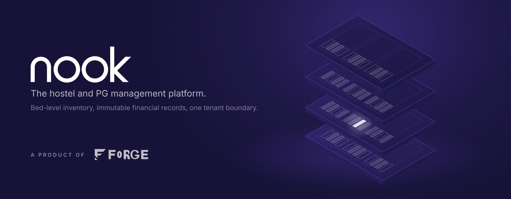

<div align="center">

<picture>
  <source srcset="docs/assets/readme-hero.svg" type="image/svg+xml">
  
</picture>

<br>


[](https://github.com/AtharvaVavhal/Nook-platform/actions/workflows/ci.yml)


</div>

---

> ### This is a pre-release build, not a launched product.
>
> `main` now holds the **Phase 2 authentication and inventory foundation**, the **Phase 3 core
> workflows** — residents, enquiries, bookings, admissions, check-in/check-out and a finance ledger —
> and **Phase 4** lifecycle audit, corrections and transfer previews, on a real PostgreSQL schema with
> tenant isolation, plus an owner and property-manager web application. The restricted Phase 4
> operations are **disabled by default in code**.
>
> **Nothing is deployed to production.** **Milestone 0 is not accepted** and the platform is **not
> launch-ready**. Launch readiness has not been independently verified; see
> [`NOOK_LAUNCH_ROADMAP.md`](NOOK_LAUNCH_ROADMAP.md) and
> [`NOOK_BLOCKER_REGISTER.md`](NOOK_BLOCKER_REGISTER.md).
>
> Nothing here records an approval, a signature or a test result that has not occurred.

<br>

## What Nook is for

A hostel and PG operator knows two things badly: **who is in which bed**, and **who owes what**. Nook
is being built to answer both without a spreadsheet — bed-level spatial inventory on an interactive
floor plan, and a financial record that can be audited rather than argued over.

Three commitments shape every decision in this codebase:

|                           |                                                                                                                                                                                                                           |
| ------------------------- | ------------------------------------------------------------------------------------------------------------------------------------------------------------------------------------------------------------------------- |
| **The bed is the unit**   | Availability, allocation and occupancy are computed per bed, never per room. Allocation is atomic and re-checked inside the transaction, so two staff cannot double-book the same bed.                                    |
| **Money is never edited** | Payments, reversals, adjustments and voids are append-only records, protected by database triggers and by the application role's privileges (no `DELETE` anywhere). Corrections are new records, not edits. Amounts are exact decimals (`NUMERIC`) — never binary floating point. |
| **No rule is guessed**    | Where a business rule or a restricted operation is unapproved, it stays disabled in code and the operation is refused. Transfer execution, assignment adoption and financial correction apply are off until the owner approves them. |

<br>

## Stack

| Layer           | Choice              | Version            |
| --------------- | ------------------- | ------------------ |
| Runtime         | Node.js             | `24.22.1`          |
| Package manager | npm                 | `11.6.2`           |
| API             | NestJS + TypeScript | `12.3.2` / `5.9.3` |
| Web             | React + Vite        | `19.3.1` / `8.3.5` |
| Database        | PostgreSQL          | `17`               |
| ORM             | Prisma              | `7.10.1`           |

One deployable modular monolith. Modules own their data and talk through service interfaces — core
workflows need atomic transactions across related records, and two developers with one customer need
transactions far more than they need independent deployability.

<br>

## Quick start

```bash
# 1 — toolchain
node --version        # must be 24.22.1
npm  --version        # must be 11.6.2

# 2 — locked dependencies
npm ci

# 3 — database (loopback only, port 5433), then apply migrations
docker compose up -d postgres
npx prisma migrate deploy

# 4 — two terminals
npm run dev:api       # http://localhost:3000
npm run dev:web       # http://localhost:5173
```

Health endpoints: `GET /api/v1/health` and `GET /api/v1/health/database`. The database check reports
a generic status and never returns connection details.

> **Port 5433 is deliberate.** `5432` may belong to an unrelated PostgreSQL on your machine. Never
> point this project at it. Check any connection URL with `python3 scripts/db_guard.py` before
> running a migration or a seed.

Validate the schema without a database connection:

```bash
DATABASE_URL='postgresql://nook:<password>@127.0.0.1:5433/nook_dev' npm run prisma:validate
```

<br>

## Scripts

| Command                               | What it does                                    |
| ------------------------------------- | ----------------------------------------------- |
| `npm run dev:api` / `dev:web`         | Start the API or web shell in watch mode        |
| `npm run build`                       | Production build, both workspaces               |
| `npm test`                            | Test suites, both workspaces                    |
| `npm run typecheck`                   | TypeScript across the workspace                 |
| `npm run lint` / `format:check`       | ESLint / Prettier                               |
| `npm run prisma:validate`             | Validate the schema, no connection needed       |
| `npm run test:integration -w @nook/api` | Database-backed API suites (needs an isolated DB) |
| `npm run job:invoices -w @nook/api`   | Run the monthly invoice scheduler (after build) |
| `npm run verify:migration`            | Verify the initial migration                    |
| `npm run verify:m0-scope`             | Static guardrail: assert Milestone 0 boundaries |
| `npm run verify:secrets`              | Baseline secret scan across the repository      |
| `npm run verify:scope` / `test:scope` | Phase scope verifier and its own tests          |

<br>

## What is built

| Area                      | State                                                                                                  |
| ------------------------- | ------------------------------------------------------------------------------------------------------ |
| Auth and account security | Login, sessions, CSRF, login throttling, change-password, auth audit events; `OWNER` and `PROPERTY_MANAGER` roles behind a default-deny permission layer |
| Inventory                 | Properties, floors, rooms and beds; interactive floor plan                                             |
| Residents                 | CRUD with tenant isolation; resident profile and stay summary                                          |
| Enquiries                 | Lead management, follow-ups, archive, conversion                                                       |
| Bookings                  | Reservations with bed availability and concurrency safety; extensions with a reason and an audit event |
| Admissions                | Bed allocation inside a re-checked transaction                                                         |
| Check-in / check-out      | Lifecycle management with concurrency safety                                                           |
| Finance                   | Invoices, payments with idempotency keys, reversals, adjustments, voids, receipts, monthly reports, overstay banner |
| Corrections (Phase 4)     | Request, review and audit workflow; non-financial corrections apply; **financial application is gated off** |
| Transfers (Phase 4)       | Preview and history only; **execution is disabled**                                                    |
| Web application           | Owner and property-manager shell: operations, finance, resident profile, settings                      |
| Operations tooling        | CLI for provisioning users and resetting passwords; restore-drill script and runbooks                  |
| Invoice scheduler         | Implemented and tested on a scratch database; **not deployed, scheduled or enabled**                   |
| Observability             | Structured logs and request ids; Sentry reporter implemented, off until configured; no event has ever been sent |

The schema has 33 models across 24 migrations. Out of scope until the owner approves it: payment
gateway, OTP, SMS/WhatsApp, KYC/Aadhaar and document upload, and any resident-facing login or portal.

<br>

## Layout

```
apps/api            NestJS API — auth, inventory, resident, enquiry, booking, admission, checkin,
                    finance, corrections, transfer, resident-history, stay-summary, jobs,
                    observability, database
apps/web            React + Vite — login, ops shell, finance shell, floor plan, design tokens
prisma/             schema.prisma and migrations
scripts/            CI scripts, QA and end-to-end harnesses, ops CLI, secret scan, scope verifiers,
                    db guard
docs/               milestone and phase validation, Phase 2/3/4 documents, ops runbooks, release
                    documents, UI readiness, handbook
marketing/          brand assets and campaign artwork
.github/workflows/  CI definition
```

<br>

## Guardrails

These exist because the cost of getting them wrong is paid by somebody's rent record.

**Schema changes are reviewed.** Domain entities and migrations are added only after the conceptual
model and the affected business rules have been reviewed and approved. Every table is tenant-scoped
with composite keys, and the integration suites assert cross-tenant isolation.

**Financial logic is gated.** Rent calculation, automated billing, payment allocation order, payment
confirmation policy, deposit deduction, refund and final checkout settlement are not applied beyond
what the owner has signed off. Phase 4 financial operations (financial correction apply, transfer
execution, assignment adoption) are disabled in code and stay off until the owner approves them.
Unapproved rules and their blockers are tracked in
[`NOOK_BLOCKER_REGISTER.md`](NOOK_BLOCKER_REGISTER.md) and the owner-decision documents under
[`docs/phase-4/`](docs/phase-4/).

**Secrets never enter the repository.** `.env` is never committed; `.env.example` holds local-only
placeholders; `VITE_*` values are public by definition and must never carry a secret. A committed
secret is revoked and rotated — deleting it in a later commit is not sufficient.

<br>

## Documentation

|                                                                                      |                                                                                                               |
| ------------------------------------------------------------------------------------ | ------------------------------------------------------------------------------------------------------------- |
| [`docs/nook-complete-project-handbook-v1/`](docs/nook-complete-project-handbook-v1/) | The complete product and engineering handbook — 121 pages, 25 chapters, plus 42 pages of technical appendices |
| [`docs/MILESTONE_0_SCOPE.md`](docs/MILESTONE_0_SCOPE.md)                             | What Milestone 0 includes and excludes                                                                        |
| [`docs/MILESTONE_0_VALIDATION.md`](docs/MILESTONE_0_VALIDATION.md)                   | Executed checks, exit codes, and the remaining acceptance blockers                                            |
| [`docs/nook-phase-3/`](docs/nook-phase-3/)                                           | Phase 3 scope register, check-in/check-out and finance plans, pilot account requirements                      |
| [`docs/phase-4/`](docs/phase-4/)                                                     | Phase 4 specifications, owner decisions required, and evidence                                                |
| [`docs/ops/`](docs/ops/)                                                             | Runbooks — invoice scheduler, backup and restore, web and API topology, observability                         |
| [`docs/release/`](docs/release/)                                                     | Pilot release readiness and backup/restore verification procedure                                             |
| [`docs/ui-readiness/`](docs/ui-readiness/)                                           | UI implementation and readiness record                                                                        |
| [`NOOK_LAUNCH_ROADMAP.md`](NOOK_LAUNCH_ROADMAP.md)                                   | Planning-only launch roadmap; nothing in it has been executed                                                 |
| [`NOOK_BLOCKER_REGISTER.md`](NOOK_BLOCKER_REGISTER.md)                               | Launch blockers (`BLK-nn`)                                                                                    |

<br>

## Brand

Nook is **wordmark-led**. The primary logo is the lowercase wordmark; the standalone symbol is the
lowercase `n` monogram, drawn from the identical vector path — not a redrawn lookalike. The
letterforms are closed vector paths and reference no font, so the product's eventual typeface is an
independent decision that cannot break the logo.

|     | Midnight Indigo | Nook Violet | Soft Lavender | Pure White | Primary Text |
| --- | --------------- | ----------- | ------------- | ---------- | ------------ |
|     | `#171338`       | `#7657F6`   | `#F4F1FF`     | `#FFFFFF`  | `#26233D`    |

Masters, the manifest they are checksummed against, and the full guidelines live in
[`docs/nook-complete-project-handbook-v1/`](docs/nook-complete-project-handbook-v1/) and
[`marketing/brand/`](marketing/brand/). Do not retype the wordmark in a font, recolour it outside the
palette, or add a gradient, shadow or outline to it.

> **The name is not cleared.** Trademark clearance and domain ownership are unverified, and public
> brand launch is blocked pending review of the Nook / Nooks conflict. Treat `nook` as a working
> product name.

<br>

## Status

**Phase 1 — accepted with documented limitations** (2026-10-28). The property view and floor plan
passed browser QA. It was a frontend-only demonstration driven by static fixtures.

**Phases 2 and 3 — merged** into `main` (pull request #1, 2026-11-07).

**Phase 4 — merged** into `main` (pull request #2, 2026-11-13): lifecycle audit, corrections,
transfer previews, a default-deny permission layer and the owner and property-manager web
application. Transfer execution, assignment adoption and financial correction apply remain
**disabled**. Hosted CI (`quality` and `full-integration`) passed on the merge commit.

**Milestone 0 — not accepted.** Approval is not verification, and the remaining evidence has not
been produced.

**Nothing is deployed to production.** Merging code is not a release.

Known gaps, as recorded in the roadmap, blocker register and release documents:

- Backup and restore readiness is not established; no production backup or restore drill has been performed
- Hosting topology is only partly decided and has not been verified on live infrastructure
- The invoice scheduler is not operational
- Browser end-to-end tests run locally, not in hosted CI
- General API rate limiting, and explicit CSP/HSTS headers, are unconfigured and unverified
- Safari, Firefox, real touch devices, screen readers and a measured contrast audit have not been done

The scope verifier is a local static guardrail. It is not a substitute for runtime, security or
financial tests. Current results always live in the validation documents, not here.

<br>

---

<div align="center">

<sub>A product of</sub>

<picture>
  <source media="(prefers-color-scheme: dark)" srcset="docs/assets/forge-lockup-dark.png">
  
</picture>

</div>
