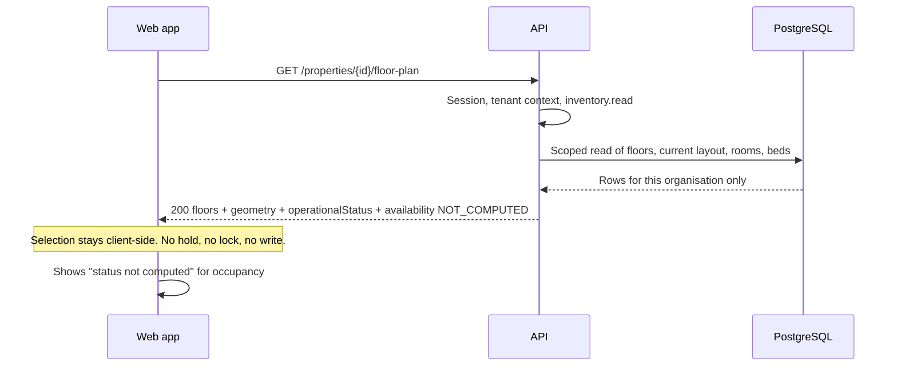

# Phase 2 — API Contract (Foundation Only)

**Status:** Proposed contract for review. **No endpoint exists beyond the two Milestone 0 health routes.** Nothing here is approved (`G-01`). Status codes and shapes are contract proposals, not code.
**Companions:** [Implementation plan](PHASE_2_IMPLEMENTATION_PLAN.md) · [Data model](PHASE_2_DATA_MODEL.md) · [Tenant isolation](PHASE_2_TENANT_ISOLATION.md) · [Security review](PHASE_2_SECURITY_REVIEW.md) · [Unresolved decisions](PHASE_2_UNRESOLVED_DECISIONS.md)

Identifiers `G-xx`, `U-xx`, `K-x` are defined in [the register](PHASE_2_UNRESOLVED_DECISIONS.md).

## Confirmed existing decisions

| Decision                                                                                                                                                                      | Source                                                                    |
| ----------------------------------------------------------------------------------------------------------------------------------------------------------------------------- | ------------------------------------------------------------------------- |
| The API is a versioned REST API under `/api/v1`. The current code already sets the global prefix `api/v1`, and serves `GET /api/v1/health` and `GET /api/v1/health/database`. | `apps/api/src/main.ts`, `health.controller.ts`; `04_API_SPECIFICATION.md` |
| Every protected endpoint needs authentication and server-side authorisation. The access column names a **permission identifier**, never a role.                               | `04_…` §1.1, `K-8`                                                        |
| Organisation context is derived from the session, never from a client-supplied identifier.                                                                                    | `04_…` §1, `K-5`                                                          |
| Errors use one envelope: `{ "error": { "code", "message", "requestId", "details" } }`. A foreign organisation's resource and a missing resource are indistinguishable.        | `04_…` §10                                                                |
| An operation whose rule is unresolved returns **`422 RULE_NOT_CONFIGURED`**, names the rule, writes nothing.                                                                  | `04_…` §1, §10; `K-7`                                                     |
| No resident personal data and no financial data in this phase. Money never appears.                                                                                           | Brief; `K-11`                                                             |
| Timestamps are ISO 8601 with an explicit offset; lists are paginated with bounded sizes and explicit sorting.                                                                 | `04_…` §1                                                                 |
| The existing server already uses `helmet`, a narrow CORS origin with credentials, and `abortOnError`. Health endpoints expose no secrets.                                     | `apps/api/src/main.ts`                                                    |

## Proposed architecture

### Conventions

| Topic               | Proposal                                                                                                                                                                                                                                              | Open item                  |
| ------------------- | ----------------------------------------------------------------------------------------------------------------------------------------------------------------------------------------------------------------------------------------------------- | -------------------------- |
| Base path           | `/api/v1`. Breaking changes require `/api/v2`; additive fields do not.                                                                                                                                                                                | Versioning policy (`U-19`) |
| Authentication      | Opaque session cookie (`HttpOnly`, `Secure` when deployed, `SameSite` per `U-02`). Mechanism pending `U-01`.                                                                                                                                          | `U-01`, `U-02`             |
| CSRF                | Every state-changing request (`POST`, `PATCH`, `PUT`, `DELETE`) must carry a CSRF token header, and the `Origin` must match the allowed web origin. Requests without it are `403 CSRF_REJECTED`. Cookie-based sessions need this; it is not optional. | Token mechanism (`U-02`)   |
| Content type        | `application/json; charset=utf-8` only. Other types ⇒ `415`.                                                                                                                                                                                          | —                          |
| IDs                 | UUID strings. Never a security control (see [isolation](PHASE_2_TENANT_ISOLATION.md)).                                                                                                                                                                | `U-16`                     |
| Request correlation | Server generates `requestId` per request, returns `X-Request-Id`, includes it in every error body and audit row.                                                                                                                                      | —                          |
| Unknown fields      | Write DTOs **reject** unknown fields with `400 VALIDATION_FAILED`, so `organizationId`, `id` or `status` cannot be smuggled in.                                                                                                                       | —                          |
| Concurrency         | Resources return `rowVersion`. `PATCH` sends the version it read in the body or `If-Match`; mismatch ⇒ `409 CONFLICT`.                                                                                                                                | —                          |
| Pagination          | Cursor-based: `?limit=` (default **50**, max **100**) and an opaque `?cursor=`. Response carries `page.nextCursor` (null at the end). Cursors are **bound to the organisation and sort order**; a replayed or tampered cursor ⇒ `400 INVALID_CURSOR`. | Defaults are `U-19`        |
| Sorting             | Explicit and stable: floors by `ordinal`, rooms and beds by `label`, audit events by `occurredAt` descending then `id`. No client-chosen arbitrary sort in Phase 2.                                                                                   | —                          |
| Dates and times     | ISO 8601 UTC with `Z` (for example `2026-10-28T18:30:00Z`).                                                                                                                                                                                           | —                          |
| Money               | **Not present.** If a financial field ever appears it must follow `amountMinor` (ADR-008). Phase 2 has none.                                                                                                                                          | —                          |
| Rate limiting       | Applied to login, recovery, audit search and write routes. Numbers are not chosen here.                                                                                                                                                               | `U-06`, `U-19`             |
| Response envelope   | Single resource `{ "data": {...} }`. List `{ "data": [...], "page": { "limit", "nextCursor" } }`. Errors as below.                                                                                                                                    | —                          |

### Error envelope and codes

```json
{
  "error": {
    "code": "VALIDATION_FAILED",
    "message": "The request could not be accepted.",
    "requestId": "01J…",
    "details": [{ "field": "label", "code": "MUST_NOT_BE_EMPTY" }]
  }
}
```

| HTTP | `code`                                        | When                                                                                                                           |
| ---- | --------------------------------------------- | ------------------------------------------------------------------------------------------------------------------------------ |
| 400  | `VALIDATION_FAILED`, `INVALID_CURSOR`         | Malformed input, unknown field, bad enum, out-of-range value                                                                   |
| 401  | `UNAUTHENTICATED`                             | No valid session                                                                                                               |
| 403  | `FORBIDDEN`, `CSRF_REJECTED`                  | Authenticated within the organisation but missing the permission; or missing or wrong CSRF token                               |
| 404  | `NOT_FOUND`                                   | Missing **or** in another organisation **or** an organisation the actor is not a member of. Identical body in all three cases. |
| 409  | `CONFLICT`, `DUPLICATE_LABEL`                 | Stale `rowVersion`; label already in use in its scope (`U-14`)                                                                 |
| 415  | `UNSUPPORTED_MEDIA_TYPE`                      | Not JSON                                                                                                                       |
| 422  | `UNPROCESSABLE_ENTITY`, `RULE_NOT_CONFIGURED` | Valid syntax but a business-state problem; or the governing rule is unresolved (names the rule IDs, writes nothing)            |
| 429  | `TOO_MANY_REQUESTS`                           | Rate limit                                                                                                                     |
| 500  | `INTERNAL_ERROR`                              | Generic public message with `requestId`; no internals                                                                          |
| 503  | `SERVICE_UNAVAILABLE`                         | A dependency is down                                                                                                           |

No stack traces, SQL, secrets, tokens or another organisation's details appear in any error.

### Endpoints

Legend: **Access** is a permission identifier from `05_SECURITY_ARCHITECTURE.md` §4.1. **Pkg** marks whether the route is in the requirements package (`04_API_SPECIFICATION.md`) or is an **addition** proposed here. **Slice** is the [implementation slice](PHASE_2_IMPLEMENTATION_PLAN.md#slices).

#### Authentication and organisation context

| Method and path                                              | Purpose                                                  | Access                             | Pkg | Slice        | Notes                                                                                                                                                                  |
| ------------------------------------------------------------ | -------------------------------------------------------- | ---------------------------------- | --- | ------------ | ---------------------------------------------------------------------------------------------------------------------------------------------------------------------- |
| `POST /api/v1/auth/login`                                    | Authenticate a staff user and start a session            | Public, rate-limited               | Yes | 2.3          | Enumeration-safe: one generic failure for unknown user, wrong password, disabled user. Sets cookie, rotates session.                                                   |
| `POST /api/v1/auth/logout`                                   | End and revoke the session                               | Authenticated                      | Yes | 2.3          | Revokes the server-side row, not only the cookie.                                                                                                                      |
| `GET /api/v1/auth/me`                                        | Current user, active organisation, effective permissions | Authenticated                      | Yes | 2.3          | Only the caller's own memberships. No other users, no other organisations.                                                                                             |
| `POST /api/v1/auth/recovery`                                 | Begin account recovery                                   | Public, rate-limited               | Yes | 2.3          | **Blocked** until `BR-SEC-006` (`U-04`). Returns `422 RULE_NOT_CONFIGURED` naming `BR-SEC-006`. Never uses security questions.                                         |
| `GET /api/v1/organisations/current`                          | Active organisation context                              | Authenticated member               | Yes | 2.3          | Context comes from the session, not the request.                                                                                                                       |
| `POST /api/v1/organisations/{organizationId}/switch`         | Change active organisation                               | Authenticated member of the target | Yes | 2.3          | The path ID is an **input to a membership check**. No membership ⇒ `404`. Rotates the session. Audited.                                                                |
| `GET /api/v1/organisations/current/members`                  | List staff memberships                                   | `member.manage`                    | Yes | 2.3          | Paginated.                                                                                                                                                             |
| `PATCH /api/v1/organisations/current/members/{membershipId}` | Change a member's role or status                         | `member.manage`                    | Yes | 2.3          | Sensitive. Audited. Revokes affected sessions in the same transaction. A caller cannot grant a permission they do not hold. Role values come from the fixed enum only. |
| `POST /api/v1/organisations/current/members`                 | Invite or enable a member                                | `member.manage`                    | Yes | **Deferred** | Not routed in Phase 2. P0 provisioning is controlled and manual (`U-09`); the invitation flow is staged later. Calling it returns `404`.                               |

There is **no** public organisation creation, no sign-up and no password-reset-by-email in Phase 2 (ADR-005).

#### Properties, floors, rooms and beds

| Method and path                                                            | Purpose                                   | Access            | Pkg      | Slice | Behaviour                                                                                                              |
| -------------------------------------------------------------------------- | ----------------------------------------- | ----------------- | -------- | ----- | ---------------------------------------------------------------------------------------------------------------------- |
| `GET /api/v1/properties`                                                   | List properties of the organisation       | `inventory.read`  | Yes      | 2.4   | Paginated. Property-scoped roles see only granted properties.                                                          |
| `POST /api/v1/properties`                                                  | Create a property                         | `property.manage` | Yes      | 2.4   | Validates fields (`U-25`). Audited.                                                                                    |
| `GET /api/v1/properties/{propertyId}`                                      | Read a property                           | `inventory.read`  | Yes      | 2.4   | Ownership verified in the scoped repository.                                                                           |
| `PATCH /api/v1/properties/{propertyId}`                                    | Update a property                         | `property.manage` | Yes      | 2.4   | `rowVersion` required. Audited.                                                                                        |
| `POST /api/v1/properties/{propertyId}/archive`                             | Archive a property                        | `property.manage` | Addition | 2.4   | Soft archive (`U-15`). There is no hard delete. Refused if a dependent (future) active record exists.                  |
| `GET /api/v1/properties/{propertyId}/floors`                               | List floors, ordered by `ordinal`         | `inventory.read`  | Addition | 2.4   | Paginated.                                                                                                             |
| `POST /api/v1/properties/{propertyId}/floors`                              | Create a floor                            | `inventory.write` | Addition | 2.4   | Unique `ordinal` and `label` within the property among non-archived floors.                                            |
| `PATCH /api/v1/floors/{floorId}`                                           | Update a floor                            | `inventory.write` | Addition | 2.4   | `rowVersion` required.                                                                                                 |
| `GET /api/v1/properties/{propertyId}/rooms`                                | List rooms                                | `inventory.read`  | Yes      | 2.4   | Filter `?floorId=`, `?q=` (label prefix). Paginated.                                                                   |
| `POST /api/v1/properties/{propertyId}/rooms`                               | Create a room                             | `inventory.write` | Yes      | 2.4   | Body names `floorId`; the floor must belong to this property and organisation, else `404`.                             |
| `PATCH /api/v1/rooms/{roomId}`                                             | Update a room                             | `inventory.write` | Yes      | 2.4   | Rejects changes that would invalidate active dependencies (none exist yet).                                            |
| `GET /api/v1/rooms/{roomId}/beds`                                          | List beds with operational status         | `inventory.read`  | Yes      | 2.4   | Returns `operationalStatus`. **Availability is not computed** (see below).                                             |
| `POST /api/v1/rooms/{roomId}/beds`                                         | Create a bed                              | `inventory.write` | Yes      | 2.4   | Rejects a duplicate label within the room (`U-14`).                                                                    |
| `PATCH /api/v1/beds/{bedId}`                                               | Update bed metadata or operational status | `inventory.write` | Yes      | 2.4   | Setting `OUT_OF_SERVICE` requires a reason. Audited. Cannot conflict with an active allocation once allocations exist. |
| `POST /api/v1/rooms/{roomId}/archive`, `POST /api/v1/beds/{bedId}/archive` | Archive a room or bed                     | `inventory.write` | Addition | 2.4   | Soft archive (`U-15`).                                                                                                 |
| `GET /api/v1/properties/{propertyId}/inventory-summary`                    | Counts for the property                   | `inventory.read`  | Addition | 2.4   | Floors, rooms, beds, `inServiceBeds`, `outOfServiceBeds`. **No** `available` or `occupied` counts.                     |
| `GET /api/v1/properties/{propertyId}/floor-plan`                           | Floor-plan inventory with geometry        | `inventory.read`  | Addition | 2.5   | See [the floor-plan resource](#floor-plan-resource). Read-only. **Gated by `G-04`.**                                   |

**Not in the Phase 2 contract, deliberately:** `GET /beds/availability` and everything about residents, stays, assignments, rental terms, charges, payments, allocations, deposits, settlement, documents, imports and exports. The availability endpoint exists in the package but requires state semantics that `BR-LIF-003` and `BR-LIF-004` have not settled; routes for the rest belong to later phases and, for money and documents, are blocked by unresolved rules.

#### Audit

| Method and path            | Purpose                         | Access       | Pkg | Slice | Notes                                                                                                           |
| -------------------------- | ------------------------------- | ------------ | --- | ----- | --------------------------------------------------------------------------------------------------------------- |
| `GET /api/v1/audit-events` | Search the organisation's audit | `audit.read` | Yes | 2.3   | Filter by `action`, `targetType`, actor, time range. Paginated. Payload is the whitelisted, minimised metadata. |

### Floor-plan resource

The floor-plan response mirrors the Phase 1 model so existing components can consume it. See the field-by-field mapping in [the data model](PHASE_2_DATA_MODEL.md#phase-1-demofloors--backend-contract).

```http
GET /api/v1/properties/6b1f…/floor-plan?floorId=2c9a…
```

```json
{
  "data": {
    "property": { "id": "6b1f…", "name": "Synthetic House A" },
    "coordinateSpace": {
      "unit": "schematic",
      "origin": "top-left",
      "xAxis": "right",
      "yAxis": "down"
    },
    "floors": [
      {
        "id": "2c9a…",
        "label": "First floor",
        "ordinal": 1,
        "elevation": 340,
        "layout": {
          "version": 1,
          "publishedAt": "2026-10-28T18:30:00Z",
          "width": 1000,
          "height": 540
        },
        "zones": [
          {
            "id": "…",
            "kind": "CORRIDOR",
            "label": "Shared corridor",
            "bounds": { "x": 20, "y": 340, "width": 940, "height": 80 }
          }
        ],
        "rooms": [
          {
            "id": "a41d…",
            "label": "101",
            "bounds": { "x": 20, "y": 20, "width": 300, "height": 320 },
            "beds": [
              {
                "id": "f07e…",
                "label": "A",
                "bounds": { "x": 28, "y": 94, "width": 80, "height": 90 },
                "operationalStatus": "IN_SERVICE",
                "outOfServiceReason": null
              }
            ]
          }
        ]
      }
    ],
    "availability": {
      "state": "NOT_COMPUTED",
      "reasonCode": "ALLOCATION_MODULE_NOT_IMPLEMENTED",
      "note": "No allocation records exist. Displayed availability must not be inferred from this response."
    },
    "generatedAt": "2026-10-28T18:30:05Z"
  }
}
```

Rules:

- **Same contract for 2D and future 3D.** `elevation` and `ordinal` are present for both. A 3D view adds room height later; it reads the same records.
- **Room bounds are floor-local; bed bounds are room-local**, exactly as in Phase 1.
- `floorId` is optional. Without it all of the property's floors are returned (bounded by validation limits, `U-19`). A floor from another property or organisation ⇒ `404`.
- `operationalStatus` is `IN_SERVICE` or `OUT_OF_SERVICE`. **The response never says a bed is "available" or "occupied"**, because no confirmed allocation exists to derive that from (`U-13`). The `availability` block says so in machine-readable form, so a client cannot mistake silence for availability.
- A client that shows a bed as "selected" is showing **local intent only**. The API has no endpoint that reserves, holds or allocates a bed, and none is proposed in this phase.
- `ETag` is returned; `If-None-Match` supports conditional requests. The payload carries **no resident data, no names, no contact details, no financial fields**.



### Request and response examples

Create a room:

```http
POST /api/v1/properties/6b1f…/rooms
Content-Type: application/json
X-CSRF-Token: …

{ "floorId": "2c9a…", "label": "101" }
```

```json
{
  "data": {
    "id": "a41d…",
    "propertyId": "6b1f…",
    "floorId": "2c9a…",
    "label": "101",
    "archivedAt": null,
    "rowVersion": 1,
    "createdAt": "2026-10-28T18:31:00Z"
  }
}
```

There is no `organizationId` in the request **or** the response. The organisation is implied by the session; exposing it invites clients to send it back.

A smuggled field:

```http
POST /api/v1/properties/6b1f…/rooms
{ "floorId": "2c9a…", "label": "101", "organizationId": "<another tenant>" }
```

```json
{
  "error": {
    "code": "VALIDATION_FAILED",
    "message": "The request could not be accepted.",
    "requestId": "01J…",
    "details": [{ "field": "organizationId", "code": "UNKNOWN_FIELD" }]
  }
}
```

An unresolved rule:

```json
{
  "error": {
    "code": "RULE_NOT_CONFIGURED",
    "message": "This operation depends on a business rule that has not been approved.",
    "requestId": "01J…",
    "details": [{ "rule": "BR-SEC-006" }]
  }
}
```

### Validation rules (proposed)

| Field                               | Rule                                                                                                                                                      |
| ----------------------------------- | --------------------------------------------------------------------------------------------------------------------------------------------------------- |
| `label` (floor, room, bed)          | Trimmed, 1–32 characters, no control characters. Uniqueness scope per `U-14`.                                                                             |
| `ordinal`                           | Integer, range-limited, unique per property among non-archived floors.                                                                                    |
| `operationalStatus`                 | Enum `IN_SERVICE` / `OUT_OF_SERVICE`. `OUT_OF_SERVICE` requires `outOfServiceReason` (1–200 chars). `IN_SERVICE` requires it to be absent.                |
| Geometry (seed or future authoring) | Integers ≥ 0 for the origin, > 0 for width and height; bed inside room, room inside floor; no overlaps; unique IDs. Mirrors Phase 1 `isFloorLayoutValid`. |
| IDs in paths                        | Must parse as UUID, else `400` (and, for ownership, `404` if not found in the organisation).                                                              |
| `limit`, `cursor`                   | Integer within bounds; cursor opaque and organisation-bound.                                                                                              |
| Free text                           | Length-bounded; stored and returned as text; never rendered as HTML by the server.                                                                        |

### Authorisation summary for Phase 2 routes

The role→permission mapping is **not defined here**. It is the owner's decision (`U-07`, `BR-SEC-001…003`). The package's proposed baseline for the permissions Phase 2 uses is reproduced for reference only:

| Permission        | Owner / Partner | Property Manager                    | Finance Clerk / Cashier        | Warden / Front Desk |
| ----------------- | --------------- | ----------------------------------- | ------------------------------ | ------------------- |
| `inventory.read`  | Yes             | Yes                                 | Read only if needed            | Scoped              |
| `inventory.write` | Yes             | Yes                                 | No                             | Scoped              |
| `property.manage` | Yes             | Yes                                 | No                             | No                  |
| `member.manage`   | Yes             | No (owner grant may permit limited) | No                             | No                  |
| `audit.read`      | Yes             | Scoped                              | Finance events only if granted | No                  |
| `settings.manage` | Yes             | No                                  | No                             | No                  |

Until the owner signs this off, implementation proceeds **deny-by-default** and the permission matrix test (`XT-35`) asserts only that nothing is granted that is not explicitly listed in an approved table.

## Unresolved decisions

`G-01` · `G-03` · `G-04` · `U-01` session mechanism · `U-02` CSRF and cookie parameters · `U-04` recovery · `U-06` rate limits · `U-07` roles · `U-12` layout scope · `U-13` bed status · `U-14` labels · `U-15` archival · `U-16` ID format · `U-19` pagination and versioning · `U-24` UI wiring. See [the register](PHASE_2_UNRESOLVED_DECISIONS.md).

## Validation still required

| #   | Claim                                                                                                | Evidence                                                                     |
| --- | ---------------------------------------------------------------------------------------------------- | ---------------------------------------------------------------------------- |
| A-1 | Every route in this table is registered and nothing else is (no route is exposed that is not listed) | Router enumeration test (`XT-27`) compared against this contract             |
| A-2 | The error envelope is identical across `NOT_FOUND` causes                                            | `XT-04`                                                                      |
| A-3 | CSRF rejection works for every state-changing route, including with a valid session cookie           | Contract test per route                                                      |
| A-4 | Pagination cursors are organisation-bound and tamper-evident                                         | `XT-10`                                                                      |
| A-5 | The floor-plan JSON drives the existing Phase 1 components unchanged                                 | Contract test; browser check if slice 2.6 is approved (**not run**)          |
| A-6 | An OpenAPI document generated from reviewed DTOs matches this contract                               | After approval; the package says not to let framework defaults define policy |
| A-7 | Validation limits (label length, ordinal range, `limit` bounds) are suitable for a real property     | Review against the surveyed pilot inventory (**not surveyed**, `BR-003`)     |

## Revision history

| Version | Date       | Change                                                                                   |
| ------- | ---------- | ---------------------------------------------------------------------------------------- |
| 0.1     | 2026-10-28 | Initial contract proposal. Adds floors, floor-plan and inventory-summary to the package. |
