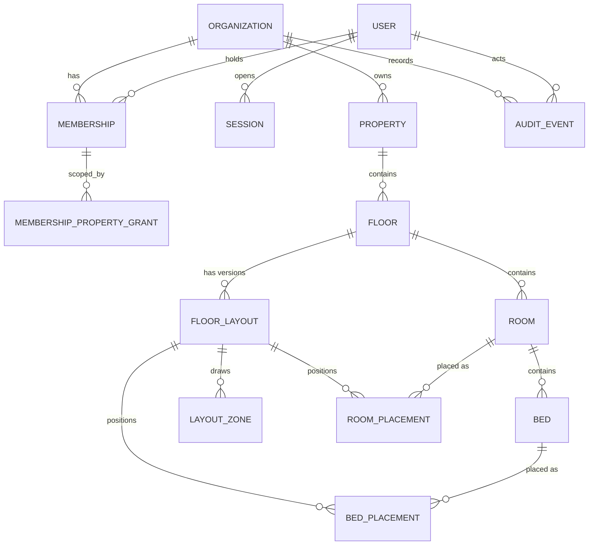
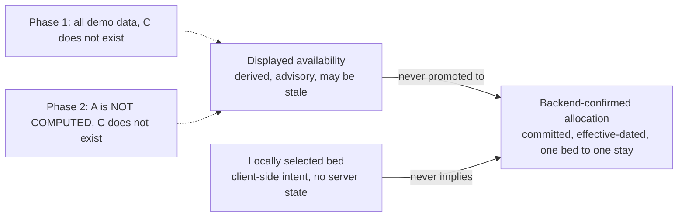

# Phase 2 — Data Model and Floor-Plan Contract

**Status:** Proposed design for review. **No schema has been written, no migration created and no database touched.** `prisma/schema.prisma` still contains no models.
**Companions:** [Implementation plan](PHASE_2_IMPLEMENTATION_PLAN.md) · [Tenant isolation](PHASE_2_TENANT_ISOLATION.md) · [API contract](PHASE_2_API_CONTRACT.md) · [Security review](PHASE_2_SECURITY_REVIEW.md) · [Unresolved decisions](PHASE_2_UNRESOLVED_DECISIONS.md)

Gate (`G-xx`), decision (`U-xx`) and confirmed-fact (`K-x`) identifiers are defined in [the register](PHASE_2_UNRESOLVED_DECISIONS.md). `ADR-*`, `BR-*` and permission identifiers come from the requirements package `NIVASA_PACKAGE_v0.2`.

## Confirmed existing decisions

| Fact                                                                                                                                                                                                                                     | Source                                           |
| ---------------------------------------------------------------------------------------------------------------------------------------------------------------------------------------------------------------------------------------- | ------------------------------------------------ |
| PostgreSQL is the source of truth. It is **approved in principle** by project review; Prisma and tool versions are only proposed.                                                                                                        | ADR-003 (register status column)                 |
| The installed tool is Prisma **7.10.1**. `prisma.config.ts` supplies `DATABASE_URL`; the schema's datasource block has no URL. The schema has a `prisma-client-js` generator and **no models**. No `prisma/migrations` directory exists. | repository, `K-4`                                |
| Organisation-owned data carries an ownership path to `organization_id`. Code and database use the spelling `organization_id` / `organizationId`; prose uses "organisation".                                                              | ADR-007; package `README.md` spelling convention |
| The package's conceptual model is `Organisation ──< Membership >── User` and `Organisation ──< Property ──< Room ──< Bed`. It has **no `Floor` entity and no geometry**.                                                                 | `03_DOMAIN_AND_DATA_MODEL.md` §2                 |
| Resident identity, stays, assignments, charges, payments and deposits are separate entities, **not part of Phase 2**.                                                                                                                    | `03_…` §3; brief for this task                   |
| Bed assignment conflicts must eventually be prevented **in the database**, but the constraint is not to be chosen until `BR-LIF-004`, `BR-LIF-006` and `BR-003` are answered.                                                            | `03_…` §6                                        |
| Money is integer paise. Nothing in Phase 2 stores money.                                                                                                                                                                                 | ADR-008, `K-6`                                   |

## Proposed architecture

### Scope of the Phase 2 schema

Fourteen tables in three groups. Everything below is **PROPOSED**; nothing is approved (`G-01`, `G-03`).

| Group                       | Tables                                                                                            | Needs approval of                                                    | Slice |
| --------------------------- | ------------------------------------------------------------------------------------------------- | -------------------------------------------------------------------- | ----- |
| Identity, tenancy and audit | `organizations`, `users`, `memberships`, `membership_property_grants`, `sessions`, `audit_events` | `G-01`, `G-03`, `U-01`…`U-10`, `U-18`                                | 2.2   |
| Inventory structure         | `properties`, `floors`, `rooms`, `beds`                                                           | `G-03`, `G-06` (`BR-LIF-*`, `BR-003`), `U-11`, `U-13`…`U-16`, `U-25` | 2.4   |
| Spatial layout (read-only)  | `floor_layouts`, `layout_zones`, `room_placements`, `bed_placements`                              | **`G-04`**, `U-12`, `U-17`                                           | 2.5   |

Deliberately **not** in the schema: residents, stays, assignments, bookings or holds, charges, payments, allocations, deposits, documents, imports, idempotency keys, subscriptions, platform-operator accounts. Each belongs to a later phase and several wait on unresolved business rules (see `14_UNRESOLVED_ITEM_BLOCKER_CLASSIFICATION.md` §A).

### Entity relationships



`User` is **global**, not organisation-owned, because one person may belong to several organisations. Access is granted only through `Membership`. Every other table except `AUDIT_EVENT` (see below) is organisation-owned and carries `organization_id` directly.

### Tenant ownership rules

| Rule                                                                                                           | How it is enforced                                                                                                                                                                                          |
| -------------------------------------------------------------------------------------------------------------- | ----------------------------------------------------------------------------------------------------------------------------------------------------------------------------------------------------------- |
| Every organisation-owned row has a **physical** `organization_id` column, never resolved through a join chain. | Schema review plus a CI script that parses the schema and fails if an organisation-owned model lacks it. The allow-list is `Organization`, `User` and `Session` (documented below).                         |
| A child row cannot reference a parent in another organisation, even if both IDs exist.                         | **Composite foreign keys** that include `organization_id` (pattern below). Violations are rejected by PostgreSQL, not by application code.                                                                  |
| Rows in the same property cannot reference rooms or floors of another property.                                | The same composite FKs also carry `property_id`.                                                                                                                                                            |
| `Session.activeOrganizationId` must be an organisation the session's user actually belongs to.                 | Composite FK `(user_id, active_organization_id)` → `memberships(user_id, organization_id)`. A null value is permitted for the moment before an organisation is chosen. Revocation is still checked in code. |
| Uniqueness is per organisation, not global, for business labels.                                               | Unique indexes lead with the scope column (for example `(organization_id, code)`).                                                                                                                          |

**Why `User` and `Session` are not organisation-owned.** A user row is an identity; a session row is bound to a user, with the active organisation as a validated attribute. Neither gives access by itself. All data access goes through the membership check described in [the isolation document](PHASE_2_TENANT_ISOLATION.md).

### Composite foreign-key pattern

A parent exposes a unique key that includes its scope; the child references **that** key, so scope columns must match.

```prisma
// ILLUSTRATIVE ONLY. Not applied. Syntax and overlapping-column behaviour must be VALIDATEd
// against Prisma 7.10.1 and a real PostgreSQL instance before approval.

model Property {
  id             String   @id @default(dbgenerated("gen_random_uuid()")) @db.Uuid
  organizationId String   @map("organization_id") @db.Uuid
  code           String
  name           String
  archivedAt     DateTime? @map("archived_at") @db.Timestamptz(6)
  organization   Organization @relation(fields: [organizationId], references: [id], onDelete: Restrict)
  floors         Floor[]

  @@unique([id, organizationId])
  @@map("properties")
}

model Floor {
  id             String   @id @default(dbgenerated("gen_random_uuid()")) @db.Uuid
  organizationId String   @map("organization_id") @db.Uuid
  propertyId     String   @map("property_id") @db.Uuid
  label          String
  ordinal        Int
  property       Property @relation(fields: [propertyId, organizationId], references: [id, organizationId], onDelete: Restrict)
  rooms          Room[]

  @@unique([id, propertyId, organizationId])
  @@map("floors")
}

model Room {
  id             String   @id @default(dbgenerated("gen_random_uuid()")) @db.Uuid
  organizationId String   @map("organization_id") @db.Uuid
  propertyId     String   @map("property_id") @db.Uuid
  floorId        String   @map("floor_id") @db.Uuid
  label          String
  floor          Floor    @relation(fields: [floorId, propertyId, organizationId], references: [id, propertyId, organizationId], onDelete: Restrict)
  beds           Bed[]

  @@unique([id, propertyId, organizationId])
  @@map("rooms")
}
```

`Bed` references `Room` with `(room_id, property_id, organization_id)` in the same way. The result: a bed's organisation, property and room are mutually consistent by construction, and a cross-tenant insert fails at the database. `onDelete: Restrict` everywhere, so history cannot be orphaned (`U-15`).

### Entities

Field lists are conceptual. Types follow the package conventions: UTC `timestamptz`, UUID keys (`U-16`), snake_case columns via `@map`.

#### Identity, membership and sessions (slice 2.2)

| Table                        | Purpose and key fields                                                                                                                                                                      | Notes                                                                                                                                                                       |
| ---------------------------- | ------------------------------------------------------------------------------------------------------------------------------------------------------------------------------------------- | --------------------------------------------------------------------------------------------------------------------------------------------------------------------------- |
| `organizations`              | `id`, `name`, `status` (`ACTIVE` / `DISABLED`, `U-10`), timestamps.                                                                                                                         | Top-level tenant. No commercial or billing fields.                                                                                                                          |
| `users`                      | `id`, `login_identifier` (normalised, globally unique, `U-04`), `password_hash`, `display_name`, `status`, `last_login_at`, timestamps.                                                     | Global. Holds staff, not residents. Only a hash of the password is stored; algorithm per `U-03`.                                                                            |
| `memberships`                | `id`, `organization_id`, `user_id`, `role` (fixed enum, `U-07`), `status` (`ACTIVE` / `REVOKED`), `created_at`, `revoked_at`.                                                               | `UNIQUE (organization_id, user_id)` and `UNIQUE (user_id, organization_id)`. `INVITED` is deferred with the invitation flow.                                                |
| `membership_property_grants` | `membership_id`, `property_id`, `organization_id`.                                                                                                                                          | Only for the package's **Scoped** access rows. Composite FKs to the membership and the property, both in the same organisation. Whether this table exists at all is `U-07`. |
| `sessions`                   | `id`, `token_hash` (unique), `user_id`, `active_organization_id`, `created_at`, `last_seen_at`, `idle_expires_at`, `absolute_expires_at`, `revoked_at`, `revoked_reason`.                   | The cookie carries an opaque random token; **only its hash is stored** (ADR-004, `U-01`). Expiry values come from configuration with no default (`U-02`).                   |
| `audit_events`               | `id`, `organization_id` (nullable), `actor_user_id` (nullable), `action`, `target_type`, `target_id`, `request_id`, `occurred_at`, `reason_code`, `metadata` (JSONB, whitelist per action). | See [audit events](#audit-events). `organization_id` is null only for events that happen before an organisation is known, such as a failed login.                           |

**Roles.** `OWNER`, `PROPERTY_MANAGER`, `FINANCE_CLERK`, `FRONT_DESK` follow the package's role columns. The role→permission mapping lives in a **table-driven constant in code**, never as role-name checks (`K-8`). The mapping is the owner's decision (`U-07`, `BR-SEC-002/003`); this plan does not write it.

#### Inventory structure (slice 2.4)

| Table        | Key fields                                                                                                                              | Constraints (proposed)                                                                                                                                                                                                                                 |
| ------------ | --------------------------------------------------------------------------------------------------------------------------------------- | ------------------------------------------------------------------------------------------------------------------------------------------------------------------------------------------------------------------------------------------------------ |
| `properties` | `id`, `organization_id`, `code`, `name`, `address_text`, `city`, `timezone`, `status`, `archived_at`, `row_version`                     | `UNIQUE (id, organization_id)`. Partial unique `(organization_id, code) WHERE archived_at IS NULL`. Field set is `U-25`.                                                                                                                               |
| `floors`     | `id`, `organization_id`, `property_id`, `label`, `ordinal`, `elevation` (nullable), `archived_at`, `row_version`                        | `UNIQUE (id, property_id, organization_id)`. Partial unique `(property_id, ordinal)` and `(property_id, label)` among non-archived. `ordinal` is the authoritative ordering; `elevation` is schematic metadata for future 3D (`U-17`).                 |
| `rooms`      | `id`, `organization_id`, `property_id`, `floor_id`, `label`, `archived_at`, `row_version`                                               | `UNIQUE (id, property_id, organization_id)`. Partial unique `(property_id, label)` among non-archived (`U-14`). FK `(floor_id, property_id, organization_id)` → `floors`.                                                                              |
| `beds`       | `id`, `organization_id`, `property_id`, `room_id`, `label`, `operational_status`, `out_of_service_reason`, `archived_at`, `row_version` | Partial unique `(room_id, label)` among non-archived. FK `(room_id, property_id, organization_id)` → `rooms`. `CHECK` that a reason is present exactly when `operational_status = 'OUT_OF_SERVICE'`. **No stored availability or occupancy** (`U-13`). |

`row_version` is an integer incremented on every update. `PATCH` requests send the version they read; a mismatch returns `409 CONFLICT`. This gives optimistic concurrency without locks for administrative edits.

#### Spatial layout, read-only (slice 2.5, **gated by `G-04`**)

Identity and geometry are separate, as the handbook proposes: moving where a bed is drawn must never change which bed it is. In Phase 2 a layout version is **seeded and read-only**; authoring and publish endpoints stay unbuilt until the owner decides `G-04` and `U-12`.

| Table             | Key fields                                                                                                          | Notes                                                                                                                                               |
| ----------------- | ------------------------------------------------------------------------------------------------------------------- | --------------------------------------------------------------------------------------------------------------------------------------------------- |
| `floor_layouts`   | `id`, `organization_id`, `property_id`, `floor_id`, `version`, `width`, `height`, `published_at`, `superseded_at`   | `UNIQUE (floor_id, version)`. Partial unique index permitting one **current** (`superseded_at IS NULL`) layout per floor. Composite FK to `floors`. |
| `layout_zones`    | `id`, `organization_id`, `layout_id`, `kind` (`CORRIDOR`, `STAIRS`, `COMMON`), `label`, `x`, `y`, `width`, `height` | Non-room areas such as the shared corridor in Phase 1.                                                                                              |
| `room_placements` | `layout_id`, `room_id`, `floor_id`, `organization_id`, `x`, `y`, `width`, `height`                                  | Floor-local coordinates. FK ensures the room is on the **same floor** as the layout.                                                                |
| `bed_placements`  | `layout_id`, `bed_id`, `room_id`, `organization_id`, `x`, `y`, `width`, `height`                                    | **Room-local** coordinates, as Phase 1 uses. FK ensures the bed belongs to the placed room.                                                         |

All coordinates are **non-negative integers in schematic units**, not surveyed metres (`U-17`). `CHECK` constraints enforce positive width and height and non-negative origin. Containment (bed inside room outline, room inside floor, no overlaps) spans rows, so it is validated by the layout service in the seeding or publish transaction and re-verified by a SQL test query. This mirrors the Phase 1 function `isFloorLayoutValid` (see the mapping below).

### Audit events

**PROPOSED** (`U-18`). Append-only: the application's database role gets `INSERT` and `SELECT` on `audit_events` and **no** `UPDATE` or `DELETE`, backed by a trigger that rejects both. This is "append-only to ordinary application roles", the package's wording; it is **not** tamper-proof against a database owner.

Events to emit in Phase 2:

| Category             | Events                                                                                                       |
| -------------------- | ------------------------------------------------------------------------------------------------------------ |
| Authentication       | `auth.login.succeeded`, `auth.login.failed`, `auth.logout`, `auth.session.revoked`                           |
| Organisation context | `org.context.switched`, `org.context.switch_denied`                                                          |
| Membership           | `membership.created`, `membership.role_changed`, `membership.revoked`, `member.manage` denials               |
| Inventory            | `property.created/updated/archived`, `floor.*`, `room.*`, `bed.*` including `bed.operational_status_changed` |
| Provisioning         | `org.provisioned` (the controlled bootstrap, `U-09`)                                                         |

`metadata` stores only whitelisted, minimised fields per action: IDs and changed field names, never passwords, tokens, session identifiers or free text. Request correlation IDs link audit rows to logs.

### Phase 1 `demoFloors` → backend contract

Phase 1 lives in `apps/web/src/propertyDemo.ts` and is consumed by `floorPlanState.ts`, `App.tsx` and the components `FloorPlan.tsx` and `InventoryOverview.tsx`.

| Phase 1 field                                      | Backend target                                                                  | Semantics and notes                                                                                                                     |
| -------------------------------------------------- | ------------------------------------------------------------------------------- | --------------------------------------------------------------------------------------------------------------------------------------- |
| `demoProperty.id` (`'nook-house-demo'`)            | `properties.id` (UUID)                                                          | The string is a fixture key. The backend ID is opaque. Seeded demo data keeps the fixture key only in the seed file.                    |
| `demoProperty.name`, `location`                    | `properties.name`, `properties.city` / `address_text`                           | `location` was `'Bengaluru'`; the pilot is in Pune. Synthetic seed data must stay fictional and must not use real pilot details.        |
| `Floor.id` (`'ground'`, `'first'` …)               | `floors.id` (UUID)                                                              | UI state keys (`floorId`) accept any string, so UUIDs drop in.                                                                          |
| `Floor.name`                                       | `floors.label`                                                                  | Display label, unique per property among non-archived floors.                                                                           |
| `Floor.elevation` (0, 340, 680, 1020)              | `floors.elevation` (nullable, schematic) and `floors.ordinal` (0…3)             | **Ordering uses `ordinal`**, not elevation. Elevation is metadata for a future 3D view and is not metres.                               |
| `Floor.width`, `Floor.height` (1000 × 540)         | `floor_layouts.width`, `floor_layouts.height`                                   | Layout-version properties, so a re-plan can change them without touching the floor's identity.                                          |
| `Floor.zones[]` (`id`, `label`, `kind`, `bounds`)  | `layout_zones`                                                                  | `kind` is `corridor`, `stairs` or `common`. Same bounds model.                                                                          |
| `Room.id` (`'101'`)                                | `rooms.id` (UUID) **and** `rooms.label` (`'101'`)                               | **The UI currently uses the label as the ID.** Backend separates a stable internal ID from the staff-facing label (`U-14`).             |
| `Room.bounds`                                      | `room_placements.{x,y,width,height}`                                            | Floor-local coordinates.                                                                                                                |
| `Bed.id` (`'A'`)                                   | `beds.id` (UUID) **and** `beds.label` (`'A'`)                                   | The display reference `101-A` is composed from labels only for display. Anything durable must reference the UUID.                       |
| `Bed.bounds`                                       | `bed_placements.{x,y,width,height}`                                             | **Room-local** coordinates, exactly as Phase 1 defines them.                                                                            |
| `Bed.status === 'unavailable'`                     | `beds.operational_status = 'OUT_OF_SERVICE'`                                    | The only demo status that has a truthful backend equivalent without residents (`U-13`).                                                 |
| `Bed.status === 'available'`, `'occupied'`         | **No stored equivalent.** Returned as availability **not computed** in Phase 2. | These would be _derived_ from confirmed allocations that do not exist yet. Storing them manually would create a second source of truth. |
| `Bed.unavailableReason`                            | `beds.out_of_service_reason`                                                    | Required when out of service. It is operational text, not resident data.                                                                |
| `summarize(rooms)` (counts)                        | A server-side inventory summary                                                 | Reconciling counts remain an invariant: total = in service + out of service. `available` and `occupied` counts are **not** returned.    |
| `filterRooms(query, status)` and the status filter | Client-side filtering over the fetched floor plan (initially)                   | A floor holds a handful of rooms and beds. Server-side filter parameters can be added when scale needs them.                            |
| `isFloorLayoutValid(floor)`                        | Layout validation in the seeding or publish service                             | Positive finite sizes, bounds inside the container, unique IDs, valid status. The backend repeats the rule and a SQL test re-checks it. |

**Rule preserved from Phase 1 and the handbook:** the 2D plan and any future 3D view read **the same service and the same records**. 3D adds elevation and room height; it introduces no second source of truth and no second availability path (handbook Ch. 7).

### Three concepts the interface must keep apart



- Phase 1 shows **displayed** availability from synthetic data and a **local** selection. A backend-confirmed allocation **does not exist**.
- Phase 2 adds real inventory structure but still **no allocation**. The API must therefore not claim a bed is "available". It returns `operationalStatus` and an explicit **availability: NOT_COMPUTED** marker. When the allocation module exists (blocked by `BR-LIF-002/003/004/006`), availability becomes a _derived_ value, re-checked inside the allocating transaction.

### Migration strategy

All **PROPOSED**; none may start before `G-01`, `G-02` and `G-03` (and `G-04` for slice 2.5).

1. **One tool.** Prisma Migrate with versioned, reviewed migrations (ADR-003, ADR-010). No `db push`, no manual schema edits, ever, outside a disposable database.
2. **Baseline.** The first migration (`0001`, slice 2.2) creates identity, tenancy and audit tables. Later slices add their own migrations. No migration mixes concerns.
3. **Reviewed SQL.** Prisma cannot express every constraint. Partial unique indexes, `CHECK` constraints, the audit immutability trigger and role grants go into **hand-reviewed SQL inside the migration**. **VALIDATE** whether Prisma's drift detection (`migrate diff`) tolerates them (`U-26`).
4. **Disposable databases only.** `prisma migrate dev` needs a shadow database and may reset it, so it runs only against a database created for that purpose. A guard in the tooling refuses to run unless the host is local and the database name matches an agreed pattern such as `nook_dev`, `nook_test`. **It must never be pointed at the unrelated PostgreSQL 16 already running on this machine without the owner's consent** (`U-20`).
5. **Forward only.** Production-style environments use `migrate deploy` only. Reversal is a new forward migration or a restore, per ADR-010. No destructive migration is written in Phase 2.
6. **Roles.** Three database roles are proposed: a **migrator** (DDL, used only by the migration job), an **application** role (DML, no DDL, no `BYPASSRLS`), and a read-only role for diagnostics. The application never connects as the owner.
7. **CI.** Apply all migrations to an empty ephemeral PostgreSQL and run the constraint tests. Hosted CI is **unverified** today.

### Seed strategy (synthetic only)

- A seed script creates **two synthetic organisations** ("Synthetic Org A" and "Synthetic Org B"), each with one property, its floors, rooms, beds and one published layout, converted from the geometry in `demoFloors`. Org B deliberately mirrors Org A's labels (`101`, `A`) so isolation tests catch confusion by label.
- It also creates synthetic users for each role, plus a user belonging to both organisations, and a disabled user and a revoked membership for negative tests.
- **No real names, phone numbers, addresses, residents or credentials.** Passwords are generated randomly at seed time and written only to a local ignored file or the terminal, never committed. `.env.example` stays placeholders only.
- **Environment guard:** the seed refuses to run unless `APP_ENV` is `development` or `test` and the database host and name match the local pattern. It never runs in CI against anything but the ephemeral instance.
- Seeded data is labelled synthetic in the names ("Synthetic …") so it cannot be mistaken for real inventory.

### Transaction boundaries for future inventory operations

Phase 2 has only administrative writes. These need small, explicit boundaries:

| Operation                                       | Boundary                                                                                                                 |
| ----------------------------------------------- | ------------------------------------------------------------------------------------------------------------------------ |
| Create or update one property, floor, room, bed | One transaction: write plus audit event, committed together. `row_version` compare-and-set for updates.                  |
| Seed or (later) publish a layout                | One transaction: insert the new version, validate geometry, mark the previous version superseded, audit. All or nothing. |
| Revoke membership                               | One transaction: update membership, revoke that user's sessions for the organisation, audit.                             |
| Switch active organisation                      | One transaction: re-confirm membership, update the session context, audit.                                               |

**Reserved for later and deliberately not designed now:** the allocation transaction. Its shape depends on unresolved rules. The plan records only what Phase 2 must not preclude: beds are individually addressable rows that can be locked (`SELECT … FOR UPDATE`), and the package already requires that conflicting active assignments be prevented in the database, possibly through an exclusion constraint on a bed and a date range (`03_…` §6). No SQL constraint is chosen here.

### Local PostgreSQL setup and validation

Gated by `U-20`. Procedure once approved, each step reversible:

1. Check free disk (`df -h`). The data volume was at **99% with about 2 GiB free** on 2026-10-28; an image pull plus volume needs headroom.
2. Start Docker and run the pinned `postgres:17-alpine` from `docker-compose.yml` on a **non-conflicting host port**, with a dedicated named volume. The current compose file publishes host port 5432, which collides with the existing PostgreSQL 16.
3. `pg_isready`, then `GET /api/v1/health/database` returns `ok` (today it correctly reports `degraded`).
4. Run migrations against the empty database, then the constraint tests, then the isolation tests.
5. Tear down with a documented command that destroys only the local volume.

### Backup and recovery considerations (later work, not Phase 2)

Phase 2 holds only synthetic data, so no recovery claim is made. Designed-in considerations for later:

- ADR-016 requires isolated **restore evidence** (backup ID and time, outcome, schema and app version, reconciliation totals, verifier, elapsed time, limitations) before recovery is claimed. A backup job succeeding is not evidence.
- A shared-schema multi-tenant database restores **all tenants at once**. Restoring one organisation after an error is a separate, harder problem; the plan flags it as a risk, not a solved one.
- RPO, RTO, retention and hosting are `U-21`, unresolved.
- A **local backup and restore rehearsal** of the synthetic database is proposed for slice 2.7 as practice, explicitly **not** as ADR-016 evidence.

## Unresolved decisions

Defined in [the register](PHASE_2_UNRESOLVED_DECISIONS.md). This document depends on:

`G-01`, `G-03`, `G-04`, `G-06` · `U-04` login identifier · `U-07` roles and grants · `U-08` RLS · `U-10` organisation states · `U-11` building level · `U-12` layout scope · `U-13` bed status · `U-14` labels · `U-15` archival · `U-16` ID format · `U-17` units · `U-18` audit · `U-20` local PostgreSQL · `U-25` property fields · `U-26` Prisma generator.

## Validation still required

Nothing below has been demonstrated.

| #   | Claim to prove                                                                                                                            | How                                                                          |
| --- | ----------------------------------------------------------------------------------------------------------------------------------------- | ---------------------------------------------------------------------------- |
| V-1 | Prisma 7.10.1 accepts composite foreign keys whose column sets **overlap** (`organization_id` appears in several relations).              | Disposable `prisma validate` and `migrate dev` against a throwaway database. |
| V-2 | A cross-tenant insert (for example a room whose floor belongs to another organisation) is **rejected by PostgreSQL**.                     | Integration test with raw SQL against the real database, not a mock.         |
| V-3 | Partial unique indexes, `CHECK` constraints and the audit trigger survive `prisma migrate dev` and `migrate diff` without spurious drift. | Spike migration, then a drift check.                                         |
| V-4 | A generated Prisma client imports and runs under `tsx` and `tsc` with the chosen generator and the `pg` driver adapter.                   | Disposable spike (`U-26`, `U-22`).                                           |
| V-5 | The layout geometry validator reproduces Phase 1's `isFloorLayoutValid` results on the seeded data and on deliberately broken data.       | Shared test cases run against both implementations.                          |
| V-6 | The seeded geometry renders in the existing Phase 1 components without change when delivered in the contract shape.                       | Contract test, then a browser check **if** slice 2.6 is approved.            |
| V-7 | The audit table rejects `UPDATE` and `DELETE` from the application role.                                                                  | Integration test connecting as the application role.                         |
| V-8 | A PostgreSQL major version and extension set (`gen_random_uuid`, none else) match what will be deployed.                                  | After `U-21`.                                                                |

## Revision history

| Version | Date       | Change                                                                                  |
| ------- | ---------- | --------------------------------------------------------------------------------------- |
| 0.1     | 2026-10-28 | Initial proposal. No schema written. Extends the package model with floors and layouts. |
