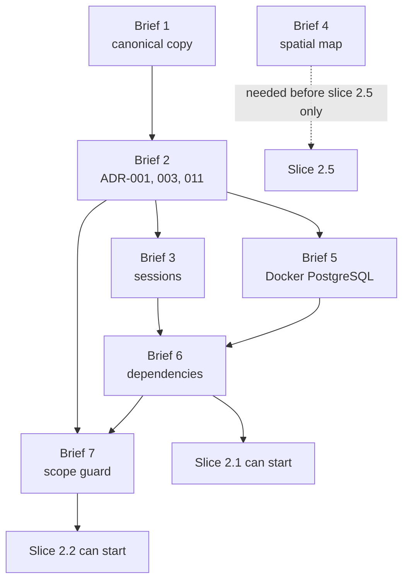

# Phase 2 — Decision Brief for the First Seven Blockers

**Status:** Decision-ready package. **Nothing in it is approved, and no file other than documentation has been created or changed.** Prepared 2026-10-29. Approving anything below is the owner's act, recorded in the owner's own instruments, not by this document.
**Companions:** [Copy comparison](PHASE_2_REQUIREMENTS_COPY_COMPARISON.md) · [Implementation plan](PHASE_2_IMPLEMENTATION_PLAN.md) · [Data model](PHASE_2_DATA_MODEL.md) · [Tenant isolation](PHASE_2_TENANT_ISOLATION.md) · [API contract](PHASE_2_API_CONTRACT.md) · [Security review](PHASE_2_SECURITY_REVIEW.md) · [Unresolved decisions](PHASE_2_UNRESOLVED_DECISIONS.md)

Gate (`G-xx`), decision (`U-xx`) and confirmed-fact (`K-x`) identifiers are defined in [the register](PHASE_2_UNRESOLVED_DECISIONS.md). `ADR-*`, `BR-*` and `C-*` identifiers are the requirements package's. **They are read against `NIVASA_PACKAGE_v0.2`**, the copy recommended as canonical in [the comparison](PHASE_2_REQUIREMENTS_COPY_COMPARISON.md#recommendation), because the older copy numbers `ADR-001`, `ADR-003` and `ADR-011` inconsistently.

## The seven blockers

| #   | Blocker                                                           | Brief section                                                                  |
| --- | ----------------------------------------------------------------- | ------------------------------------------------------------------------------ |
| 1   | Which requirements copy is canonical (`U-23`)                     | [Brief 1](#brief-1--which-requirements-copy-is-canonical-u-23)                 |
| 2   | Approve, amend or reject `ADR-001`, `ADR-003`, `ADR-011` (`G-01`) | [Brief 2](#brief-2--adr-001-adr-003-and-adr-011-g-01)                          |
| 3   | Server-side sessions or JWT (`U-01`, ADR-004)                     | [Brief 3](#brief-3--server-side-sessions-or-jwt-u-01)                          |
| 4   | 2D spatial map in the pilot, or deferred (`G-04`)                 | [Brief 4](#brief-4--2d-spatial-map-in-the-pilot-or-deferred-g-04)              |
| 5   | Isolated Docker PostgreSQL on a non-conflicting port (`U-20`)     | [Brief 5](#brief-5--isolated-docker-postgresql-on-a-non-conflicting-port-u-20) |
| 6   | Minimum new dependencies (`U-22`)                                 | [Brief 6](#brief-6--minimum-new-dependencies-u-22)                             |
| 7   | Replacement of the Milestone 0 scope guard (`U-27`)               | [Brief 7](#brief-7--replacing-the-milestone-0-scope-guard-u-27)                |

## Confirmed existing decisions

What the sign-off instruments themselves say, read from the canonical copy on 2026-10-29.

| Instrument                                                                                | Exact position                                                                                                                                                                                                                                                                                                                                                                                                                                                                            |
| ----------------------------------------------------------------------------------------- | ----------------------------------------------------------------------------------------------------------------------------------------------------------------------------------------------------------------------------------------------------------------------------------------------------------------------------------------------------------------------------------------------------------------------------------------------------------------------------------------- |
| **Architecture approval register** (`10_ARCHITECTURE_APPROVAL_REGISTER.md`, v0.3)         | "This register is the **canonical home of `ADR-*` identifiers** and the **only place an architecture decision can be approved**." Status: "Proposed for explicit approval; no scaffold or application code authorised yet". §4: "One row per decision. A blank row means the decision is **not approved**. Implementation starting is not approval, and neither is silence." **All 17 rows are blank** (columns: Approve / Amend / Reject, Decision owner, Date, Notes / conditions).     |
| Register status vocabulary                                                                | `PROPOSED — approve/amend` is "Recommended default for review. The project owner must make an explicit choice." `Approved in principle` is "Accepted in direction by project review; specifics remain open. **Does not authorise implementation on its own.**"                                                                                                                                                                                                                            |
| **Owner sign-off checklist** (`11_OWNER_BUSINESS_RULES_SIGNOFF_CHECKLIST.md`, v0.3)       | "This checklist is the **only instrument through which a business rule becomes approved**." Status: "To be completed with the owner/authorised partnership representative. **Not started.**" Each line records Decision, Evidence, Approved by, Date and **Test case ID**. **0 items are ticked.** Section F (`BR-SEC-001…006`) covers roles, documents and recovery. The final block requires "The role and permission matrix is approved."                                              |
| **Corrections register** (`12_CROSS_DOCUMENT_CORRECTIONS.md` §14)                         | "Mark each correction. A blank row means no disposition has been given; it does not mean accepted." **All 17 rows are blank.** Notably `C-02` (session design) and `C-13` (ADR numbering) are "Applied" in the text but not dispositioned.                                                                                                                                                                                                                                                |
| **Unresolved-item classification** (`14_UNRESOLVED_ITEM_BLOCKER_CLASSIFICATION.md`, v0.3) | Category **C** (does not block policy-independent development, "after architecture approval, using synthetic data") includes: repository conventions, local Docker Compose PostgreSQL, "Session/auth skeleton, role-permission primitives and secure cookie/CSRF implementation **after ADR-004 and ADR-005 are approved**", "Organisation-scoped repository/service patterns per ADR-007 … once the conceptual model is approved". "**No final domain schema until separate approval.**" |
| **Release decision rule** (same document)                                                 | "Category C means work may proceed only within the approved scope and without weakening security or correctness guardrails."                                                                                                                                                                                                                                                                                                                                                              |

The register's own vocabulary is the standard this brief uses: until a row is filled in by the owner, the decision is **proposed**.

## Proposed architecture

Briefs 1 to 7 below are the proposals. Each ends with what would change, the tests, the risks and the rollback.

## Brief 1 — Which requirements copy is canonical (`U-23`)

**Question.** Several copies of the requirements package exist. Which text is the owner being asked to approve?

**Evidence.** Full detail, hashes and file-by-file differences are in [the comparison report](PHASE_2_REQUIREMENTS_COPY_COMPARISON.md). In short:

- `~/Documents/Nook/` (13 files) and the loose copies in `~/Downloads/` (documents 01–12 and one README) are **byte-identical** to each other: one set of v0.1 drafts stored twice.
- `~/Downloads/NIVASA_PACKAGE_v0.2/` (**16 files**) is the only complete set, differs from the older set in **all 12** shared files, and is the source the handbook's own verification script reads.
- The older set contradicts itself: `ADR-003` means "NestJS and TypeScript" in document 09 but "database and ORM" in document 10, and its sign-off checklist cites **21 `BR-*` identifiers its register never defines**. Version 0.2 has none of these defects (corrections `C-13`, `C-17`).
- The two loose documents 13 and 14 are intermediate drafts (created 08:41 on 2026-10-27, before v0.2's 09:15) that match neither folder.

**Options.** **(A)** v0.2 is canonical and the others are superseded. **(B)** The older set is canonical. **(C)** Some other copy, which the owner would have to identify.

**Recommendation: (A).** (B) would reintroduce an ADR numbering that makes a signature ambiguous.

**What changes after approval.**

| Where                                                                                         | Change                                                                           |
| --------------------------------------------------------------------------------------------- | -------------------------------------------------------------------------------- |
| Decision log (new file `docs/nook-phase-2/PHASE_2_DECISION_LOG.md`, created at approval time) | Record "v0.2 is canonical", with the SHA-256 hashes from the comparison appendix |
| `PHASE_2_UNRESOLVED_DECISIONS.md` (`U-23`)                                                    | Mark decided, with the date and owner                                            |
| Package files and the other copies                                                            | **Nothing.** They are not edited, renamed, moved or deleted                      |
| Code                                                                                          | None                                                                             |

**Tests.** Re-run `shasum -a 256` on the canonical files at sign-off and compare with the appendix. Re-run this repository's document consistency check.
**Risks.** The owner reviewed a different copy (`W-1`; only the owner can confirm). The canonical copy sits in `~/Downloads`, easy to change by accident. Choosing v0.2 does not settle the "Nivasa" versus "Nook" naming conflict, nor does it approve anything inside v0.2.
**Rollback.** Supersede the decision-log entry with a dated correction. Nothing else changed, so nothing else needs undoing.

## Brief 2 — `ADR-001`, `ADR-003` and `ADR-011` (`G-01`)

**Question.** Approve, amend or reject each, in the register's §4.

### What each proposal says

Quoted from `10_ARCHITECTURE_APPROVAL_REGISTER.md` §1 (v0.3) and the rationale in `09_ARCHITECTURE_DECISIONS.md` (v0.2).

#### `ADR-001` — Backend architecture (status: `PROPOSED — approve/amend`)

- **Proposed default:** "NestJS + TypeScript, one modular monolith; modules remain explicit and business rules live in domain/application services, not controllers or React components."
- **Reason:** "Fastest safe starting point for two developers; transactional use cases can remain in one deployable process. No microservices in P0."
- **Document 09 adds:** one deployable application "with explicit modules for access, inventory, residents and stays, finance, deposits, reports, documents and audit". **Alternative considered:** microservices, which "would introduce distributed deployment, observability and consistency overhead before product demand justifies them". **Consequences:** easier deployment and transactional composition; modules need clear boundaries; "The framework does not guarantee security. Guard placement, validation, transaction boundaries and tests remain the team's responsibility." **Revisit when:** "Team size, workload, deployment independence or integration needs demonstrate a measurable reason to split services."
- **Dependencies:** none upstream. `ADR-002` (frontend) is separate.
- **Repository today:** NestJS `12.3.2` in a single `apps/api` with one `AppModule`, health controller and database service. The named domain modules do not exist. Approving ADR-001 approves a **direction**, not the building of residents, finance or documents.

#### `ADR-003` — Primary database and ORM (status: "PostgreSQL **approved in principle** by project review; Prisma and tool versions **PROPOSED**")

- **Proposed default:** "PostgreSQL as source of truth; Prisma ORM with versioned Prisma Migrate migrations. Exact supported PostgreSQL/Node/package-manager versions are pinned during scaffold approval after checking maintained releases."
- **Reason:** "Relational data, referential integrity, reporting, transactions, constraints and migrations fit the domain. No production `db push` or manual schema edits. Domain schema is not finalised in Milestone 0."
- **Document 09 adds:** the **alternative considered** is MongoDB and the MERN stack, rejected as a "domain-fit decision, not a claim that MongoDB cannot be used for financial applications". **Consequences:** use relational constraints and transactions; "Migrations are reviewed in pull requests and tested against a clean PostgreSQL database in CI"; "**Production `db push` and manual schema editing are prohibited**"; "Schema implementation begins only after the conceptual model and the business rules for enabled features are approved"; row-level security considered only after connection context, roles and policies can be managed safely (`ADR-007`). **Revisit when:** a workload "has proven document-store needs"; PostgreSQL remains the source of truth for financial and occupancy records unless separately approved.
- **Dependencies:** the pinned "managed PostgreSQL" and deployed major version depend on `ADR-010` and `BR-OPS-005`, both **OPEN**. The conceptual model approval (`G-03`) gates the schema.
- **Repository today:** Prisma and `@prisma/client` `7.10.1`, a datasource-only schema with **no models**, no migrations, no generated client and no driver adapter (`U-26`, `U-22`). The local PostgreSQL major is `17` (compose). The release-candidate trap on the Prisma CLI `latest` tag is recorded as finding `S-01` in [the security review](PHASE_2_SECURITY_REVIEW.md).
- **Open point inside the proposal:** "after checking maintained releases". That check has **not** been done for the PostgreSQL major. Doing it is a prerequisite to approving "pinned".

#### `ADR-011` — Local development and CI (status: `PROPOSED — approve/amend`)

- **Proposed default:** "Single repository with a pinned package manager/workspace; pinned supported Node LTS version; Docker Compose PostgreSQL at the same major version chosen for deployed environments; `.env.example` contains placeholders only. CI checks formatting, lint, typecheck, unit/integration tests, build, migration-on-empty-database, dependency review and secret scanning."
- **Reason:** "A new developer can reproduce checks from a clean clone. No secrets or real resident data are required." **Document 09 adds:** "CI uses synthetic values only. No required check may pass by silently skipping tests. This decision is realised by Milestone 0." The package records **no alternatives** for this ADR.
- **Dependencies:** "the same major version chosen for deployed environments" depends on `ADR-010` and `BR-OPS-005` (both **OPEN**), so that clause **cannot currently be satisfied or checked**. It also depends on Milestone 0 acceptance (`G-02`).

How the repository measures up against `ADR-011`, element by element:

| Element of `ADR-011`                                    | Repository today                                                                                             | Status                          |
| ------------------------------------------------------- | ------------------------------------------------------------------------------------------------------------ | ------------------------------- |
| Single repository, pinned package manager and workspace | `packageManager: npm@11.6.2`, workspaces `apps/api` and `apps/web`                                           | Met                             |
| Pinned Node LTS                                         | `.nvmrc` and `.node-version` `24.22.1`; `engines` `>=24.22.1 <25`. LTS status was not verified in this task. | Met (pinned)                    |
| Compose PostgreSQL at the deployed major                | Compose pins `postgres:17-alpine`; deployed major is undecided                                               | **Unverifiable**                |
| `.env.example` placeholders only                        | Local-only placeholder credentials                                                                           | Met                             |
| CI: formatting, lint, typecheck, unit tests, build      | Present in `.github/workflows/ci.yml`                                                                        | Present, **never shown to run** |
| CI: **integration** tests                               | None exist                                                                                                   | **Not met**                     |
| CI: **migration on an empty database**                  | No migrations exist                                                                                          | **Not met**                     |
| CI: dependency review                                   | `npm audit --audit-level=high` only                                                                          | Partial                         |
| CI: secret scanning                                     | Baseline scanner with four patterns                                                                          | Partial                         |
| "No required check may pass by silently skipping tests" | Unverified (CI has not run)                                                                                  | Unverified                      |

### Options for each ADR

| Option  | Meaning                                                                                   |
| ------- | ----------------------------------------------------------------------------------------- |
| Approve | The decision stands as written                                                            |
| Amend   | Approve with written changes or conditions (the register has a "Notes / conditions" cell) |
| Reject  | Do not adopt; a replacement decision is needed before the dependent work                  |

### Recommendation

| ADR       | Recommended outcome        | Suggested conditions to write in "Notes / conditions"                                                                                                                                                                                                                                         |
| --------- | -------------------------- | --------------------------------------------------------------------------------------------------------------------------------------------------------------------------------------------------------------------------------------------------------------------------------------------- |
| `ADR-001` | **Approve**                | "Direction approved. Phase 2 builds only access, inventory and audit modules. Other modules named in the ADR are not authorised by this approval."                                                                                                                                            |
| `ADR-003` | **Approve with amendment** | "PostgreSQL and Prisma approved. Local pins: Prisma 7.10.1, PostgreSQL 17. The deployed PostgreSQL major, hosting and region remain open under ADR-010. The 'maintained releases' check for the PostgreSQL major is to be recorded before schema work."                                       |
| `ADR-011` | **Approve with amendment** | "Approved as the target. The 'same major as deployed' clause is provisional until ADR-010 is decided. Integration tests and migration-on-empty-database are added to CI when the first migration lands. A hosted CI run on a clean clone is required before this ADR is treated as realised." |

### What changes after approval

| Where                                                                  | Change                                                                                                                              |
| ---------------------------------------------------------------------- | ----------------------------------------------------------------------------------------------------------------------------------- |
| Package `10_ARCHITECTURE_APPROVAL_REGISTER.md` §4 (owner fills in)     | Three rows: decision, owner, date, conditions. **This is the approval.**                                                            |
| Package `12_…` §14                                                     | Disposition for `C-06` (database and migration pinning) and `C-13` (ADR numbering), which these ADRs rest on                        |
| `docs/nook-phase-2/PHASE_2_DECISION_LOG.md` (new, created at approval) | Mirror the approvals with dates, so the repository records what was approved                                                        |
| `PHASE_2_UNRESOLVED_DECISIONS.md`                                      | Update the `G-01` state                                                                                                             |
| Code                                                                   | **None.** These are decisions, not changes. (`ADR-011` gaps become work in slice 2.1 and 2.2: CI integration job, migration check.) |

**Tests.** None new for the approval itself. Re-run the consistency check on the documentation set. The `ADR-011` gaps are later tests: a migration-on-empty-database job and an integration test job in CI.
**Risks.** Approving `ADR-011` literally commits to a deployed-version match nobody can verify. Approving `ADR-003` without the "maintained releases" check pins an unchecked PostgreSQL major. Approving without recording conditions lets "approved" be read as authorising more than intended.
**Rollback.** An ADR is superseded by a new dated row or amendment. Because approval authorises no code, there is nothing to revert. If code has begun, the plan's gating makes each slice's entry conditions re-checkable.

## Brief 3 — Server-side sessions or JWT (`U-01`)

**Question.** How do staff authenticate in the browser?

**What the sources say.** `ADR-004` (proposed, **not approved**): "Server-side opaque sessions, not long-lived JWTs in browser storage. Cookie: `HttpOnly`, `Secure` in deployed environments, `SameSite=Lax` (or stricter if flows permit), narrow `Path`/host scope; CSRF protection on state-changing requests. Session is revocable server-side and rotated after authentication and privilege changes." Rationale in document 09: it "Reduces bearer-token exposure to browser JavaScript and gives central, immediate session revocation — which matters because a revoked staff member must lose access at once, not when a token happens to expire." Consequences: "CSRF and origin handling must be validated, as must reverse-proxy cookie settings. The session store becomes a dependency of every protected request. Revocation must be tested, not assumed." **No copy of the package proposes JWT.** The brief's "JWT planned" is the only source.

### Options

| Option                                                                                           | How it works                                                                                     | For                                                                                          | Against                                                                                                                                                                         |
| ------------------------------------------------------------------------------------------------ | ------------------------------------------------------------------------------------------------ | -------------------------------------------------------------------------------------------- | ------------------------------------------------------------------------------------------------------------------------------------------------------------------------------- |
| **A. Opaque server-side session in an `HttpOnly` cookie** (`ADR-004`)                            | Random token in the cookie; only its hash stored; session row holds user and active organisation | Immediate revocation; no claims to go stale; membership checked each request; no signing key | A database read per protected request; CSRF protection required; cookie scope depends on hosting; session table in the schema                                                   |
| **B. Short-lived JWT in an `HttpOnly` cookie, plus a server-side refresh and revocation record** | Signed access token; server keeps refresh tokens and a denylist                                  | Stateless verification of the access token; familiar to some clients                         | Still needs server state, so most of A's machinery returns; a signing key is a new secret to manage and rotate; claims can be stale until expiry; CSRF still applies to cookies |
| **C. JWT held by JavaScript (memory or storage) and sent in a header**                           | `Authorization: Bearer` header                                                                   | No CSRF on header auth                                                                       | Contradicts the package's rule that bearer tokens are not kept in browser storage; token theft via script; revocation needs the same server state as B                          |

Under **any** option, tenant isolation does not come from the token. The tenant context is rebuilt from the database on every request. See [the isolation document](PHASE_2_TENANT_ISOLATION.md#why-jwt-alone-does-not-give-tenant-isolation).

**Recommendation: A**, for the package's reasons, and because the pilot has one owner and one or two staff, where immediate revocation matters more than stateless scale. If JWT is wanted for a reason the package does not contain (for example a native or third-party client), the owner should state it, and the choice becomes **B**.

Sessions need further owner decisions before any shared environment: idle and absolute expiry, `SameSite` and cookie scope, password hashing, MFA, rate limits, recovery channel (`U-02` to `U-06`). **Approving A does not settle those.**

### What changes after approval

| Where                                 | Change (option A)                                                                                                                                                                                                                                                                    |
| ------------------------------------- | ------------------------------------------------------------------------------------------------------------------------------------------------------------------------------------------------------------------------------------------------------------------------------------ |
| Package register §4 (owner) and §3    | `ADR-004` row; the unresolved parameters remain listed                                                                                                                                                                                                                               |
| `PHASE_2_UNRESOLVED_DECISIONS.md`     | `U-01` decided; `U-02`…`U-06` stay open                                                                                                                                                                                                                                              |
| `PHASE_2_API_CONTRACT.md`             | Authentication conventions confirmed. **If B or C:** rewrite the authentication row, login and logout bodies, `me`, switch flow and the CSRF row                                                                                                                                     |
| `PHASE_2_DATA_MODEL.md`               | `sessions` table confirmed. If B: replace with refresh-token and denylist tables                                                                                                                                                                                                     |
| `PHASE_2_TENANT_ISOLATION.md`         | Layer 1 and the switch sequence. If B: token reissue on switch                                                                                                                                                                                                                       |
| `PHASE_2_SECURITY_REVIEW.md`          | Session lifecycle section. If B: signing-key management and rotation                                                                                                                                                                                                                 |
| Code (slice 2.2 and 2.3, **not now**) | Migration `0001` (`sessions`); `apps/api/src/auth/*` (new); `apps/api/src/main.ts` (cookie parsing, CSRF registration, existing CORS stays); `apps/api/src/config.ts` (new required settings with **no defaults**); `.env.example` (placeholder keys); `apps/api/test/*` (new tests) |
| Dependencies                          | `cookie` (see [Brief 6](#brief-6--minimum-new-dependencies-u-22)); nothing else for option A                                                                                                                                                                                         |

**Tests needed.** `XT-15` to `XT-18`, `XT-30`, `XT-31`; a login enumeration test (unknown user, wrong password and disabled user give one response); cookie attribute assertions (`HttpOnly`, `Secure` when deployed, `SameSite`); CSRF rejection on every state-changing route; session rotation on login, switch and privilege change; idle and absolute expiry; revocation in the same transaction as the membership change; start-up failure when required settings are unset in a non-local environment; log redaction (`SR-5`).
**Risks.** CSRF or `Origin` mishandling; cookies that stop working if the web app and API end up on different registrable domains (hosting is `OPEN`, `U-21`); the session store becoming a single point of failure; for B, stale claims and a new signing secret.
**Rollback.** Before code exists: revise the documents listed above. After code but before any shared environment: revert the slice's commits. The `sessions` migration is forward-only, so rollback is a **new** migration rather than a drop (destructive migrations are prohibited by the scope guard rules below). Therefore authentication endpoints stay unrouted until the isolation tests pass, and no shared environment is exposed (`U-02`).

## Brief 4 — 2D spatial map in the pilot or deferred (`G-04`)

**Question.** Is the interactive 2D floor plan part of the pilot scope, or does it wait until the ledger is trustworthy?

**What the sources say.** Handbook Chapter 7: "The spatial map does not appear in the approved requirements package. It is new product direction introduced with this handbook and has received no review or approval. … adopting it expands the pilot materially." Chapter 24 (risks): "The 2D floor plan, public discovery, enquiry and phone verification are not in the approved requirements package"; the map "expands the pilot by a module group, adds a public attack surface, adds a paid messaging dependency, and introduces an accessibility obligation that must be met rather than deferred." It names **two defensible positions**: "Include it: the differentiator ships with version one and the layout model is cheaper to build alongside inventory than retrofitted. Defer it: reach a trustworthy ledger sooner, since that is what the first customer is actually paying for, and add the map once the money is right." And: "What should not happen is the decision being taken by default, by it simply appearing in a handbook." The package's own pilot principle is a trustworthy ledger: "The first release is successful when the hostel can maintain resident and bed records, apply owner-approved rent rules, record and allocate payments…". Phase 1's brief called the floor plan "a key Nook feature".

### Options

| Option                                                  | What Phase 2 builds                                                                                                                                          | Effect on the pilot                                                                                                  |
| ------------------------------------------------------- | ------------------------------------------------------------------------------------------------------------------------------------------------------------ | -------------------------------------------------------------------------------------------------------------------- |
| **1. Include in the pilot scope**                       | Inventory structure, **plus** layout tables, a read-only floor-plan endpoint, and (later) layout authoring, the accessible list as a peer, enquiry flows     | The map becomes a go-live gate. The pilot grows by a module group and an accessibility obligation                    |
| **2. Defer from the pilot entirely**                    | Identity, tenancy and **inventory without geometry** (floors, rooms, beds). Slice 2.5 is not built. Phase 1 remains a labelled demonstration                 | Reaches a trustworthy ledger sooner. Map work starts after the money is right; later schema additions are migrations |
| **3. In product scope, not a pilot gate (recommended)** | As option 2 **plus** slice 2.5: four read-only layout tables, a geometry validator, a seeded layout and `GET …/floor-plan`. **No authoring, no public view** | The map is built to the extent that is cheap alongside inventory, but the pilot does not wait for it                 |

**Recommendation: option 3**, as a suggestion for the owner to accept or reject. It separates two things the sources run together: _product scope_ (the map is Nook's differentiator) and _pilot gating_ (the first customer is paying for the ledger). It honours the handbook's point that the layout model is cheaper beside inventory, without adding authoring, public exposure, enquiry or the accessibility peer to the pilot's critical path. If the owner regards the map as the pilot's reason for existing, the answer is option 1, and the plan's slice 2.5 and slice 2.6 grow.

### What changes after approval

| Where                                                                         | Option 3 (and notes for 1 and 2)                                                                                                                                                                                  |
| ----------------------------------------------------------------------------- | ----------------------------------------------------------------------------------------------------------------------------------------------------------------------------------------------------------------- |
| Handbook Chapter 24 decision record (out of Phase 2 scope; the owner updates) | Record the decision, so it is not taken "by default"                                                                                                                                                              |
| Package `01_PRD.md` scope                                                     | Option 1 only: add requirements. Options 2 and 3: unchanged                                                                                                                                                       |
| `PHASE_2_UNRESOLVED_DECISIONS.md`                                             | `G-04` decided; `U-12` (layout scope) and `U-17` (units) follow from it                                                                                                                                           |
| `PHASE_2_IMPLEMENTATION_PLAN.md`                                              | Slice 2.5: keep (options 1 and 3) or remove (option 2). Option 1 adds authoring, accessible-list and web-integration work to slices 2.5 and 2.6                                                                   |
| `PHASE_2_DATA_MODEL.md`                                                       | Keep the layout group (options 1 and 3) or delete it and `U-12`, `U-17` (option 2)                                                                                                                                |
| `PHASE_2_API_CONTRACT.md`                                                     | Keep or remove `GET /properties/{propertyId}/floor-plan` and its resource                                                                                                                                         |
| Code (slice 2.5, **not now**)                                                 | One migration (four tables); a layout service and validator under `apps/api/src/`; a seed file converting the geometry now in `apps/web/src/propertyDemo.ts`; one route. **No change to `apps/web`** until `U-24` |

**Tests needed.** Validator parity with Phase 1's `isFloorLayoutValid` on valid and deliberately broken layouts (`V-5`); contract shape test for the floor-plan response; `XT-11`; a SQL check that every seeded bed lies inside its room and every room inside its floor; a test that the response never reports "available" or "occupied" (`U-13`). Option 1 adds keyboard-only selection and screen-reader announcement tests from handbook Chapter 7.
**Risks.** Option 3: layout tables built and then not needed (additive, low cost); wrong coordinate scale forcing rework before 3D (`U-17`, mitigated by labelling units schematic). Option 1: scope growth and an accessibility obligation on the pilot's critical path. All options: the UI must not imply allocation, since none exists.
**Rollback.** The decision is reversible by not shipping the route. The layout tables are additive; removing them later is a destructive migration that the guard rules forbid by default, so the plan **keeps them unused** rather than dropping them. A deferred decision loses nothing but time.

## Brief 5 — Isolated Docker PostgreSQL on a non-conflicting port (`U-20`)

**Question.** How does the project get its own PostgreSQL, given the facts on this machine?

**Facts (observed, read-only, 2026-10-29).**

- Docker Desktop is installed and holds about **2.1 GB** of existing data under `~/Library/Containers/com.docker.docker`. The Docker daemon is **not running**.
- A PostgreSQL **16** server (Homebrew, PID 885, about four days uptime, owned by the developer) listens on `127.0.0.1:5432` and `[::1]:5432`. It is not the project's database. **No connection to it was made in this task.**
- `docker-compose.yml` pins `postgres:17-alpine` and publishes `'5432:5432'`. That collides with the existing server. Because no host address is given, Docker's documented default is to publish on **all** host interfaces (not observed, since the daemon is stopped), which would expose a database with a weak local-only password beyond loopback.
- `.env.example` (and `README.md` line 25) point at port `5432` with `nook` / `nook_local_only`. Anyone following those instructions today aims the API at the unrelated server.
- The data volume is at **99% (about 2.7 GiB free)**.

### Options

| Option                                                                                                     | Description                                                                     | For                                                                                         | Against                                                                                                                                                        |
| ---------------------------------------------------------------------------------------------------------- | ------------------------------------------------------------------------------- | ------------------------------------------------------------------------------------------- | -------------------------------------------------------------------------------------------------------------------------------------------------------------- |
| **A. Docker Compose PostgreSQL 17 on a loopback-only non-conflicting port** (for example `127.0.0.1:5433`) | Edit the compose port mapping and the example URL; use a dedicated named volume | Matches the pinned compose file and `ADR-011`; isolated from the other server; reproducible | Needs Docker started and disk headroom; image size is unverified; PostgreSQL 17 versus the unknown deployed major                                              |
| **B. A dedicated database and role inside the existing PostgreSQL 16**                                     | `CREATE DATABASE` and `CREATE ROLE` on the Homebrew server                      | No Docker, no new image                                                                     | Touches a server that is not the project's and may hold other data; needs the owner's explicit consent; the major version differs from the pinned compose file |
| **C. A second PostgreSQL 16 instance with its own data directory and port**                                | New data directory and port from the Homebrew binaries                          | Isolated; no Docker                                                                         | Hand-managed; major version differs from compose; not reproducible for another developer                                                                       |

**Recommendation: A**, with two specifics: bind to loopback explicitly (`127.0.0.1:<port>:5432`), and make **free disk a written precondition**. A margin is a proposal, not a measurement: with 2.7 GiB free and an unverified image size, the owner should set a threshold (for example "at least 5 GiB free before starting Docker") and free the space **themselves**. Nothing in this task deletes anything.

### What changes after approval

| Where                            | Change                                                                                                                   |
| -------------------------------- | ------------------------------------------------------------------------------------------------------------------------ |
| `docker-compose.yml`             | `ports:` line `'5432:5432'` → `'127.0.0.1:5433:5432'`                                                                    |
| `.env.example`                   | `DATABASE_URL` port `5432` → `5433`                                                                                      |
| `README.md`                      | Line 25 command port; the setup steps; a note that port `5432` may be an unrelated server                                |
| `.github/workflows/ci.yml`       | Unchanged for now (`prisma validate` does not connect). A `services: postgres` job is added when integration tests exist |
| `scripts/` (new, slice 2.1)      | A database tooling guard that refuses a non-loopback host, port `5432` and database names outside an agreed pattern      |
| `docs/MILESTONE_0_VALIDATION.md` | **Left as a historical record**; superseded by the slice 2.1 evidence                                                    |
| `scripts/verify_m0_scope.py`     | **No change needed.** It checks that `.env.example` contains `nook_local_only` and `localhost`; both remain              |

**Tests needed.** `docker compose config` parses; the container reports healthy; `pg_isready -h 127.0.0.1 -p 5433` succeeds; `GET /api/v1/health/database` returns `ok` (today it correctly reports `degraded`); a negative test that the tooling guard refuses port `5432` and an unexpected database name; a check that the port is not published on non-loopback addresses.
**Risks.** Docker Desktop and the image consume disk at 99% usage; port `5433` may be taken (check first); the named volume `nook_postgres_data` **may already exist from earlier attempts and was not inspected, since the daemon is stopped**, so list volumes before any `down -v`; the weak local credentials must never leave loopback; PostgreSQL 17 versus the deployed major (`U-21`).
**Rollback.** `git revert` the three configuration edits. `docker compose down` stops the container and **keeps** data; `docker compose down -v` deletes **only the project's named volume**, so it is run only after listing volumes. The image can be removed afterwards. The unrelated PostgreSQL 16 is never touched.

## Brief 6 — Minimum new dependencies (`U-22`)

**Question.** Which packages does the first part of Phase 2 genuinely need?

**Method.** Registry metadata only, read on 2026-10-29. **Nothing was installed or downloaded**; no tarball, maintainer, advisory or licence text was inspected beyond the registry's `license` field. The repository pins exact versions, so each addition would be installed with `--save-exact`.

| Need                                   | Candidate                                            | Registry facts (2026-10-29)                                                                                                                                                   | In the minimum set?                                                                                     |
| -------------------------------------- | ---------------------------------------------------- | ----------------------------------------------------------------------------------------------------------------------------------------------------------------------------- | ------------------------------------------------------------------------------------------------------- |
| Prisma 7 driver adapter for PostgreSQL | `@prisma/adapter-pg@7.10.1`                          | Apache-2.0; 4 dependencies (`@prisma/driver-adapter-utils`, `@types/pg`, `pg`, `postgres-array`); `pg` is already installed at `8.16.3`; version matches the installed Prisma | **Yes, conditional** on the slice 2.1 spike proving it is required (`V-4`)                              |
| Request validation                     | `zod@4.6.7`                                          | MIT; **0 dependencies**; about 6.1 MB unpacked                                                                                                                                | **Yes** (one library)                                                                                   |
|                                        | `class-validator@0.15.1` + `class-transformer@0.5.1` | MIT; `class-validator` has 3 dependencies (`libphonenumber-js` among them), about 5.3 MB; `class-transformer` was last published in **2022**                                  | No. Two packages instead of one, one of them not updated since 2022                                     |
| Cookie parse and serialise             | `cookie@2.0.1`                                       | MIT; **0 dependencies**; requires Node `>=22` (installed 24.22.1)                                                                                                             | **Yes**                                                                                                 |
|                                        | `cookie-parser@1.4.7`                                | MIT; 2 dependencies (`cookie`, `cookie-signature`); last published 2024-10                                                                                                    | No. Adds an indirection the signed-cookie feature does not need                                         |
| Rate limiting                          | `@nestjs/throttler@6.7.1`                            | MIT; **0 dependencies**; peers accept Nest 12 (`^12.0.0`) and Node `>=24`                                                                                                     | **Deferred.** Needed only when thresholds are approved and before any shared environment (`U-06`)       |
| Password hashing                       | `node:crypto` scrypt (built in)                      | No package                                                                                                                                                                    | **Yes by default**, with **no dependency**. The algorithm is the owner's decision (`U-03`)              |
|                                        | `@node-rs/argon2@2.2.2`                              | MIT; no listed dependencies (prebuilt binaries)                                                                                                                               | Only if the owner prefers argon2id                                                                      |
|                                        | `argon2@0.45.1`                                      | MIT; 4 dependencies including a native build helper                                                                                                                           | Only if the owner prefers it. A native build adds toolchain risk                                        |
| CSRF token                             | In-repo, using `node:crypto`                         | No package                                                                                                                                                                    | Yes. Small and reviewable. No hand-rolled cryptography beyond constant-time comparison and random bytes |
| Test client and framework              | `node:test`, global `fetch`, `NestFactory.create`    | Already present (Node 24)                                                                                                                                                     | **Yes, no package.** Avoids `supertest`                                                                 |
|                                        | `@nestjs/testing@12.3.2`                             | MIT; 1 dependency; peers accept Nest 12; published 2026-10-27                                                                                                                 | Optional (dev only), if provider overriding is wanted                                                   |
|                                        | `supertest@7.3.1`                                    | MIT; 3 dependencies                                                                                                                                                           | No                                                                                                      |

**Recommended minimum for slices 2.1 to 2.3: three packages.** `@prisma/adapter-pg` (conditional), `zod` and `cookie`. Optional: `@nestjs/testing` (dev). Deferred: `@nestjs/throttler`, and an argon2 package only if `U-03` chooses it.

**What changes after approval.**

| Where                                    | Change                                                                                                |
| ---------------------------------------- | ----------------------------------------------------------------------------------------------------- |
| `apps/api/package.json`                  | Added by npm: `npm install -w @nook/api --save-exact <package>@<version>`, **one package per change** |
| `package-lock.json`                      | Written by npm. Never edited by hand                                                                  |
| Code                                     | New code in slices 2.1 to 2.3 imports them. None exists today                                         |
| `PHASE_2_SECURITY_REVIEW.md`             | Update the dependency table with what was actually installed                                          |
| `scripts/phase_scope.json` (see Brief 7) | The approved additions are recorded there                                                             |

**Tests needed (after each install).** `npm audit` and `npm audit signatures`; `npm ls <package>`; `npm run build` and `npm run typecheck`; an import smoke test; lockfile diff reviewed for **unrelated** packages; confirm no dependency adds a native build step unexpectedly; disk checked before and after.
**Risks.** A new package changes the audited tree (re-audit); `zod` is large unpacked (irrelevant to a server build but visible in disk); `cookie@2` needs Node 22 or later (met); the adapter's necessity is unproven; registry metadata is not a security review of the packages.
**Rollback.** `npm uninstall -w @nook/api <package>` and `git checkout` of `apps/api/package.json` and `package-lock.json` from the previous commit. Each package is its own commit so each can be reverted alone.

## Brief 7 — Replacing the Milestone 0 scope guard (`U-27`)

**Question.** The current guard stops unapproved scope but will fail on the first approved model. How is it replaced without losing protection?

### What the current guard does

`scripts/verify_m0_scope.py` (run by `npm run verify:m0-scope` and by CI) runs **22 checks**. This brief does **not** modify it.

| Checks                                                 | Count | What they test                                                                                                                                                              |
| ------------------------------------------------------ | ----- | --------------------------------------------------------------------------------------------------------------------------------------------------------------------------- |
| Required files exist                                   | 14    | `README.md`, `.env.example`, `.gitignore`, `docker-compose.yml`, CI workflow, API shell files, web entry and tokens, `prisma/schema.prisma`, M0 scope doc, `secret_scan.py` |
| "Prisma schema has no domain models"                   | 1     | Fails if any line matches `^\s*model\s+\w+`                                                                                                                                 |
| "No schema migrations are present in M0"               | 1     | Fails if any `migration.sql` exists under `prisma/migrations`                                                                                                               |
| Documentation phrases                                  | 3     | `MILESTONE_0_SCOPE.md` or `README.md` must contain "real resident data", "production deployment" and "no domain models or migrations"                                       |
| Environment example uses local placeholder credentials | 1     | `.env.example` contains `nook_local_only` and `localhost`                                                                                                                   |
| No real `.env` file                                    | 1     | `.env` absent                                                                                                                                                               |
| No obsolete `verify:docs` command                      | 1     | `package.json` does not reference a missing file                                                                                                                            |

**Gaps in the current guard** (observed from its code): it ignores `enum`, `view` and composite `type` declarations; it checks only the **existence** of a migration, never its SQL, so a migration could create a `payments` table while the schema file stays model-free; it never inspects API routes or dependencies; its documentation-phrase check couples the guard to prose; and the guard itself has **no tests**.

### Options

| Option                                                                                  | Effect                                                                                           |
| --------------------------------------------------------------------------------------- | ------------------------------------------------------------------------------------------------ |
| **A. Replace with a Phase 2 guard that allow-lists exact approved scope** (recommended) | Protection continues and becomes stricter; the guard is tested and driven by a reviewed manifest |
| B. Edit the M0 guard in place                                                           | Loses history of what M0 enforced; easy to loosen by accident                                    |
| C. Remove it                                                                            | Removes the only control that blocks resident, booking and finance models                        |

**Recommendation: A.**

### Proposed rules for the replacement

Proposed names: `scripts/verify_phase_scope.py` (the guard), `scripts/phase_scope.json` (the single reviewed manifest), `scripts/test_phase_scope.py` (self-tests), npm script `verify:scope`. **None is created now.**

The manifest records, per approved slice, the exact models, enums, tables, routes and dependencies allowed, plus an **approval reference** (a file and anchor in the decision log, an approver and a date). Rules:

| ID  | Rule                            | Fails when                                                                                                                                                                                                                                                                                                                                                                                                                                  | Relation to the old guard                                                        |
| --- | ------------------------------- | ------------------------------------------------------------------------------------------------------------------------------------------------------------------------------------------------------------------------------------------------------------------------------------------------------------------------------------------------------------------------------------------------------------------------------------------- | -------------------------------------------------------------------------------- |
| S1  | **Retained checks**             | Any of: a required file missing; `.env` present; `.env.example` without `nook_local_only` and `localhost`; obsolete `verify:docs` reference; the phrases "real resident data" and "production deployment" absent from the scope docs                                                                                                                                                                                                        | Carried over unchanged (19 of the 22; the other three are replaced by S2 and S3) |
| S2  | **Schema allow-list**           | `schema.prisma` declares any `model`, `enum`, `view` or composite `type` not listed for an **approved** slice                                                                                                                                                                                                                                                                                                                               | Replaces "no domain models" and the third documentation phrase                   |
| S3  | **Migration SQL allow-list**    | A migration creates or alters a table, type, index, trigger, policy, function or extension, or grants on an object, not in the manifest. Every migration must carry a first-line tag `-- phase-scope: slice-<n>` naming an approved slice                                                                                                                                                                                                   | Replaces "no migrations"                                                         |
| S4  | **No destructive SQL**          | `DROP TABLE`, `DROP COLUMN`, `DROP TYPE`, `TRUNCATE`, `DELETE FROM` or a column type change appears, unless the migration carries `-- destructive-approved: <decision-log ref>` that resolves to an existing entry                                                                                                                                                                                                                          | New. Phase 2 plans **no** destructive migration                                  |
| S5  | **Migration immutability**      | In a Git checkout, any previously committed `migration.sql` is modified, renamed or deleted. Only additions pass. Outside Git the guard prints a clear WARN, and CI always runs inside Git                                                                                                                                                                                                                                                  | New                                                                              |
| S6  | **Forbidden domain vocabulary** | An identifier in the schema, migration SQL, route paths or new source file names splits (camelCase, snake_case, kebab-case) into a forbidden word: resident, stay, booking, hold, enquiry; charge, payment, invoice, receipt, deposit, refund, settlement, ledger, rent, fee, balance, price, amount; document, upload, kyc, aadhaar; otp, sms, whatsapp. The list is reviewed with the guard; each exception is an explicit manifest entry | New. Whole-word matching avoids false hits such as "threshold"                   |
| S7  | **Money and numeric types**     | The schema uses `Decimal` or `Float`, or a column is named as money, unless an approved slice allows it (none in Phase 2). This protects `ADR-008` (`BIGINT` paise)                                                                                                                                                                                                                                                                         | New                                                                              |
| S8  | **Route allow-list**            | A `@Controller`, `@Get`, `@Post`, `@Patch`, `@Put` or `@Delete` path under `apps/api/src` is not in the manifest's route list (taken from the [API contract](PHASE_2_API_CONTRACT.md)). The manifest may list routes not yet built                                                                                                                                                                                                          | New. The runtime `XT-27` enumeration remains the stronger check                  |
| S9  | **Raw SQL in application code** | `$queryRaw`, `$executeRaw` or their `Unsafe` forms appear outside manifest-listed files                                                                                                                                                                                                                                                                                                                                                     | New                                                                              |
| S10 | **Dependency allow-list**       | A workspace `package.json` dependency or devDependency is not in the baseline snapshot or the approved additions; any version uses a range (`^`, `~`) instead of an exact pin; or a name matches a payment or messaging SDK pattern (for example `razorpay`, `stripe`, `twilio`)                                                                                                                                                            | New                                                                              |
| S11 | **Approval completeness**       | A slice present in the schema has an empty approver, date or reference in the manifest, or the referenced file does not exist                                                                                                                                                                                                                                                                                                               | New                                                                              |
| S12 | **Self-tests**                  | The guard's own tests fail. They build temporary fixtures that each add one violation (an extra `Resident` model, a migration creating `payments`, `DROP TABLE`, a modified old migration, a `@Get('residents')` route, a `razorpay` dependency, an empty approval) and assert the guard **fails** on each, and passes on a clean fixture                                                                                                   | New. The current guard has no tests                                              |

**Output** keeps the existing `PASS` / `FAIL` / `SUMMARY` line format and non-zero exit so CI behaviour is unchanged.

**Known limits.** The checks are static and pattern-based. They cannot prove approval is **genuine** (anyone can edit the manifest, so review and branch protection are the real control, and hosted CI is unverified), and they cannot detect semantic scope creep such as resident data stored in a free-text column on an approved table. Human review and the isolation tests cover that.

### Rollout order (when approved)

1. **Commit 1, before any model.** Add the manifest (no slices yet), the guard and the self-tests. The new guard must **pass on today's tree**, which proves it is compatible with the Milestone 0 baseline.
2. **Commit 2.** Repoint CI and `README.md` step 7 from `verify:m0-scope` to `verify:scope`. Leave `scripts/verify_m0_scope.py` in the repository, **unmodified**, noted as valid only for the Milestone 0 tree.
3. **Commit 3, slice 2.2.** The first migration and schema, with the manifest slice entry and its approval reference added in the same change. The guard passes.

### What changes after approval

| Where                                                                                      | Change                                                                                                               |
| ------------------------------------------------------------------------------------------ | -------------------------------------------------------------------------------------------------------------------- |
| `scripts/verify_phase_scope.py`, `scripts/phase_scope.json`, `scripts/test_phase_scope.py` | New                                                                                                                  |
| `package.json` (scripts only)                                                              | Add `verify:scope`. This is a script entry, not a dependency change                                                  |
| `.github/workflows/ci.yml`                                                                 | Replace the guard step; add the self-test step before it                                                             |
| `README.md`                                                                                | Setup step 7 and the "schema has no domain models or migrations" line (which the **old** guard's phrase check reads) |
| `docs/MILESTONE_0_SCOPE.md`                                                                | A note that it describes Milestone 0 only                                                                            |
| `PHASE_2_UNRESOLVED_DECISIONS.md`                                                          | `U-27` decided                                                                                                       |
| `scripts/verify_m0_scope.py`                                                               | **Not modified**                                                                                                     |

**Tests needed.** The guard passes on the current tree; each self-test fixture fails as designed; the guard fails on a deliberately added `model Resident` in a scratch copy of the repository; it passes after the approved slice's models and migration are added.
**Risks.** Over-blocking (false positives on the vocabulary list); an out-of-date manifest blocking legitimate work; the guard being edited to pass (mitigated by review); regex limits on routes; the old guard's prose-phrase coupling when `README.md` changes.
**Rollback.** Revert the slice commit, then the CI repoint, to restore the old guard, which only passes on a model-free and migration-free tree. So rolling back the guard **requires rolling back the schema** with it. That coupling is intentional.

## Cross-cutting dependencies between the decisions

Briefs 1 to 3, 5 and 6 gate **slice 2.1**. Brief 7 gates **slice 2.2**. Brief 4 gates only **slice 2.5**, so the map decision does **not** hold up identity, tenancy or inventory.

## Corrections to existing planning documents

The task asked that existing documents stay unchanged "unless a factual correction is necessary". One was.

| File                              | Before                                                          | After        | Why                                                                                                                                                                                    |
| --------------------------------- | --------------------------------------------------------------- | ------------ | -------------------------------------------------------------------------------------------------------------------------------------------------------------------------------------- |
| `PHASE_2_UNRESOLVED_DECISIONS.md` | `NIVASA_PACKAGE_v0.2/ (2026-10-27, 17 files)` in the `U-23` row | `… 16 files` | A directory count showed **16** files (documents 01–14, the revision report and the README). My earlier "17" was a counting error. The same error appeared in my earlier chat summary. |

No other existing planning document was edited. Two **new observations** from this task are recorded here, not in those documents: the compose port mapping binds to all interfaces by Docker's default, and `.env.example` points at the unrelated server's port. They belong in the security review and `U-20` when the owner approves the register's next revision.

## Unresolved decisions

Everything in this brief is **unresolved** until the owner decides. Related open items that this brief does **not** settle: `G-03` (conceptual model), `G-05` (corrections), `G-06` (role and bed-semantic sign-off), `U-02` to `U-06`, `U-07`, `U-08`, `U-12`, `U-13`, `U-21`, `U-24`, `U-26`. See [the register](PHASE_2_UNRESOLVED_DECISIONS.md).

## Validation still required

| #   | Claim                                                                         | Status                                                                        |
| --- | ----------------------------------------------------------------------------- | ----------------------------------------------------------------------------- |
| B-1 | The owner reviewed v0.2 (not the older copy)                                  | Not confirmable here (`W-1`)                                                  |
| B-2 | The PostgreSQL 17 major is a maintained release                               | **Not checked.** `ADR-003` requires "checking maintained releases"            |
| B-3 | The Docker image fits on disk and starts                                      | **Not run.** Daemon stopped; image size unknown                               |
| B-4 | The compose mapping publishes on all interfaces                               | **Not observed.** Based on Docker's documented default; the daemon is stopped |
| B-5 | `@prisma/adapter-pg` is required and sufficient                               | **Not run** (`V-4`)                                                           |
| B-6 | The proposed guard passes on today's tree and fails on each forbidden fixture | **Not written.** Proposal only                                                |
| B-7 | The forbidden-vocabulary list has no harmful false positives                  | **Not tested**                                                                |
| B-8 | Registry metadata for the candidate packages is complete and benign           | Metadata only; no package was downloaded, audited or inspected                |
| B-9 | Markdown renders and Mermaid diagrams draw                                    | Formatting checked with Prettier; **Mermaid not rendered**                    |

## Owner approval table and signing order

**Recommended order** and what each approval unlocks. "Rec." is a recommendation for the owner to accept or reject, never an approval.

| Order | Decision                        | IDs                | Rec.                                                                               | Owner must provide                                             | Depends on                        | Unlocks                                     |
| ----- | ------------------------------- | ------------------ | ---------------------------------------------------------------------------------- | -------------------------------------------------------------- | --------------------------------- | ------------------------------------------- |
| 1     | **Canonical requirements copy** | `U-23`             | v0.2 (`NIVASA_PACKAGE_v0.2`)                                                       | Yes/no and, if no, which copy                                  | None                              | Every later decision, by fixing the text    |
| 2     | **Approve `ADR-001`**           | `G-01`             | Approve                                                                            | Approve / amend / reject with owner and date                   | 1                                 | Slice 2.1 (with 3 and 4 below)              |
| 3     | **Approve `ADR-003`**           | `G-01`             | Approve with amendment (local pins, deployed major open, maintained-release check) | Same                                                           | 1                                 | Slice 2.1                                   |
| 4     | **Approve `ADR-011`**           | `G-01`             | Approve with amendment (deployed-major clause provisional; CI gaps listed)         | Same                                                           | 1, and 3 for the PostgreSQL major | Slice 2.1                                   |
| 5     | **Session mechanism**           | `U-01` (`ADR-004`) | Server-side opaque sessions                                                        | Choose A, B or C; state any reason JWT is needed               | 2, 3                              | Slice 2.3 design (and the `sessions` table) |
| 6     | **Local PostgreSQL route**      | `U-20`             | Docker on `127.0.0.1:5433`, with a disk precondition the owner sets                | Choose A, B or C; set the free-space threshold; free space     | 4                                 | Slice 2.1                                   |
| 7     | **Minimum dependency list**     | `U-22`             | `@prisma/adapter-pg` (conditional), `zod`, `cookie`; defer `@nestjs/throttler`     | Approve the named list and versions                            | 5, 6                              | Slice 2.1                                   |
| 8     | **Scope guard replacement**     | `U-27`             | Option A with rules S1–S12                                                         | Approve the rules, or amend the vocabulary list                | 2, 3, 7                           | Slice 2.2                                   |
| 9     | **2D spatial map scope**        | `G-04`             | Option 3: in product scope, not a pilot gate                                       | Choose 1, 2 or 3 and record it in the handbook decision record | None (can be last)                | Slice 2.5 only                              |

**Why this order.** Fixing the text first (1) means every later signature is unambiguous. The three ADRs (2–4) are the register's own gate (`G-01`). Sessions (5) and the database route (6) both feed the dependency list (7), which feeds the guard's dependency allow-list (8). The map (9) is last because nothing before slice 2.5 depends on it.

**What signing all nine does _not_ do.** It does not approve the conceptual model (`G-03`), the role matrix (`G-06`), bed-status semantics (`U-13`), any business rule, or any financial behaviour. Slice 2.2 additionally needs `G-03`, and slice 2.3 needs `U-02` to `U-07`.

## Revision history

| Version | Date       | Change                                                                                                                          |
| ------- | ---------- | ------------------------------------------------------------------------------------------------------------------------------- |
| 0.1     | 2026-10-29 | Initial brief. Includes one factual correction to `PHASE_2_UNRESOLVED_DECISIONS.md` (file count 17 → 16). No decision resolved. |
