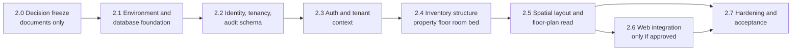

# Phase 2 — Backend Foundation and Multi-Tenant Architecture: Implementation Plan

**Status:** Plan only. **No application code, schema, migration, dependency change or database action has been made.** Nothing in this plan is approved. Implementation waits for the approvals listed under [Entry conditions](#entry-conditions-what-must-be-approved-first).
**Prepared:** 2026-10-28 to 2026-10-29, against local `main` at `b2a9f0c` (two commits ahead of `origin/main`, nothing pushed).

| Document                                                | Content                                                                         |
| ------------------------------------------------------- | ------------------------------------------------------------------------------- |
| **This plan**                                           | Sequence, gates, slices, risks, resource safety                                 |
| [Data model](PHASE_2_DATA_MODEL.md)                     | Entities, Prisma approach, floor-plan contract, migrations, seed                |
| [Tenant isolation](PHASE_2_TENANT_ISOLATION.md)         | Isolation layers and the negative cross-tenant test catalogue (`XT-01…35`)      |
| [API contract](PHASE_2_API_CONTRACT.md)                 | Versioned REST endpoints, errors, validation                                    |
| [Security review](PHASE_2_SECURITY_REVIEW.md)           | Fresh audit, repository findings, security design                               |
| [Unresolved decisions](PHASE_2_UNRESOLVED_DECISIONS.md) | **Defines** every gate `G-xx` and decision `U-xx` and the confirmed facts `K-x` |

Every document separates four things: **confirmed existing decisions**, **proposed architecture**, **unresolved decisions** and **validation still required**.

## Confirmed existing decisions

| Fact                                                                                                                                                                                                                                        | Source                                                         |
| ------------------------------------------------------------------------------------------------------------------------------------------------------------------------------------------------------------------------------------------- | -------------------------------------------------------------- |
| Phase 1 is a frontend-only demonstration with synthetic data. No API, database, authentication or allocation exists.                                                                                                                        | `docs/PHASE_1_VALIDATION.md`                                   |
| The backend direction is NestJS, TypeScript, PostgreSQL, Prisma and REST. **Those are the owner's stated direction, but in the requirements package only PostgreSQL is "approved in principle"; NestJS, Prisma and the rest are PROPOSED.** | Brief; `10_ARCHITECTURE_APPROVAL_REGISTER.md` (ADR-001, 003)   |
| Toolchain is pinned: Node 24.22.1, npm 11.6.2. `@nestjs/*` is 12.3.2, `prisma` and `@prisma/client` 7.10.1.                                                                                                                                 | `package.json`, installed manifests                            |
| The API currently contains only health routes, a database availability check and configuration parsing.                                                                                                                                     | `apps/api/src`                                                 |
| The pilot is a ladies' hostel in Pune with about 100 beds, run by a partnership with one owner and 1–2 staff. The platform must serve many independent organisations.                                                                       | `02_BUSINESS_RULES_REGISTER.md` (`BR-001`, `BR-002`, `BR-011`) |
| No financial, resident, booking, payment, deposit, refund or checkout work is in Phase 2.                                                                                                                                                   | Brief                                                          |
| Do not push, reset, rebase, amend or rewrite history. Do not delete `marketing/` or the handbook. Preserve the Puppeteer cache. Do not terminate unknown processes.                                                                         | Brief                                                          |

### The ground the plan stands on — a hard finding

**The requirements package says none of its architecture is approved, and the repository's own history shows Milestone 0 was never accepted.** In particular:

- Every row of the architecture approval register is **blank** (`G-01`).
- Milestone 0 "remains unaccepted" (`G-02`).
- The owner sign-off checklist is "**Not started**" (`G-06`).
- The conceptual data model is "not a finalized database schema" (`G-03`).
- The spatial floor-plan scope is recorded as an **open, critical** decision, and floors and geometry are **not in the approved package at all** (`G-04`).
- Your brief says JWT; the package's ADR-004 proposes opaque server-side sessions and **not** JWTs (`U-01`).

None of that prevents **planning**, which is all this task does. It does mean the plan cannot honestly say "start coding". It orders the work so the earliest slices need the fewest approvals, and it lists exactly what to approve (`G-01` to `G-06`, then the `U-xx` list).

## Proposed architecture

### How this phase maps to the requirements package

The word "Phase" is used differently in the two vocabularies.

| This repository's task history | Requirements package vocabulary                                                                                                                                                               |
| ------------------------------ | --------------------------------------------------------------------------------------------------------------------------------------------------------------------------------------------- |
| Phase 1 (demonstration UI)     | Not a package phase. The handbook records the demonstration UI as fixtures with "no persistence".                                                                                             |
| Milestone 0                    | `P0` in the handbook roadmap; `M0-*` tasks. **Unaccepted.**                                                                                                                                   |
| **Phase 2 (this plan)**        | Roughly **`P1`** (identity, sessions, memberships, permissions, tenant context, audit contract) **plus the structure half of `P2`** (property, floors, rooms, beds, layout, floor-plan read). |
| Later                          | `P3` residents and stays; `P4` money; `P5` migration and recovery; `P6` operations and the second organisation.                                                                               |

Two deliberate differences from the package's `P1`: **money utilities and idempotency infrastructure are excluded** (your brief rules out financial work), and the **availability service is excluded** from `P2` (it needs `BR-LIF-002/003/004/006`).

### Scope

**In scope (planned):**

- Organisations, users, memberships, roles, server-side sessions and a tenant context.
- Deny-by-default permissions on permission identifiers.
- Properties, floors, rooms and beds, administered through the API with audit events.
- A **read-only** floor-plan resource shaped like the Phase 1 model.
- Audit events for security-sensitive administrative changes.
- A synthetic seed, a negative cross-tenant test suite and database constraints that make cross-tenant references impossible to store.

**Out of scope, by decision or by gate:** residents, stays, assignments, bookings and holds, availability computation, charges, payments, allocations, deposits, refunds, checkout, documents and uploads, imports and exports, subscriptions, platform-operator console, notifications, a 3D view, deployment, real data and credentials.

### Principles

1. **Isolation is structural, not conventional.** Layers stack so no single mistake leaks a tenant ([isolation design](PHASE_2_TENANT_ISOLATION.md)).
2. **Server derives everything that matters.** Tenant, permissions and ownership never come from the request.
3. **Honest availability.** The floor-plan API reports `operationalStatus` and states plainly that availability is **not computed**. Nothing simulates an allocation.
4. **One spatial model.** 2D and any future 3D read the same records.
5. **Unresolved means disabled.** `422 RULE_NOT_CONFIGURED`, never a silent default.
6. **Smallest design that is correct.** No microservices, no generic abstractions, no building level (`U-11`), no layout authoring (`U-12`) until approved.
7. **No weakening of existing guards.** The M0 scope guard is replaced only by an approved, stricter guard (`U-27`).

### Slices

Each slice has entry conditions, a deliverable and exit evidence. **No dates or effort estimates are given**, on purpose: the package notes the inputs a credible estimate needs do not yet exist.

#### Slice 2.0 — Decision freeze (documents only)

| Item    | Detail                                                                                                                                                                                                                                                                                                                                                        |
| ------- | ------------------------------------------------------------------------------------------------------------------------------------------------------------------------------------------------------------------------------------------------------------------------------------------------------------------------------------------------------------- |
| Purpose | Turn the proposals into recorded decisions so that code is never the place a decision is made.                                                                                                                                                                                                                                                                |
| Work    | Owner fills `10_ARCHITECTURE_APPROVAL_REGISTER.md` §4 for ADR-001…011 at least; marks the corrections in `12_…` §14; answers `U-01` (session versus JWT), `U-07` (role baseline) and `U-23` (canonical package). Records the spatial scope decision (`G-04`) and approves or amends the conceptual model additions (floors, layouts: `G-03`, `U-11`, `U-12`). |
| Exit    | A dated decision log. Each `G-01…G-06` item marked met, deferred with reason, or waived by the owner in writing.                                                                                                                                                                                                                                              |
| Code    | None.                                                                                                                                                                                                                                                                                                                                                         |

#### Slice 2.1 — Environment and database foundation

| Item   | Detail                                                                                                                                                                                                                                                                                                                                                                                                                     |
| ------ | -------------------------------------------------------------------------------------------------------------------------------------------------------------------------------------------------------------------------------------------------------------------------------------------------------------------------------------------------------------------------------------------------------------------------- |
| Entry  | `G-01` subset (`U-23`, `ADR-001`, `ADR-003`, `ADR-011`), `U-20`, `U-22` and the `G-02` choice are **approved or decided by the owner on 2026-10-29** (see `PHASE_2_DECISION_LOG.md`); the `U-26` spike is **authorised** subject to `A3`, `A6` and the 5 GiB disk gate. Disk re-measured before each action. _(Reconciles `X-1` to `X-3`: the owner authorises the spike at entry; its **result** closes `U-26` at exit.)_ |
| Work   | Decide the local PostgreSQL route (`U-20`). Run the **Prisma spike** in a throwaway directory: generator choice, driver adapter, client import under `tsx` and `tsc`, composite foreign keys with overlapping columns (data model V-1, V-4). Approve and install the named dependencies, then audit again. Add the database tooling guard (host and database name).                                                        |
| Exit   | `GET /api/v1/health/database` returns `ok` against a **project-dedicated** database; a throwaway migration applies and is discarded; audit still reports 0 vulnerabilities; decisions `U-20`, `U-22`, `U-26` recorded. This also supplies the evidence Milestone 0 lacked (PostgreSQL health).                                                                                                                             |
| Safety | Never run `migrate dev` against the unrelated PostgreSQL 16. No image pull or install with less than a stated free-disk margin.                                                                                                                                                                                                                                                                                            |

#### Slice 2.2 — Identity, tenancy and audit schema

| Item  | Detail                                                                                                                                                                                                                                                                                                                                                      |
| ----- | ----------------------------------------------------------------------------------------------------------------------------------------------------------------------------------------------------------------------------------------------------------------------------------------------------------------------------------------------------------- |
| Entry | `G-01`, `G-03`, slice 2.1 exit, `U-04`, `U-07` (shape), `U-08`, `U-09`, `U-10`, `U-16`, `U-18`, **`U-27`** (the replacement scope guard written and tested **first**).                                                                                                                                                                                      |
| Work  | Migration `0001`: `organizations`, `users`, `memberships`, `membership_property_grants` (if `U-07` keeps it), `sessions`, `audit_events`, with composite keys, the audit immutability trigger and role grants. Controlled provisioning script. Synthetic seed for organisations A and B. Database-level isolation tests `XT-20…XT-23`. Schema lint `XT-25`. |
| Exit  | Migrations apply to an empty database in CI and locally; XT-20…XT-23 and XT-25 pass against real PostgreSQL; the scope guard rejects a deliberately added resident model (proving it works); `prisma validate` passes.                                                                                                                                      |

#### Slice 2.3 — Authentication and tenant context

| Item  | Detail                                                                                                                                                                                                                                                                                                                       |
| ----- | ---------------------------------------------------------------------------------------------------------------------------------------------------------------------------------------------------------------------------------------------------------------------------------------------------------------------------- |
| Entry | Slice 2.2 exit, `U-01`, `U-02`, `U-03`, `U-05` (shared env only), `U-06`, `U-07` (approved matrix for the permissions in use).                                                                                                                                                                                               |
| Work  | Login, logout, `me`, organisation current and switch, member list and update, recovery stub that returns `RULE_NOT_CONFIGURED`. Session store, CSRF, tenant-context guard, deny-by-default permission guard, scoped repository base, lint rule against importing the Prisma client elsewhere, audit emission, log redaction. |
| Exit  | `XT-06`, `XT-07`, `XT-12`, `XT-13…XT-19`, `XT-24…XT-31`, `XT-33`, `XT-35` pass; session rotation, revocation and disablement take effect on the next request; **mutation test** shows the router-enumerated suite fails when a scope predicate is removed (`I-3`).                                                           |

#### Slice 2.4 — Inventory structure

| Item  | Detail                                                                                                                                                                                          |
| ----- | ----------------------------------------------------------------------------------------------------------------------------------------------------------------------------------------------- |
| Entry | Slice 2.3 exit, `G-06` for `BR-LIF-002/004` and `BR-003` **or** the owner's decision to proceed with `OUT_OF_SERVICE` only (`U-13`), `U-11`, `U-14`, `U-15`, `U-19`, `U-25`.                    |
| Work  | Migration for `properties`, `floors`, `rooms`, `beds`. Endpoints with validation, `rowVersion`, soft archive, inventory summary and audit. Partial unique indexes and `CHECK` constraints.      |
| Exit  | `XT-01…XT-05`, `XT-08`, `XT-09`, `XT-10`, `XT-27`, `XT-28`, `XT-32`, `XT-34` pass; inventory counts reconcile (total = in service + out of service); no endpoint reports available or occupied. |

#### Slice 2.5 — Spatial layout and floor-plan read (**gated by `G-04`**)

| Item  | Detail                                                                                                                                                                                                                                                                      |
| ----- | --------------------------------------------------------------------------------------------------------------------------------------------------------------------------------------------------------------------------------------------------------------------------- |
| Entry | Slice 2.4 exit; **`G-04`** decided; `U-12`; `U-17`; **and** the inventory contract approved (`G-03`, `U-13`, `U-14`, `U-15`) with the slice 2.4 endpoints passing their tests. _(Reconciles `X-4`.)_                                                                        |
| Work  | Migration for `floor_layouts`, `layout_zones`, `room_placements`, `bed_placements`. Geometry validator that mirrors Phase 1's `isFloorLayoutValid`. Seed that converts the `demoFloors` geometry. `GET /properties/{id}/floor-plan`. **No authoring or publish endpoints.** |
| Exit  | `XT-11` passes; contract test shows the seeded floor plan has the shape the Phase 1 components expect; validator agrees with Phase 1 on valid and broken data (`V-5`); the response states `availability: NOT_COMPUTED`.                                                    |

#### Slice 2.6 — Web integration (only if approved, `U-24`)

Introduce a data-source boundary in the web app so the Phase 1 UI can read either its fixtures or the API. Add an honest **"status not computed"** presentation for occupancy. The demonstration data stays clearly labelled. No booking, hold or allocation control may appear. Needs its own approval, because it changes what the UI is allowed to say. **Exit:** browser check at the Phase 1 viewports; no control implies a backend action. Browser validation is **not performed** by this plan.

#### Slice 2.7 — Hardening and acceptance

Re-run the dependency audit and signatures; run the full negative suite; **time-boxed RLS spike** with bypass tests (`U-08`); local backup-and-restore rehearsal of the synthetic database (practice, explicitly **not** ADR-016 evidence); update this documentation set; write an acceptance report in the style of `docs/PHASE_1_VALIDATION.md` with explicit ACCEPT, ACCEPT WITH LIMITATIONS or NOT ACCEPTED, and remaining blockers. It must not claim release-gate `RG-2` is satisfied unless the router-enumerated suite runs in verified hosted CI (`G-02`).

### Recommended sequence

`2.0 → 2.1 → 2.2 → 2.3 → 2.4 → 2.5 → (2.6) → 2.7`.

Reasons for the order: the package's own roadmap places identity and tenant context **before** inventory, because "isolation retrofitted after P4 means migrating live financial data" (handbook Ch. 22). Slices 2.0 and 2.1 need the fewest business-rule answers. Slice 2.5 sits last because it depends on the open spatial-scope decision; the plan deliberately lets the rest of Phase 2 complete without it, so that decision does not block identity, tenancy and inventory.

### Entry conditions: what must be approved first

| Needed by slice | Approval                                                                                                        | Where it is recorded                  |
| --------------- | --------------------------------------------------------------------------------------------------------------- | ------------------------------------- |
| 2.1             | `G-01` (at least ADR-001, 003, 011), `U-20`, `U-22`, `U-26`                                                     | Register §4; this plan's decision log |
| 2.2             | `G-03`, `U-04`, `U-08`, `U-09`, `U-10`, `U-16`, `U-18`, `U-27`                                                  | Same                                  |
| 2.3             | `U-01`, `U-02`, `U-03`, `U-06`, **`U-07` role baseline (`BR-SEC-001…003`)**                                     | Register §4; sign-off checklist       |
| 2.4             | `U-11`, `U-13`, `U-14`, `U-15`, `U-19`, `U-25`; `BR-LIF-002/004` and `BR-003` or an explicit narrowing decision | Sign-off checklist                    |
| 2.5             | **`G-04`**, `U-12`, `U-17`                                                                                      | Handbook Ch. 24 decision; register    |
| 2.6             | `U-24`                                                                                                          | Decision log                          |

### Verification commands the plan will use

All existing: `npm test`, `npm run typecheck`, `npm run build`, `npm run lint`, `npm run format:check`, `npm run verify:secrets`, `npm run verify:m0-scope` (until replaced by the Phase 2 guard under `U-27`), `npm audit`, `npm audit signatures`, and `DATABASE_URL=<placeholder> npm run prisma:validate`. Phase 1's browser smoke script remains the optional UI check.

### Risk register

| ID   | Risk                                                                                                          | Likelihood | Impact   | Mitigation                                                            |
| ---- | ------------------------------------------------------------------------------------------------------------- | ---------- | -------- | --------------------------------------------------------------------- |
| R-1  | Code starts before approvals, so decisions are made in code                                                   | Medium     | High     | Gates `G-01…G-06`, slice entry conditions, this plan's stop           |
| R-2  | Session mechanism chosen by habit (JWT) against ADR-004                                                       | Medium     | High     | `U-01` decided explicitly                                             |
| R-3  | A tenant leak through one forgotten scope predicate                                                           | Medium     | Critical | Layered design, router-enumerated suite, mutation test, composite FKs |
| R-4  | Destructive tooling runs on the unrelated local PostgreSQL 16                                                 | Low        | High     | `U-20`, tooling guard, no use without consent                         |
| R-5  | The M0 scope guard is edited away, so resident and finance models slip in                                     | Medium     | High     | `U-27`: replace with a stricter, tested guard                         |
| R-6  | Prisma 7 behaviour differs from assumptions (generator, adapter, overlapping composite keys, partial indexes) | Medium     | Medium   | Throwaway spike before the schema; data model V-1, V-3, V-4           |
| R-7  | Spatial layout work is built before the scope decision and later discarded                                    | Medium     | Medium   | Slice 2.5 last and gated; identity and inventory do not depend on it  |
| R-8  | Phase 2 invents availability, so the UI misleads                                                              | Low        | High     | `NOT_COMPUTED` contract; no stored occupancy; `U-13`                  |
| R-9  | The pre-release Prisma CLI is pulled by an unpinned command                                                   | Low        | Medium   | Security finding S-01: always use the pinned CLI                      |
| R-10 | Disk exhaustion mid-install or mid-build                                                                      | Medium     | Medium   | Check `df` first; no cache clearing; named free-space margin          |
| R-11 | Recovery from a shared-schema backup is all-tenants only                                                      | Medium     | High     | Flagged in the data model; not solved in Phase 2                      |
| R-12 | A different copy of the requirements package is the approved one                                              | Low        | Medium   | `U-23`                                                                |
| R-13 | Phase 2 growth into residents and finance because "the schema is open"                                        | Medium     | High     | Allow-list guard, scope section of this plan                          |

### Repository and resource safety rules for the whole phase

- **Disk:** the data volume was at **99% (about 2.1 GiB free)** on 2026-10-29. Run `df -h` before any install, image pull, build or large file. Do not clear caches. In particular, **preserve** `~/.npm/_npx/8003d8991b0d346b`, which holds the `puppeteer-core` used for Phase 1 browser QA.
- **Processes:** do not terminate unknown processes. PID 94150 is the developer's own Vite server; an unrelated PostgreSQL 16 is PID 885; a Node process listens on `*:3000` (PID 44793, not identified). None is touched.
- **Git:** no push, no reset, no rebase, no amend, no history rewrite. Stage only the exact files of a slice by path. `marketing/` and `docs/nook-complete-project-handbook-v1/` stay untracked and untouched.
- **Brand:** the approved Nook palette and the logo assets are not modified or recreated.
- **Dependencies:** none are installed or upgraded without approval (`U-22`). Every install is followed by `npm audit` and `npm audit signatures`.
- **Data:** synthetic only. No real names, phone numbers, addresses, residents, credentials or hostel details.

## Unresolved decisions

All in [the register](PHASE_2_UNRESOLVED_DECISIONS.md). The ones that block the first code are `G-01`, `G-02`, `G-03`, `U-01`, `U-20`, `U-22`, `U-26`, `U-27`. The one that blocks only the floor-plan work is `G-04`.

## Validation still required

| #   | Claim                                                         | Status                                                                                                |
| --- | ------------------------------------------------------------- | ----------------------------------------------------------------------------------------------------- |
| P-1 | The project can run its own PostgreSQL and pass health checks | **Not run.** Docker daemon is stopped; the existing PG 16 is unrelated.                               |
| P-2 | Hosted CI passes every check on a clean clone                 | **Not run** (`G-02`).                                                                                 |
| P-3 | Prisma 7.10.1 supports the schema features this plan needs    | **Not run.** Spike in slice 2.1.                                                                      |
| P-4 | Tenant isolation holds                                        | **Not claimed.** Designed only.                                                                       |
| P-5 | The seeded floor plan drives the existing UI without change   | **Not run.** Slice 2.5 and, if approved, 2.6.                                                         |
| P-6 | The requirements package copy used here is the approved one   | **Not confirmed** (`U-23`).                                                                           |
| P-7 | Mermaid diagrams render                                       | **Not rendered** (no renderer installed). Syntax was kept conservative and checked structurally only. |
| P-8 | Markdown is correctly formatted                               | Checked with the repository's own Prettier; see the final report.                                     |

## Approval checklist for the owner

To start Slice 2.1, please decide or answer, in this order:

1. Are ADR-001 (NestJS monolith), ADR-003 (PostgreSQL, Prisma) and ADR-011 (local development and CI) approved, amended or rejected? (`G-01`)
2. **Session mechanism: server-side opaque sessions (package) or JWT (brief)?** (`U-01`)
3. Is the 2D spatial map in the pilot scope, or deferred behind the ledger? (`G-04`)
4. Which copy of the requirements package is canonical? (`U-23`)
5. Which local PostgreSQL route? Docker on another port is recommended. (`U-20`)
6. Approve the short dependency list. (`U-22`)
7. Approve a Phase 2 scope guard to replace the M0 guard when the first model lands. (`U-27`)

## Revision history

| Version | Date       | Change                                                         |
| ------- | ---------- | -------------------------------------------------------------- |
| 0.1     | 2026-10-29 | Initial plan. No implementation. Awaiting the approvals above. |
