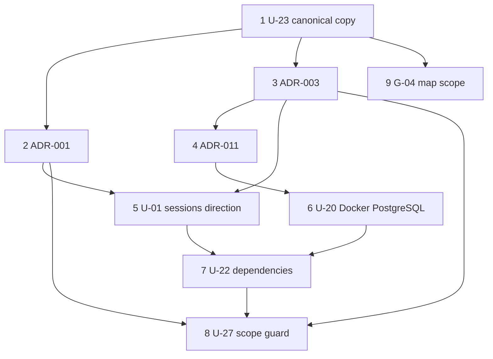

# Phase 2 — Owner Decision Register

**Status of this document:** a checkpoint for the owner. **Every decision in it is `PROPOSED`. None is `APPROVED`.** Prepared 2026-10-29 against local `main` at `b2a9f0c`. Documentation only: no application code, manifest, lockfile, Prisma schema, migration or Docker configuration was touched; no service was started, nothing was installed or pulled, and the existing PostgreSQL was not contacted.
**Source documents:** [Decision brief](PHASE_2_DECISION_BRIEF.md) · [Copy comparison](PHASE_2_REQUIREMENTS_COPY_COMPARISON.md) · [Unresolved decisions](PHASE_2_UNRESOLVED_DECISIONS.md). Also relevant: [Implementation plan](PHASE_2_IMPLEMENTATION_PLAN.md) · [Security review](PHASE_2_SECURITY_REVIEW.md) · [Data model](PHASE_2_DATA_MODEL.md) · [API contract](PHASE_2_API_CONTRACT.md) · [Tenant isolation](PHASE_2_TENANT_ISOLATION.md).

> **Status update, 2026-10-29:** the owner approved or decided `U-23`, `ADR-001`, `ADR-003`, `ADR-011`, `U-20`, `U-22`, `G-02` and authorised `U-26`, as recorded in [PHASE_2_DECISION_LOG.md](PHASE_2_DECISION_LOG.md). The cards and text below are **preserved as written** and still show `PROPOSED` because they predate that decision; for those eight items **the decision log controls the status**. Approval is not verification: the verification each decision still needs is listed in the log.

Identifiers `G-xx`, `U-xx`, `K-x` are defined in [the register of gates and decisions](PHASE_2_UNRESOLVED_DECISIONS.md). `ADR-*`, `BR-*`, `C-*` are the requirements package's, read against `NIVASA_PACKAGE_v0.2`.

## Rules for this register

| Rule                                                                                                                                                                                                                                                                                                                                  | Why                                                                                                                                 |
| ------------------------------------------------------------------------------------------------------------------------------------------------------------------------------------------------------------------------------------------------------------------------------------------------------------------------------------- | ----------------------------------------------------------------------------------------------------------------------------------- |
| Allowed statuses: **`PROPOSED`**, **`APPROVED`**, **`REJECTED`**, **`DEFERRED`**.                                                                                                                                                                                                                                                     | As requested                                                                                                                        |
| A status becomes `APPROVED` only when the owner's approval exists in the owner's own instrument and is cited in the **Approval evidence** column. For the three ADRs that instrument is `10_ARCHITECTURE_APPROVAL_REGISTER.md` §4 (a row with Approve / Amend / Reject, owner, date). A recommendation in any report is not approval. | The package: "A blank row means the decision is **not approved**. Implementation starting is not approval, and neither is silence." |
| The **Approval evidence** column below is blank for every decision. It stays blank until the owner supplies a reference.                                                                                                                                                                                                              | Prevents a recommendation reading as a decision                                                                                     |
| No older copy of the requirements package, and no source document, is edited by this register.                                                                                                                                                                                                                                        | Preservation                                                                                                                        |

## Confirmed existing decisions

| #   | Fact                                                                                                                                                                                                                                                                                                                                           | Source                                                                                                             |
| --- | ---------------------------------------------------------------------------------------------------------------------------------------------------------------------------------------------------------------------------------------------------------------------------------------------------------------------------------------------- | ------------------------------------------------------------------------------------------------------------------ |
| E-1 | In the canonical candidate (`NIVASA_PACKAGE_v0.2`) every row of the architecture approval record is blank, the owner sign-off checklist has 0 ticked items, and the corrections disposition table is blank.                                                                                                                                    | [Comparison](PHASE_2_REQUIREMENTS_COPY_COMPARISON.md#confirmed-existing-decisions)                                 |
| E-2 | `ADR-003` records PostgreSQL as "**approved in principle** by project review"; Prisma and tool versions are `PROPOSED`. "Approved in principle" "Does not authorise implementation on its own."                                                                                                                                                | `10_ARCHITECTURE_APPROVAL_REGISTER.md` §1 and the status vocabulary                                                |
| E-3 | The repository's legacy guard (`scripts/verify_m0_scope.py`) has SHA-256 `90150af7abce2e3acc5632dd79a53202d5d2e474cc589aadbe33292a01fb8f04` and runs 22 checks. CI (`.github/workflows/ci.yml`, SHA-256 `52c9490b5d5484ad1be91f365c6a71c791f592fae552ccb5bbbc19273c35cc5a`) runs it as `npm run verify:m0-scope`. Both were read, not changed. | Hashed 2026-10-29                                                                                                  |
| E-4 | Local checks: Node `24.22.1`, npm `11.6.2`, NestJS `12.3.2`, Prisma and `@prisma/client` `7.10.1`; live `npm audit` reported 0 vulnerabilities on 2026-10-29.                                                                                                                                                                                  | [Security review](PHASE_2_SECURITY_REVIEW.md#part-1--current-dependency-and-repository-status-verified-2026-10-29) |
| E-5 | The two source documents the ADR text is taken from: `10_…APPROVAL_REGISTER.md` SHA-256 `55b18f67fdcee1ce618371090ccc0dd4d0aea38fd92cac0121eb6777e10163f6`; `09_ARCHITECTURE_DECISIONS.md` SHA-256 `8b781571e905b563661a76ad89d0561417aaf9532a2eb289386f71de0db08f9b` (both in `NIVASA_PACKAGE_v0.2`).                                         | Hashed 2026-10-29                                                                                                  |

## Proposed architecture

The decision cards below are the proposals. Each states the exact decision wording, the options, the recommended choice, the amendments required, dependencies and affected documents, the validation evidence still needed, and the current status.

### Summary

| #   | Item                           | ID(s)              | Recommended choice                                                                          | Status       | Approval evidence |
| --- | ------------------------------ | ------------------ | ------------------------------------------------------------------------------------------- | ------------ | ----------------- |
| 1   | Canonical requirements package | `U-23`             | `~/Downloads/NIVASA_PACKAGE_v0.2/` as canonical; older copies superseded **after** approval | **PROPOSED** |                   |
| 2   | Backend architecture           | `ADR-001` (`G-01`) | Approve                                                                                     | **PROPOSED** |                   |
| 3   | Database and ORM               | `ADR-003` (`G-01`) | Approve with amendments                                                                     | **PROPOSED** |                   |
| 4   | Local development and CI       | `ADR-011` (`G-01`) | Approve with amendments                                                                     | **PROPOSED** |                   |
| 5   | Authentication direction       | `U-01` (`ADR-004`) | Server-side opaque sessions (a **direction**, not an implementation)                        | **PROPOSED** |                   |
| 6   | Local PostgreSQL               | `U-20`             | Docker on a loopback-only non-conflicting port, behind explicit disk and binding checks     | **PROPOSED** |                   |
| 7   | New dependencies               | `U-22`             | `@prisma/adapter-pg` (conditional), `zod`, `cookie`; installed per slice                    | **PROPOSED** |                   |
| 8   | Scope guard replacement        | `U-27`             | Allow-list guard with testable rules S1–S14                                                 | **PROPOSED** |                   |
| 9   | 2D spatial map                 | `G-04`             | In **product scope**; implementation gated on approved inventory and spatial contracts      | **PROPOSED** |                   |

### Evidence collected on 2026-10-29

Collected read-only. Third-party pages were read at a point in time and were not independently verified.

| Evidence                                                               | Result                                                                                                                                                                                                                | Source                                                                                            |
| ---------------------------------------------------------------------- | --------------------------------------------------------------------------------------------------------------------------------------------------------------------------------------------------------------------- | ------------------------------------------------------------------------------------------------- |
| PostgreSQL support policy                                              | "The PostgreSQL Global Development Group supports a major version for 5 years after its initial release. After this, a final minor version will be released and the software will then be unsupported (end-of-life)." | `https://www.postgresql.org/support/versioning/`                                                  |
| PostgreSQL **17**                                                      | Supported: **Yes**. Current minor `17.11`. First release 2024-09-26. **Final release 2029-11-08.**                                                                                                                    | Same                                                                                              |
| PostgreSQL 18                                                          | Supported: Yes. Current minor `18.6`. First release 2025-09-25. Final release 2030-11-14. (The newest major.)                                                                                                         | Same                                                                                              |
| PostgreSQL 16 (the unrelated local server's major)                     | Supported: Yes. Current minor `16.15`. Final release 2028-11-09.                                                                                                                                                      | Same                                                                                              |
| Docker image tag `postgres:17-alpine` (what `docker-compose.yml` pins) | A **floating** tag. Last pushed 2026-10-26. Compressed layers for `linux/arm64` ≈ **109.7 MiB** (this machine is arm64) and `linux/amd64` ≈ 111.8 MiB. The **uncompressed** size was not obtained.                    | Docker Hub public tag metadata (`hub.docker.com/v2/repositories/library/postgres/tags/17-alpine`) |
| Node 24 (the repository's pin, `24.22.1`)                              | LTS from 2025-10-28; **Maintenance LTS since 2026-10-20**; end of life **2028-04-30**. Supported, but no longer the newest LTS.                                                                                       | `https://raw.githubusercontent.com/nodejs/Release/main/schedule.json`                             |
| Node 26                                                                | **Became LTS on 2026-10-28**; end of life 2029-04-30. Not adopted or evaluated by this plan.                                                                                                                          | Same                                                                                              |
| `@prisma/client@7.10.1` Node engines                                   | `^20.19 \|\| ^22.12 \|\| >=24.0`                                                                                                                                                                                      | npm registry                                                                                      |

**What this evidence does and does not establish.** It establishes that PostgreSQL 17 is a **currently supported** major (and 18 is newer), and that Node 24 is a supported LTS. It does **not** establish that Prisma 7.10.1 works against PostgreSQL 17 (that needs the slice 2.1 spike), which major the **deployed** environment will use (`ADR-010`, `BR-OPS-005` are `OPEN`), or the unpacked size of the image.

---

### Decision 1 — Canonical requirements package (`U-23`)

**Status: `PROPOSED`.** Approval evidence: _(blank)_.

**Exact decision wording to record (if approved):**
"`~/Downloads/NIVASA_PACKAGE_v0.2/` is the canonical requirements package for Nook Phase 2. All `ADR-*`, `BR-*` and `C-*` identifiers are read against it. The copies in `~/Documents/Nook/` and the loose requirement files in `~/Downloads/` are historical, superseded drafts and are not to be used for sign-off. The package's own status remains 'Proposed; not approved'."

**Options.** (A) v0.2 canonical (recommended). (B) The older v0.1 set canonical. (C) Another copy, which the owner must identify.

**Recommended choice.** (A). Evidence: [comparison](PHASE_2_REQUIREMENTS_COPY_COMPARISON.md#recommendation). v0.2 is the only complete set (16 files), the handbook's own verification script reads it, and the older set numbers `ADR-001`, `ADR-003` and `ADR-011` inconsistently across its documents 09 and 10.

**Required amendments / conditions.**

1. Record the SHA-256 hashes of the canonical files (appendix of the comparison) in the owner's decision log.
2. Approvals reference v0.2 identifiers only.
3. **After approval only**, add a status note to the comparison report: "`~/Documents/Nook/` and the loose copies are superseded historical copies as of `<date>`". The copies themselves are never edited, renamed, moved or deleted.
4. Keep the product-name question (**Nivasa** in the package, **Nook** as the product, trademark clearance "Blocked" in the handbook) open and separate.

**Provenance status of each copy (what to record on approval; nothing is recorded now).**

| Copy                                                 | Today                                            | If decision approved            |
| ---------------------------------------------------- | ------------------------------------------------ | ------------------------------- |
| `~/Downloads/NIVASA_PACKAGE_v0.2/` (B)               | Candidate canonical. Unchanged.                  | **Canonical (proposed status)** |
| `~/Documents/Nook/` (A)                              | Older v0.1 set. Unchanged.                       | Superseded, historical only     |
| Loose `01…12`, `README (2).md` in `~/Downloads/` (C) | Byte-identical to A. Unchanged.                  | Superseded, historical only     |
| Loose `13`, `14` in `~/Downloads/` (C)               | Intermediate drafts of B's 13 and 14. Unchanged. | Superseded, historical only     |

**Dependencies.** None. Every other decision cites the text this one fixes.
**Affected documents.** The decision log (new, at approval); `PHASE_2_UNRESOLVED_DECISIONS.md` (`U-23` status); the comparison report (status note). No code.
**Validation evidence required.**

- ☑ Hashes of all 44 files recorded (comparison appendix), re-hashed unchanged on 2026-10-29.
- ☐ The owner confirms they reviewed v0.2 (`W-1`). Only the owner can supply this.
- ☐ Re-hash the canonical files at sign-off and compare with the appendix (`W-3`).

---

### Decision 2 — `ADR-001` backend architecture (`G-01`)

**Status: `PROPOSED`.** Approval evidence: _(blank)_. The register's own status for this row: `PROPOSED — approve/amend`.

**Register row, `ADR-001` (verbatim, `10_ARCHITECTURE_APPROVAL_REGISTER.md` §1; the four content cells, one per block)**

_Decision:_

```text
Backend architecture
```

_Proposed default:_

```text
NestJS + TypeScript, one modular monolith; modules remain explicit and business rules live in domain/application services, not controllers or React components.
```

_Reason / consequences:_

```text
Fastest safe starting point for two developers; transactional use cases can remain in one deployable process. No microservices in P0.
```

_Status / approval required:_

```text
**PROPOSED — approve/amend**
```

**Narrative (verbatim, `09_ARCHITECTURE_DECISIONS.md`)**

```text
### ADR-001 — Modular monolith on NestJS and TypeScript

**Status:** Proposed
**Decision:** One deployable backend application built with NestJS and TypeScript, with explicit modules for access, inventory, residents and stays, finance, deposits, reports, documents and audit. Business rules live in domain and application services, not in controllers or React components.

**Context:** The team has two developers and one initial customer. Core workflows need atomic transactions across related records. Microservices would introduce distributed deployment, observability and consistency overhead before product demand justifies them. Shared TypeScript reduces language switching with the React client, and a module-oriented framework helps maintain boundaries across two developers.

**Consequences:**
- Easier deployment and transactional composition.
- Modules need clear boundaries and interfaces to avoid a single unstructured codebase.
- The framework does not guarantee security. Guard placement, validation, transaction boundaries and tests remain the team's responsibility.
- Establish domain services, DTO validation, permission checks, typed error contracts and integration tests from the start.
- Separate services can be extracted later based on real scaling or organisational needs.

**Revisit when:** Team size, workload, deployment independence or integration needs demonstrate a measurable reason to split services.

*Version 0.1: this document's ADR-001 and ADR-003, merged.*
```

**Exact decision wording to record (if approved):** "`ADR-001` approved as written in `10_ARCHITECTURE_APPROVAL_REGISTER.md` v0.3 (SHA-256 `55b18f67fdcee1ce618371090ccc0dd4d0aea38fd92cac0121eb6777e10163f6`). Condition: this approval authorises the architectural direction only. Phase 2 builds only the access, inventory and audit modules. Residents and stays, finance, deposits, reports and documents, named in the narrative, are **not** authorised by this approval."

**Options.** Approve as written (recommended with the scope condition) · Amend (write the change in "Notes / conditions") · Reject (name the replacement).

**Required amendments.** The scope condition above (it keeps the module list in the narrative from being read as authority to build residents or finance). The source wording is retained **unchanged** in the quotation.

**Dependencies.** Decision 1 (text). No upstream ADR. Downstream: every slice.
**Affected documents.** Package register §4 (the owner fills the row); decision log; `PHASE_2_UNRESOLVED_DECISIONS.md` (`G-01`). No code.
**Validation evidence required.**

- ☑ The repository matches the direction: NestJS `12.3.2`, one `apps/api` with one `AppModule`.
- ☐ The owner's row in register §4 (decision, owner, date, conditions).

---

### Decision 3 — `ADR-003` database and ORM (`G-01`)

**Status: `PROPOSED`.** Approval evidence: _(blank)_. Register status: "PostgreSQL **approved in principle** by project review; Prisma and tool versions **PROPOSED**".

**Register row, `ADR-003` (verbatim, `10_ARCHITECTURE_APPROVAL_REGISTER.md` §1; the four content cells, one per block)**

_Decision:_

```text
Primary database and ORM
```

_Proposed default:_

```text
PostgreSQL as source of truth; Prisma ORM with versioned Prisma Migrate migrations. Exact supported PostgreSQL/Node/package-manager versions are pinned during scaffold approval after checking maintained releases.
```

_Reason / consequences:_

```text
Relational data, referential integrity, reporting, transactions, constraints and migrations fit the domain. No production `db push` or manual schema edits. Domain schema is not finalised in Milestone 0.
```

_Status / approval required:_

```text
PostgreSQL **approved in principle** by project review; Prisma and tool versions **PROPOSED**
```

**Narrative (verbatim, `09_ARCHITECTURE_DECISIONS.md`)**

```text
### ADR-003 — PostgreSQL as source of truth, with Prisma and versioned migrations

**Status:** PostgreSQL **approved in principle** by project review. Prisma, and the pinned tool and runtime versions, remain **Proposed**.
**Decision:** Use managed PostgreSQL as the source of truth for all domain data. Use Prisma ORM with versioned Prisma Migrate migrations. Exact supported PostgreSQL, Node and package-manager versions are pinned at scaffold approval, after checking maintained releases. *(C-06)*

**Context:** Nivasa's central records are relational: organisations, properties, rooms, beds, stays, rental terms, charges, payments, allocations and deposit entries. Correct reporting, referential integrity and multi-record financial operations are core requirements.

**Why not default to MongoDB and the MERN stack:** MongoDB can support transactions, but a document-first structure gives no clear advantage for the key workflows and would push more relationship and reporting integrity into application code. This is a domain-fit decision, not a claim that MongoDB cannot be used for financial applications.

**Consequences:**
- Use relational constraints and transactions where appropriate.
- Design indexes from actual queries after the data model is approved.
- Migrations are reviewed in pull requests and tested against a clean PostgreSQL database in CI.
- **Production `db push` and manual schema editing are prohibited.** Schema history must be reproducible from the migration record alone. *(C-06)*
- Do not finalise the domain schema during Milestone 0. Schema implementation begins only after the conceptual model and the business rules for enabled features are approved.
- Row-level security is considered only after the team can safely manage connection context, database roles and policies — see ADR-007.

**Revisit when:** A future workload or data domain has proven document-store needs that justify a separate datastore. PostgreSQL remains the source of truth for financial and occupancy records unless separately approved.

*Version 0.1: this document's ADR-002, extended with the ORM and migration decision.*
```

**Proposed amendments (additions only; the source wording above stays as written):**

1. **PostgreSQL major.** "Local development pins PostgreSQL **17**. Maintained-release evidence collected 2026-10-29: 17 is supported, current minor 17.11, final release 2029-11-08 (`postgresql.org/support/versioning`). PostgreSQL 18 is also supported and is the newer major. **The final PostgreSQL major is not selected by this approval**; it is decided with `ADR-010` (hosting) and must match the deployed major."
2. **Prisma.** "Prisma and `@prisma/client` `7.10.1`, exact pins. The CLI is always run from the installed pin; the `latest` dist-tag currently points to a release candidate (`8.0.0-rc.28`) and must not be used (`S-01`)."
3. **Hosting and region** remain open under `ADR-010`; "managed PostgreSQL" in the source text is an intention, not a selected provider.
4. **No schema before approval:** the source rule "Schema implementation begins only after the conceptual model and the business rules for enabled features are approved" is repeated as a condition and tied to `G-03`.

**Options.** Approve with amendments (recommended) · Approve as written · Reject (the package's alternative, MongoDB, was considered and not defaulted to).

**Dependencies.** Decision 1. Prerequisite for `G-03` and every migration. The deployed-version question depends on `ADR-010` and `BR-OPS-005` (`OPEN`, `U-21`).
**Affected documents.** Package register §4; decision log; `PHASE_2_DATA_MODEL.md` (migration strategy, V-8); `PHASE_2_UNRESOLVED_DECISIONS.md` (`G-01`, `U-21`). No code until slice 2.1.
**Validation evidence required.**

- ☑ **Maintained-release check for PostgreSQL 17**: supported until 2029-11-08 (retrieved 2026-10-29).
- ☐ **Final PostgreSQL major selection**: not made. Needs the owner and `ADR-010`.
- ☐ Prisma `7.10.1` compatibility with PostgreSQL 17: **not confirmed**; proven by the slice 2.1 spike (`V-1`, `V-4`).
- ☐ Generator and driver-adapter configuration (`U-26`): spike.
- ☐ The owner's row in register §4.

---

### Decision 4 — `ADR-011` local development and CI (`G-01`)

**Status: `PROPOSED`.** Approval evidence: _(blank)_. Register status: `PROPOSED — approve/amend`.

**Register row, `ADR-011` (verbatim, `10_ARCHITECTURE_APPROVAL_REGISTER.md` §1; the four content cells, one per block)**

_Decision:_

```text
Local development and CI
```

_Proposed default:_

```text
Single repository with a pinned package manager/workspace; pinned supported Node LTS version; Docker Compose PostgreSQL at the same major version chosen for deployed environments; `.env.example` contains placeholders only. CI checks formatting, lint, typecheck, unit/integration tests, build, migration-on-empty-database, dependency review and secret scanning.
```

_Reason / consequences:_

```text
A new developer can reproduce checks from a clean clone. No secrets or real resident data are required.
```

_Status / approval required:_

```text
**PROPOSED — approve/amend**
```

**Narrative (verbatim, `09_ARCHITECTURE_DECISIONS.md`)**

```text
### ADR-011 — Reproducible local development and CI quality gates

**Status:** Proposed
**Decision:** A single repository with a pinned package manager and workspace strategy, a pinned supported Node LTS version, and Docker Compose PostgreSQL at the same major version chosen for deployed environments. `.env.example` contains placeholders only. CI checks formatting, lint, typecheck, unit and integration tests, build, migration against an empty database, dependency review and secret scanning.

**Rationale:** A new developer must reproduce every check from a clean clone. No secrets and no real resident data are required to do so.

**Consequences:** CI uses synthetic values only. No required check may pass by silently skipping tests. This decision is realised by Milestone 0 (`13_MILESTONE_0_PREPARATION_PLAN.md`).

*Version 0.1: no narrative existed in this document.*
```

**Proposed amendments (additions only):**

1. **"Same major version chosen for deployed environments" is provisional.** No deployed major exists (`ADR-010` is `OPEN`), so the clause cannot be checked. Local pin: PostgreSQL 17.
2. **Pinning precision.** `docker-compose.yml` uses the floating tag `postgres:17-alpine`, which changes whenever a new minor is published (last pushed 2026-10-26). Whether "pinned" means a minor-version tag or an image digest is a decision for the owner when `docker-compose.yml` is next changed (see Decision 6). The source wording does not say.
3. **CI gaps recorded, not hidden.** Integration tests and a migration-on-empty-database job do not exist; they are added when the first migration lands (slice 2.2). Dependency review is `npm audit --audit-level=high` only; secret scanning is a four-pattern baseline.
4. **"Realised" claim.** `ADR-011` is not treated as realised until a **hosted CI run on a clean clone** is verified (`G-02`). CI has never been shown to run.
5. **Node.** The source requires a "pinned supported Node LTS version". Node `24.22.1` is pinned and supported (Maintenance LTS since 2026-10-20, end of life 2028-04-30). Node 26 became LTS on 2026-10-28. **No Node change is proposed.**

**Options.** Approve with amendments (recommended) · Approve as written · Reject.

**Dependencies.** Decisions 1 and 3 (the PostgreSQL major); `G-02` (Milestone 0 acceptance); `ADR-010` (deployed major).
**Affected documents.** Package register §4; decision log; `PHASE_2_UNRESOLVED_DECISIONS.md` (`G-01`, `G-02`). Later (not now): `.github/workflows/ci.yml` (integration and migration jobs).
**Validation evidence required.**

- ☑ Conformance table of the repository against each `ADR-011` element ([decision brief](PHASE_2_DECISION_BRIEF.md#adr-011--local-development-and-ci-status-proposed--approveamend)).
- ☑ Node 24 supported-LTS status (retrieved 2026-10-29).
- ☐ A hosted CI run passes on a clean clone. **Not run.**
- ☐ The owner's row in register §4.

---

### Decision 5 — Server-side opaque sessions (`U-01`, `ADR-004`)

**Status: `PROPOSED`.** Approval evidence: _(blank)_. **This is recorded as the recommended authentication direction. It is not an implementation, and nothing authenticates anyone today.**

**Exact decision wording to record (if approved):** "Browser authentication for Nook uses **server-side, revocable, opaque sessions** in an `HttpOnly` cookie, as proposed in `ADR-004`, with CSRF protection on every state-changing request. **No JWT is adopted.** Session expiry values, password hashing, MFA, rate limits and the recovery channel remain open (`U-02` to `U-06`) and are decided before any shared environment. This records a direction; implementation is gated by slice 2.2 and 2.3 entry conditions."

**Options.** A. Opaque server-side session (recommended). B. Short-lived JWT in a cookie plus server-side refresh and revocation state. C. JWT held by JavaScript and sent in a header. (Full comparison in the [brief](PHASE_2_DECISION_BRIEF.md#brief-3--server-side-sessions-or-jwt-u-01).) The package source: `ADR-004`, "Server-side opaque sessions, not long-lived JWTs in browser storage."

**Required amendments / conditions.** If the owner wants JWT for a reason the package does not contain (for example a native client), state the reason and choose B. Under any option, tenant isolation comes from the membership lookup, scoped access, database constraints and tests, not from the token.

**Dependencies.** Decisions 1 to 3. Feeds Decision 7 (the `cookie` package) and `U-02`…`U-06`. Needed by slice 2.3, not by slice 2.1.
**Affected documents.** Package register §4 (`ADR-004`, and §3 parameters); `PHASE_2_UNRESOLVED_DECISIONS.md` (`U-01`); if B or C: `PHASE_2_API_CONTRACT.md`, `PHASE_2_DATA_MODEL.md`, `PHASE_2_TENANT_ISOLATION.md`, `PHASE_2_SECURITY_REVIEW.md`. Code (later): `apps/api/src/auth/*`, `main.ts`, `config.ts`, `.env.example`, a `sessions` migration.
**Validation evidence required.**

- ☑ No copy of the package proposes JWT (comparison, F-section).
- ☐ The owner's choice among A, B, C, and any stated reason for JWT.
- ☐ Later, before any shared environment: the tests in the brief (`XT-15`…`XT-18`, `XT-30`, `XT-31`, cookie attributes, CSRF rejection, rotation, expiry, revocation, log redaction).

---

### Decision 6 — Isolated Docker PostgreSQL (`U-20`)

**Status: `PROPOSED`.** Approval evidence: _(blank)_.

**Exact decision wording to record (if approved):** "The project's local PostgreSQL runs from the pinned Docker Compose service on a **loopback-only host port other than 5432**. The existing Homebrew PostgreSQL on port 5432 is never used by this project without the owner's separate written consent. Before any container is started, the **explicit checks** below pass."

**Options.** A. Docker Compose on loopback, non-conflicting port (recommended). B. A dedicated database and role inside the existing PostgreSQL 16 (needs explicit owner consent; not recommended). C. A second self-managed PostgreSQL 16 instance on another port.

**Recommended choice.** A, with these as **explicit, recorded checks** (each must pass and be noted before any start; none was run or changed in this task):

| Check                                    | Required result                                                                                                                                                                       | State today (2026-10-29)                                                                                                                                                            |
| ---------------------------------------- | ------------------------------------------------------------------------------------------------------------------------------------------------------------------------------------- | ----------------------------------------------------------------------------------------------------------------------------------------------------------------------------------- |
| **Loopback binding**                     | The compose port mapping names a host address: `127.0.0.1:<port>:5432`. `docker compose config` and `docker port` show only `127.0.0.1`. **Never** `0.0.0.0` or a bare `<port>:5432`. | **Not met by the current file**: it contains the bare mapping `'5432:5432'`. The all-interfaces behaviour is Docker's documented default and was **not observed** (daemon stopped). |
| **Port not 5432**                        | The chosen port is not `5432`, and `lsof` shows nothing already listening on it                                                                                                       | Port `5432` is held by the unrelated PostgreSQL 16 (PID 885). A new port has not been chosen or probed                                                                              |
| **Disk-space threshold**                 | Free space on the data volume is at least the **owner-set threshold** before Docker is started or an image is pulled. **Proposed: 5 GiB.** The owner sets the number.                 | **Not met**: **1.3 GiB free (100% used)** at the last reading, down from 2.7 GiB earlier the same day; Docker Desktop already holds about 2.1 GB.                                   |
| **Image size known**                     | The image's compressed size is recorded; the owner accepts it                                                                                                                         | Recorded: `postgres:17-alpine` ≈ 109.7 MiB (arm64) compressed. Uncompressed **unknown**                                                                                             |
| **Existing volumes listed**              | `docker volume ls` is reviewed before any `down -v`. The named volume `nook_postgres_data` may already exist                                                                          | **Not checked** (daemon stopped)                                                                                                                                                    |
| **No connection to the existing server** | Tooling refuses port `5432` and unexpected database names                                                                                                                             | Guard not written; no connection was made in any task step                                                                                                                          |

**Required amendments.** Loopback binding and the disk threshold are conditions of approval, not optional hardening. `.env.example` and `README.md` currently aim at port `5432`; they change with the compose file (not in this task).

**Dependencies.** Decision 4 (`ADR-011`). Feeds Decision 7 and slice 2.1.
**Affected documents / files after approval (not now):** `docker-compose.yml` (ports line), `.env.example` (port), `README.md` (line 25 and setup), a new tooling guard under `scripts/`; `PHASE_2_UNRESOLVED_DECISIONS.md` (`U-20`); `PHASE_2_SECURITY_REVIEW.md` (add the all-interfaces observation). `scripts/verify_m0_scope.py` needs **no** change for this.
**Validation evidence required.**

- ☑ Image compressed size and last-push date (Docker Hub metadata).
- ☐ **Free space ≥ the owner's threshold.** Not met.
- ☐ Binding verified as loopback-only after the edit.
- ☐ `pg_isready` on the new port and `GET /api/v1/health/database` returns `ok`.
- ☐ Existing Docker volumes listed and reviewed.

---

### Decision 7 — Minimum dependencies (`U-22`)

**Status: `PROPOSED`.** Approval evidence: _(blank)_. **Nothing is installed.**

**Exact decision wording to record (if approved):** "The following new dependencies are approved **individually and for installation per slice**, each added with `npm install -w @nook/api --save-exact`, each as its own commit, each followed by `npm audit` and `npm audit signatures`: `@prisma/adapter-pg@7.10.1` (only if the slice 2.1 spike shows it is required); `zod@4.6.7` (when the first request DTO is written); `cookie@2.0.1` (slice 2.3). Re-verify each version from the registry at install time. No other dependency, and no dependency upgrade, is approved."

**Options.** Approve the minimal list above (recommended) · Approve with alternatives (for example `class-validator`) · Defer all.

**Recommended choice.** The minimal list. Not in the list, on purpose: `@nestjs/throttler` (deferred until rate-limit thresholds exist, before any shared environment), an argon2 package (only if `U-03` rejects the built-in `node:crypto` scrypt), `supertest`, `cookie-parser`, `class-validator` and `class-transformer`. Registry facts are in the [brief](PHASE_2_DECISION_BRIEF.md#brief-6--minimum-new-dependencies-u-22) (metadata only; no package was downloaded or inspected).

**Required amendments.** Install **timing**: only `@prisma/adapter-pg` could be needed in slice 2.1, so `zod` and `cookie` are not installed until the slices that use them. This keeps the dependency tree no larger than the current gate requires.

**Dependencies.** Decision 5 (cookie handling) and Decision 6 (database route); `U-03` (hashing choice) and `U-26` (Prisma generator).
**Affected documents / files after approval (not now):** `apps/api/package.json`; `package-lock.json` (written by npm, never by hand); `PHASE_2_SECURITY_REVIEW.md`; the scope-guard manifest (Decision 8).
**Validation evidence required.**

- ☑ Registry metadata for each candidate recorded 2026-10-29.
- ☐ The slice 2.1 spike shows `@prisma/adapter-pg` is required and sufficient (`V-4`). This spike itself needs an install in a throwaway directory, so Decision 7 must be approved before it runs.
- ☐ After each install: `npm audit` 0 vulnerabilities; `npm audit signatures` clean; lockfile diff reviewed; build and typecheck pass; disk checked.

---

### Decision 8 — Scope guard replacement (`U-27`)

**Status: `PROPOSED`.** Approval evidence: _(blank)_.

**Current guard, not modified:** `scripts/verify_m0_scope.py`, SHA-256 `90150af7abce2e3acc5632dd79a53202d5d2e474cc589aadbe33292a01fb8f04`, 22 checks, run by `npm run verify:m0-scope` and CI. It fails on any `model` and any `migration.sql`. It will therefore fail on the first approved schema **by design**.

**Exact decision wording to record (if approved):** "The Milestone 0 scope guard is **replaced, not weakened**, by a Phase 2 scope guard that allow-lists exactly the approved models, tables, routes and dependencies and fails on everything else, with its own self-tests. `scripts/verify_m0_scope.py` is **never edited**; its recorded hash is checked by the new guard. The M0 guard stops running in CI **only** in the same approved change that introduces the first migration, and the new guard must already pass on the repository as it stands today."

**Options.** A. Replace with an allow-list guard (recommended). B. Edit the M0 guard in place. C. Remove it. (B and C are rejected by the recommendation: they lose history or the only control against unapproved resident and finance models.)

**Proposed testable rules.** Each rule is written as a check with the fixture that proves it works. **Nothing is created now.** Rules S1–S12 are from the [brief](PHASE_2_DECISION_BRIEF.md#brief-7--replacing-the-milestone-0-scope-guard-u-27); **S13 and S14 are additions proposed in this checkpoint** to answer "do not disable or silently weaken the existing guard".

| ID      | Rule (guard fails when…)                                                                                                                                                                                                                                                                                                                                                 | Test fixture that must **fail**                                       | Must pass on                               |
| ------- | ------------------------------------------------------------------------------------------------------------------------------------------------------------------------------------------------------------------------------------------------------------------------------------------------------------------------------------------------------------------------ | --------------------------------------------------------------------- | ------------------------------------------ |
| S1      | A retained M0 check regresses: a required file missing; `.env` present; `.env.example` lacking `nook_local_only` and `localhost`; an obsolete `verify:docs` reference; "real resident data" or "production deployment" absent from the scope docs                                                                                                                        | A copy of the tree with `.env` created                                | Today's tree                               |
| S2      | `schema.prisma` declares any `model`, `enum`, `view` or composite `type` not listed for an **approved** slice                                                                                                                                                                                                                                                            | Add `model Resident {}`; add an unlisted `enum`                       | The approved slice's schema                |
| S3      | A migration creates or alters a table, type, index, trigger, policy, function or extension, or grants on an object, not in the manifest; or lacks the first-line tag `-- phase-scope: slice-<n>`                                                                                                                                                                         | A migration `CREATE TABLE payments`; an untagged migration            | The approved slice's migration             |
| S4      | A migration contains `DROP TABLE`, `DROP COLUMN`, `DROP TYPE`, `TRUNCATE`, `DELETE FROM` or a column type change without `-- destructive-approved: <resolvable ref>`                                                                                                                                                                                                     | A migration with `DROP TABLE organizations`                           | Phase 2 migrations (none are destructive)  |
| S5      | In Git, a previously committed `migration.sql` is modified, renamed or deleted (additions only pass)                                                                                                                                                                                                                                                                     | Edit an earlier migration in a scratch repository                     | A history with only added migrations       |
| S6      | An identifier in the schema, SQL, route paths or new source file names splits into a forbidden whole word (resident, stay, booking, hold, enquiry, charge, payment, invoice, receipt, deposit, refund, settlement, ledger, rent, fee, balance, price, amount, document, upload, kyc, aadhaar, otp, sms, whatsapp), unless an explicit reviewed manifest exception exists | A `payment_status` column; a `ResidentController` file                | Approved identifiers (whole-word matching) |
| S7      | The schema uses `Decimal` or `Float`, or a column is named as money, with no approved slice allowing it                                                                                                                                                                                                                                                                  | A `Decimal` column                                                    | Phase 2 schema (no money)                  |
| S8      | A controller or route decorator under `apps/api/src` yields a path not in the manifest's route list (taken from the API contract)                                                                                                                                                                                                                                        | `@Get('residents')`                                                   | The contract's routes                      |
| S9      | `$queryRaw`, `$executeRaw` or their `Unsafe` forms appear outside manifest-listed files                                                                                                                                                                                                                                                                                  | A file calling `$queryRawUnsafe`                                      | Repository without raw calls               |
| S10     | A workspace dependency is not in the baseline snapshot or approved additions; or uses a range (`^`, `~`) instead of an exact pin; or matches a payment or messaging SDK pattern (for example `razorpay`, `stripe`, `twilio`)                                                                                                                                             | Add `razorpay` to a scratch `package.json`; add `"zod": "^4.6.7"`     | Approved exact pins only                   |
| S11     | A slice present in the schema has an empty approver, date or reference in the manifest, or the referenced file does not exist                                                                                                                                                                                                                                            | A slice entry with a blank approver                                   | Entries with resolvable references         |
| S12     | The guard's own self-tests fail. They run in CI **before** the guard                                                                                                                                                                                                                                                                                                     | Each fixture above, run through the guard, must make it exit non-zero | A clean fixture exits 0                    |
| **S13** | **Legacy guard integrity:** the SHA-256 of `scripts/verify_m0_scope.py` differs from the baseline recorded at approval (`90150af7abce2e3acc5632dd79a53202d5d2e474cc589aadbe33292a01fb8f04`), unless the manifest carries an owner-approved replacement hash with a resolvable reference                                                                                  | Append one comment line to a copy of the legacy guard                 | Today's unmodified file                    |
| **S14** | **A guard always runs:** `package.json` lacks both `verify:m0-scope` and `verify:scope`, or `.github/workflows/ci.yml` has no step that runs one of them. The M0 step may be removed from CI only when `verify:scope` is present and S13 passes                                                                                                                          | A copy of `ci.yml` with the guard step deleted                        | Today's CI file (M0 step present)          |

**How "not silently weakened" is met.** The legacy guard is never edited (S13 detects any edit). Zero guards in CI is impossible (S14). The replacement is strictly stricter than the original on every point the original covered, and it covers points the original did not (SQL, enums, routes, dependencies, money types). Its protection is itself tested (S12).

**Explicit consequence the owner must acknowledge.** Once the first approved migration exists the legacy guard **cannot pass**, so it must leave CI in that same change. That is the point of approving Decision 8 _before_ slice 2.2, not a loosening of scope.

**Rollout order (when approved).** (1) Add manifest, guard, self-tests; they must pass on **today's** tree. (2) Repoint CI, README step 7 and `package.json` scripts (an addition of `verify:scope`). (3) In slice 2.2, add the first migration **and** its manifest entry with approval reference in one change.

**Dependencies.** Decisions 2, 3 and 7 (approved ADRs and dependency list feed the manifest). Needed before slice 2.2.
**Affected documents / files after approval (not now):** new `scripts/verify_phase_scope.py`, `scripts/phase_scope.json`, `scripts/test_phase_scope.py`; `package.json` (scripts only); `.github/workflows/ci.yml`; `README.md` (setup step 7 and the line the old guard's phrase check reads); `docs/MILESTONE_0_SCOPE.md` (a note that it covers Milestone 0 only); `PHASE_2_UNRESOLVED_DECISIONS.md`. `scripts/verify_m0_scope.py`: **no change**.
**Validation evidence required.**

- ☑ Current guard inventory: 22 checks, hash recorded.
- ☐ New guard passes on today's tree. **Not written.**
- ☐ Each S-rule fixture makes the guard fail. **Not written.**
- ☐ Vocabulary list reviewed for false positives (`B-7`).
- ☐ Hosted CI runs the guard (`G-02`). **Not run.**

---

### Decision 9 — 2D spatial map scope (`G-04`)

**Status: `PROPOSED`.** Approval evidence: _(blank)_. **Owner direction noted:** the 2026-10-29 checkpoint instruction says to keep the 2D map in product scope. That direction is **not yet recorded** in the owner's instrument (the handbook's decision record in Chapter 24) and does not by itself satisfy `G-04`, so the status stays `PROPOSED`.

**Exact decision wording to record (if approved):** "The interactive 2D floor plan **remains in Nook's product scope**. It is **not** a pilot go-live gate. Its implementation is **gated** on approved **inventory** and **spatial** contracts, listed below. Until every gate is `APPROVED`, no layout table, migration or floor-plan route is built, and the Phase 1 floor plan remains a labelled demonstration."

**Options.** (1) In the pilot scope as a go-live gate. (2) Deferred from the pilot. (3) **In product scope, not a pilot gate; implementation gated on approved contracts (recommended, and matching the owner direction noted above).**

**Gates for implementation (all must be `APPROVED` before slice 2.5):**

| Gate                   | What must be approved                                                                                                                                                                                                                      | Where                                                                        |
| ---------------------- | ------------------------------------------------------------------------------------------------------------------------------------------------------------------------------------------------------------------------------------------ | ---------------------------------------------------------------------------- |
| **Inventory contract** | The conceptual model including floors (`G-03`); label uniqueness (`U-14`); bed status semantics and the out-of-service concept (`U-13`, `BR-LIF-002/004`); archival rule (`U-15`); slice 2.4's inventory endpoints and their passing tests | [Data model](PHASE_2_DATA_MODEL.md), [API contract](PHASE_2_API_CONTRACT.md) |
| **Spatial contract**   | Layout scope, read-only and seeded (`U-12`); coordinate units, schematic (`U-17`); the floor-plan response shape, including `availability: NOT_COMPUTED`                                                                                   | [API contract](PHASE_2_API_CONTRACT.md#floor-plan-resource)                  |
| **Scope decision**     | `G-04` itself, recorded in the handbook's Chapter 24 decision record and this register                                                                                                                                                     | Handbook Ch. 24                                                              |

**Required amendments.** Make slice 2.5's entry conditions explicit: the plan lists "slice 2.4 exit, `G-04` decided, `U-12`, `U-17`", with `G-03`, `U-13` and `U-14` only implied through earlier slices. This register states them as separate gates.

**Dependencies.** Decisions 2 and 3; `G-03`; slice 2.4 exit. Does **not** block slices 2.1 to 2.4.
**Affected documents (when approved):** handbook Ch. 24 record (owner updates it); `PHASE_2_IMPLEMENTATION_PLAN.md` slice 2.5; `PHASE_2_DATA_MODEL.md` (layout group); `PHASE_2_API_CONTRACT.md` (floor-plan route); `PHASE_2_UNRESOLVED_DECISIONS.md` (`G-04`, `U-12`, `U-17`). Code (later): a four-table migration, a layout validator, a seed from the Phase 1 geometry, one read-only route. **No change to `apps/web`** until `U-24`.
**Validation evidence required.**

- ☑ The map is absent from the approved package and is new, unreviewed scope (handbook Chapters 7 and 24).
- ☐ The owner records the decision in the handbook's decision record.
- ☐ Inventory and spatial contracts approved (table above).
- ☐ Later: validator parity with Phase 1 (`V-5`), contract shape test, `XT-11`.

---

## Dependencies and signing order



| Order | Item                  | Needs first     | What approval alone unlocks                      |
| ----- | --------------------- | --------------- | ------------------------------------------------ |
| 1     | `U-23` canonical copy | none            | A fixed text for every later signature           |
| 2     | `ADR-001`             | 1               | Direction only                                   |
| 3     | `ADR-003`             | 1               | PostgreSQL 17 as the local pin; Prisma direction |
| 4     | `ADR-011`             | 1, 3            | The CI and local-development target              |
| 5     | `U-01` sessions       | 2, 3            | Slice 2.3 design                                 |
| 6     | `U-20` Docker         | 4               | Part of slice 2.1                                |
| 7     | `U-22` dependencies   | 5, 6            | The slice 2.1 spike and later installs           |
| 8     | `U-27` scope guard    | 2, 3, 7         | Slice 2.2 may begin once `G-03` is also approved |
| 9     | `G-04` map            | 1 (can be last) | Slice 2.5 only, with the contract gates          |

## Discrepancies between the source documents

Found while preparing this register. **No source document was edited to resolve them.** Each has a resolution applied in this register, for the owner to confirm.

| #    | Discrepancy                                                                                                                                                                                                                                                | Where                                                                   | Resolution used here                                                                                                                                                      |
| ---- | ---------------------------------------------------------------------------------------------------------------------------------------------------------------------------------------------------------------------------------------------------------- | ----------------------------------------------------------------------- | ------------------------------------------------------------------------------------------------------------------------------------------------------------------------- |
| X-1  | **Slice 2.1's entry conditions differ.** The plan lists `G-01`, `G-02` (or an owner waiver), `U-20`, `U-22`, `U-26`. The brief's table says the nine approvals unlock "Slice 2.1" and omits `G-02` and `U-26`.                                             | Plan (slice 2.1) against brief (approval table)                         | The plan is the fuller list. **Next gate below adds `G-02` and `U-26`.**                                                                                                  |
| X-2  | **`U-26` is both an entry condition and slice 2.1 work.** The plan puts it in the entry list and also says the Prisma spike happens in slice 2.1.                                                                                                          | Plan (slice 2.1)                                                        | Treated as: the owner **authorises the spike** (entry); the spike's **result** closes `U-26` (exit).                                                                      |
| X-3  | **The spike needs an install.** The brief says the minimum list is approved before use, yet the spike needs `@prisma/adapter-pg` in a throwaway directory.                                                                                                 | Brief 6 against plan (slice 2.1)                                        | Decision 7 must be `APPROVED` **before** the spike runs.                                                                                                                  |
| X-4  | **Slice 2.5 entry omits some contract gates.** The plan lists "slice 2.4 exit, `G-04`, `U-12`, `U-17`", while the checkpoint requires approved inventory and spatial contracts.                                                                            | Plan (slice 2.5) against this checkpoint                                | Decision 9 states the gates explicitly (adds `G-03`, `U-13`, `U-14`, `U-15`).                                                                                             |
| X-5  | **Loopback binding is missing from earlier text.** `U-20` recommends changing the host port but not the bind address; the security review's `S-03` records the port collision but not the all-interfaces default. The brief adds the loopback requirement. | Unresolved decisions (`U-20`), security review (`S-03`) against brief 5 | Decision 6 makes loopback binding a condition. The earlier documents are unchanged and should be updated when the owner approves this register.                           |
| X-6  | **The guard proposal grew.** The brief has rules S1–S12. This checkpoint adds S13 (legacy guard integrity) and S14 (a guard always runs).                                                                                                                  | Brief 7 against this checkpoint                                         | Decision 8 lists S1–S14 and marks S13–S14 as additions.                                                                                                                   |
| X-7  | **"Do not disable" versus "leave unmodified".** The brief's rollout leaves `verify_m0_scope.py` unmodified but repoints CI, so the legacy guard stops running in CI. That could be read as disabling it.                                                   | Brief 7 (rollout step 2)                                                | Decision 8 states the exact condition: it leaves CI only in the approved change that adds the first migration, with S13 and S14 holding. The owner must acknowledge this. |
| X-8  | **Node LTS status was "not verified" in the brief** (`ADR-011` conformance table). It is now: Node 24 is supported (Maintenance LTS since 2026-10-20), and Node 26 became LTS on 2026-10-28.                                                               | Brief 2 against evidence collected today                                | Recorded as evidence. The brief's "Met (pinned)" row stays accurate. No Node change proposed.                                                                             |
| X-9  | **The compose image tag floats.** `ADR-011` says "pinned" while `docker-compose.yml` uses `postgres:17-alpine`, which moves with each minor release. No earlier document noted this.                                                                       | `ADR-011` against `docker-compose.yml`                                  | Raised as amendment 2 on Decision 4; the owner decides minor tag versus digest when the compose file is next changed.                                                     |
| X-10 | **The handbook calls v0.2 "approved"; the package calls itself "Proposed; not approved".**                                                                                                                                                                 | Handbook appendix text against `NIVASA_PACKAGE_v0.2/README.md`          | Recorded in Decision 1 and the comparison. Treated as **not approved**. The handbook wording needs correcting when it is regenerated (out of scope).                      |
| X-11 | **"Seven blockers" versus nine items.** The brief names seven blockers; the register lists nine items because the ADR blocker is three ADRs and the checkpoint lists `U-23` and `G-04` separately.                                                         | Brief against this checkpoint                                           | Not a conflict. Item numbers 1–9 are used here.                                                                                                                           |

## Next safe implementation gate

**Nothing is implementable yet.** The next **safe** gate is **starting slice 2.1 (environment and database foundation)**, which writes **no schema**. It opens only when **all** of these are true:

1. Decisions 1, 2, 3 and 4 are `APPROVED` (`U-23`, `ADR-001`, `ADR-003`, `ADR-011`), with the owner's register rows filled in.
2. Decision 6 is `APPROVED` **and** its explicit checks pass: loopback binding, a port other than 5432, free space at or above the owner's threshold (**not met today: 1.3 GiB free**), and volumes listed.
3. Decision 7 is `APPROVED`, so the Prisma spike may install `@prisma/adapter-pg` in a throwaway directory.
4. `G-02` has an owner decision: accept that Milestone 0's missing evidence (PostgreSQL health, CI on a clean clone) is gathered **inside** slice 2.1, or waive it in writing (`X-1`).
5. The owner authorises the `U-26` spike (`X-2`).

Decisions 5 and 8 are **not** needed to start slice 2.1. Decision 5 gates slice 2.3 design; Decision 8 gates slice 2.2, which also needs `G-03`. Decision 9 gates slice 2.5 only.

**Await explicit owner approval before implementing any Phase 2 work.**

## Unresolved decisions

All nine items above are unresolved until the owner decides. Also still open and **not** settled by this register: `G-02`, `G-03`, `G-05`, `G-06`, `U-02` to `U-19`, `U-21`, `U-24`, `U-25`, `U-26`. See [the register](PHASE_2_UNRESOLVED_DECISIONS.md).

## Validation still required

| #    | Claim                                                                | Status                                                                                 |
| ---- | -------------------------------------------------------------------- | -------------------------------------------------------------------------------------- |
| R-1  | The owner reviewed v0.2 and not the older copy                       | Not confirmable here (`W-1`)                                                           |
| R-2  | PostgreSQL 17 is a maintained release                                | **Collected** 2026-10-29 (supported until 2029-11-08). Third-party page, point in time |
| R-3  | The final PostgreSQL major, matching the deployed environment        | **Not decided** (`ADR-010`, `U-21`)                                                    |
| R-4  | Prisma 7.10.1 works against PostgreSQL 17                            | **Not confirmed** (spike)                                                              |
| R-5  | Docker image uncompressed size; the daemon starts; volumes inspected | **Not run**                                                                            |
| R-6  | The compose mapping publishes on all interfaces                      | **Not observed**                                                                       |
| R-7  | Free disk meets the owner's threshold                                | **Not met** (1.3 GiB at last reading)                                                  |
| R-8  | The replacement guard and its self-tests exist and pass              | **Not written**                                                                        |
| R-9  | Hosted CI passes on a clean clone                                    | **Not run** (`G-02`)                                                                   |
| R-10 | Mermaid diagrams render                                              | **Not rendered.** Structure checked only                                               |

## Revision history

| Version | Date       | Change                                                                               |
| ------- | ---------- | ------------------------------------------------------------------------------------ |
| 0.1     | 2026-10-29 | Initial owner decision register. Every status `PROPOSED`. No source document edited. |
