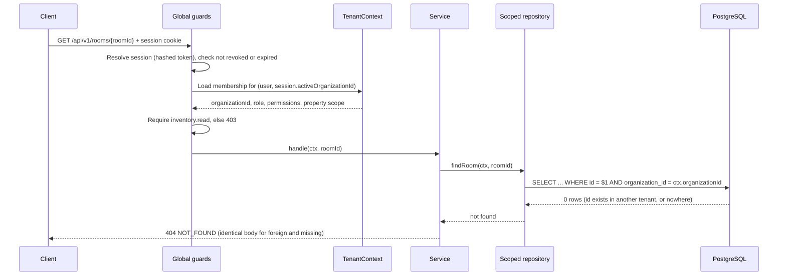

# Phase 2 — Tenant Isolation Design and Negative Test Plan

**Status:** Proposed design. **No isolation property is claimed to hold today.** There is no authentication, no tenant context and no domain table in the repository. The statement in `docs/MILESTONE_0_SCOPE.md` stands: "No tenant isolation … is claimed as proven by this shell."
**Companions:** [Implementation plan](PHASE_2_IMPLEMENTATION_PLAN.md) · [Data model](PHASE_2_DATA_MODEL.md) · [API contract](PHASE_2_API_CONTRACT.md) · [Security review](PHASE_2_SECURITY_REVIEW.md) · [Unresolved decisions](PHASE_2_UNRESOLVED_DECISIONS.md)

Identifiers `G-xx`, `U-xx`, `K-x` are defined in [the register](PHASE_2_UNRESOLVED_DECISIONS.md). `XT-xx` identifies a cross-tenant test in this document.

## Confirmed existing decisions

| Decision                                                                                                                                                                                                              | Source                                                                               |
| --------------------------------------------------------------------------------------------------------------------------------------------------------------------------------------------------------------------- | ------------------------------------------------------------------------------------ |
| Nook is a multi-tenant platform from the first commit. A one-customer pilot is **not** a single-tenant schema; organisation scoping exists from day one.                                                              | Package `README.md`; handbook Ch. 13                                                 |
| The active organisation is **derived on the server** from a validated session and membership. A client-supplied organisation identifier — in a path, query, body or header — is **never** an authorisation mechanism. | `04_API_SPECIFICATION.md` §1–2, `05_SECURITY_ARCHITECTURE.md` §5 (correction `C-05`) |
| Changing the active organisation requires an explicit authenticated **switch** operation that re-confirms membership.                                                                                                 | `04_…` §2                                                                            |
| A request for an organisation the actor does not belong to returns **404, not 403**, so existence cannot be probed.                                                                                                   | `05_…` §5                                                                            |
| Cross-tenant isolation tests are a **release gate (RG-2)**. Their absence is not waivable. Tests must run against the actual database configuration, not mocked repositories.                                         | `05_…` §5; `01_PRD.md` §9                                                            |
| PostgreSQL row-level security is **OPEN** as defence in depth and must never substitute for application authorisation.                                                                                                | ADR-007 (`U-08`)                                                                     |

**All of these are PROPOSED in the package, not approved** (`G-01`). The Phase 2 design below follows them because they are the only documented direction, and flags where it adds detail.

## Proposed architecture

### What "one tenant cannot see another" must survive

The design has to hold even when each of these happens:

1. A client sends another organisation's ID in a URL, query, body or header.
2. A client sends a valid ID that simply belongs to another tenant (IDs are random, but **an ID is never a secret and never a control**).
3. A developer forgets the scope predicate in one new query.
4. A user has several memberships, loses one, or is disabled mid-session.
5. A list, search, pagination cursor or export is replayed by a different tenant.
6. A controller imports the database client directly.
7. A bug writes a row whose parent is in another organisation.

No single layer is trusted to cover all seven. The design stacks independent layers so that a failure of one is caught by another.

### Why JWT alone does not give tenant isolation

Whatever token form is chosen (`U-01`), a token only answers **"who is this?"**. It says nothing about which rows that person may touch. Tenant isolation comes from four things that must exist regardless of the token:

- a server-side **membership lookup** that turns identity into an organisation and a set of permissions;
- **scoped data access** that cannot be written without that organisation;
- **database constraints** that make a cross-tenant reference impossible to store;
- **tests that try to break all of it**.

If a JWT carried an `organizationId` claim and the server trusted it without re-checking membership, a stale or forged claim would widen access. This is why the package keeps the organisation context **in the server-side session** and re-validates membership. If the owner chooses a JWT (`U-01`), the same four items are still required and the token must not be treated as proof of current membership.

### Layers of enforcement

| #   | Layer                           | Mechanism                                                                                                                                                                                                                                                   | What it catches                                           | Failure it does **not** cover                                                     |
| --- | ------------------------------- | ----------------------------------------------------------------------------------------------------------------------------------------------------------------------------------------------------------------------------------------------------------- | --------------------------------------------------------- | --------------------------------------------------------------------------------- |
| 1   | Authentication                  | Opaque session cookie → server-side session row (`U-01`). Disabled user, revoked session or expired session ⇒ `401`.                                                                                                                                        | Anonymous access                                          | Anything about which tenant                                                       |
| 2   | **One tenant context**          | A single guard builds a `TenantContext` object: user, membership, organisation, role, effective permissions, property scope. It is attached to the request and passed **explicitly** to every service and repository call. No ambient globals.              | Mixing up whose request this is                           | A handler that ignores the context                                                |
| 3   | **Deny-by-default permissions** | A global guard. Every route must declare either `@Public()` or `@RequirePermission(id)`. An undeclared route fails the application start-up check and a test. Checks use **permission identifiers**, never role names (`K-8`).                              | A forgotten permission check                              | Row-level ownership                                                               |
| 4   | **Scoped repositories**         | Repositories require a `TenantContext` and add `organization_id = ctx.organizationId` themselves. Controllers and handlers cannot import the Prisma client; a lint rule (`no-restricted-imports`) enforces it. No `findById(id)` without scope.             | A developer forgetting the predicate                      | A repository written to ignore its argument                                       |
| 5   | **Composite foreign keys**      | A child row must carry the same `organization_id` as its parent, enforced by PostgreSQL ([data model](PHASE_2_DATA_MODEL.md#composite-foreign-key-pattern)).                                                                                                | Writing a cross-tenant reference                          | Reading across tenants                                                            |
| 6   | **Schema lint in CI**           | A script fails the build if an organisation-owned model lacks `organization_id` or lacks the composite unique key its children need.                                                                                                                        | Schema drift that erodes layers 4–5                       | Application bugs                                                                  |
| 7   | **Row-level security**          | **OPEN (`U-08`).** If adopted: the application connects as a role without `BYPASSRLS`; each transaction sets the organisation (`SET LOCAL`); policies filter by it. The decision needs pool, transaction and migration-role handling worked out and tested. | A query that bypasses layers 4–6 and reaches the database | Anything, until proven in a spike. A written policy is **not** an active control. |
| 8   | **The standing test suite**     | A cross-tenant suite **enumerated from the router**, run on every commit ([below](#negative-cross-tenant-tests)).                                                                                                                                           | Regressions in all of the above                           | Only what the suite exercises                                                     |

Layers 4 and 5 together mean a leak needs a scoped query to be written wrongly **and** a database constraint to be absent. Layer 8 is the control that keeps the other seven honest.

### Request flow



A foreign ID and a non-existent ID produce **byte-identical** `404` bodies and comparable timing. The test plan checks this explicitly (`XT-04`).

### Where an organisation identifier may appear

| Position                                                    | Rule                                                                                                                                                                                        |
| ----------------------------------------------------------- | ------------------------------------------------------------------------------------------------------------------------------------------------------------------------------------------- |
| Session (server-side)                                       | **The only authority.** Set at login and by the switch operation, validated against memberships.                                                                                            |
| Path of `POST /organisations/{organizationId}/switch`       | An **input to a membership check**, not authority. Success requires an `ACTIVE` membership for that organisation. Otherwise `404`.                                                          |
| Query string, JSON body, headers (e.g. `X-Organization-Id`) | **Not read.** Write DTOs reject unknown fields with `400`, so a smuggled `organizationId` fails loudly. For headers and queries the value is ignored and a test asserts it changes nothing. |
| Resource paths (`/rooms/{roomId}`)                          | Carry only a resource ID. Ownership is verified in the scoped repository.                                                                                                                   |
| Database rows                                               | Always present as the physical `organization_id` column.                                                                                                                                    |

### Switching organisation

```mermaid
sequenceDiagram
    participant U as User (member of A and B)
    participant API as API
    participant DB as PostgreSQL

    U->>API: POST /organisations/{B}/switch (CSRF token, session cookie)
    API->>DB: SELECT membership WHERE user = U AND organization = B AND status = ACTIVE
    alt active membership
        API->>DB: rotate session; set active organisation = B; insert audit org.context.switched
        API-->>U: 200 + new session cookie
    else no membership, revoked, or organisation disabled
        API->>DB: insert audit org.context.switch_denied
        API-->>U: 404 NOT_FOUND
    end
```

The session is **rotated** on every switch so a captured pre-switch identifier is useless. Switching is never a client-side filter.

### Membership changes take effect immediately

Revoking a membership, disabling a user, disabling an organisation or changing a role **invalidates the affected server-side sessions in the same transaction** (ADR-004). The tenant context is rebuilt from the database on **every request**, not cached in the cookie, so a revocation cannot be outlived by a stale claim.

### Repository pattern (illustrative)

```typescript
// ILLUSTRATIVE ONLY. Not implemented. Shows the shape, not the final API.
export interface TenantContext {
  readonly userId: string;
  readonly organizationId: string; // derived server-side, never from the request
  readonly membershipId: string;
  readonly permissions: ReadonlySet<PermissionId>;
  readonly propertyScope: 'all' | ReadonlySet<string>;
}

export class RoomRepository {
  constructor(private readonly db: PrismaService) {}

  findById(ctx: TenantContext, id: string): Promise<Room | null> {
    return this.db.room.findFirst({
      where: { id, organizationId: ctx.organizationId, ...propertyFilter(ctx) },
    });
  }
}
```

Rules around it: the `PrismaService` is only injectable into `*Repository` classes; every repository method takes a `TenantContext` as its **first** parameter; a unit test constructs two contexts and asserts the SQL parameters differ.

### Property scope inside a tenant

The handbook distinguishes two boundaries: **organisation** (absolute) and **property** (a grant inside a tenancy). Phase 2 has one property per organisation in the pilot, but the structure supports many. For roles marked **Scoped** in the package matrix, `propertyScope` restricts repository results to the granted properties. Whether such grants exist at all is `U-07`. A property-scope violation is "serious, recoverable"; an organisation violation is not, so organisation tests carry the highest priority.

### Things that must stay true when later phases arrive

- **Background jobs** rebuild a `TenantContext` from their payload and use the same repositories. A job never runs with "all tenants" access. (None exist in Phase 2.)
- **Exports, imports, reports and files** pass through the same scoping and each needs its own test before it ships. (None exist in Phase 2.)
- **Caches** are keyed by organisation. No shared cache holds tenant data under a bare resource ID.
- **Logs and errors** never include another tenant's data. Request bodies for auth are redacted.
- **Support access** is just-in-time, reason-coded, time-limited and audited, if it ever exists. It is not a standing grant.

## Negative cross-tenant tests

These are the tests that must exist and pass **before anyone may say isolation holds** (and the existence of the list proves nothing). They run against a real PostgreSQL instance with the real application role, not mocks.

### Fixtures

Two synthetic organisations, **A** and **B**, built to look alike on purpose (same room labels `101`, same bed labels `A`), so label-based confusion is caught. Users:

| Fixture user | Membership                          | Purpose                               |
| ------------ | ----------------------------------- | ------------------------------------- |
| `ownerA`     | A, `OWNER`                          | Normal full-access user of A          |
| `ownerB`     | B, `OWNER`                          | The attacker's identity in most tests |
| `deskA`      | A, `FRONT_DESK` with property grant | Least-privilege user                  |
| `multi`      | A and B                             | Context switching                     |
| `revoked`    | A, `REVOKED`                        | Revocation                            |
| `disabled`   | A, user `DISABLED`                  | Disabled account                      |
| `orgOff`     | Organisation with status `DISABLED` | Disabled organisation                 |

### Test catalogue

Expected results use the package's contract: foreign or missing ⇒ `404 NOT_FOUND` with an identical body; own-tenant permission failure ⇒ `403 FORBIDDEN`.

| ID    | Level  | Attempt                                                                                                                         | Expected                                                                                                                         |
| ----- | ------ | ------------------------------------------------------------------------------------------------------------------------------- | -------------------------------------------------------------------------------------------------------------------------------- |
| XT-01 | API    | `ownerB` `GET`s A's property, floor, room and bed by ID                                                                         | `404`                                                                                                                            |
| XT-02 | API    | `ownerB` sends `PATCH` and `DELETE`-equivalent (archive) against A's property, floor, room, bed                                 | `404`; A's rows unchanged (verified by direct SQL)                                                                               |
| XT-03 | API    | `ownerB` `POST`s a room under A's `propertyId`, and a bed under A's `roomId`                                                    | `404`; nothing created                                                                                                           |
| XT-04 | API    | Compare the response to a **foreign** ID with the response to a **random UUID**                                                 | Same status, same body, same headers apart from `requestId`; timing within the test's tolerance                                  |
| XT-05 | API    | Cross-tenant **reference combination**: create a room under B's property but with A's `floorId`, both IDs valid                 | Rejected (`404` or `422`); no row. Also rejected by the database in XT-20                                                        |
| XT-06 | API    | Body contains `organizationId` of A while authenticated as B                                                                    | `400` for unknown field on write DTOs; nothing created or changed                                                                |
| XT-07 | API    | Query `?organizationId=A`, header `X-Organization-Id: A`, and path variants on every list and read route                        | Results identical to the request without them; B sees only B                                                                     |
| XT-08 | API    | `GET /properties`, `/floors`, `/rooms`, `/beds` lists as B                                                                      | Only B's rows; counts match B's seed                                                                                             |
| XT-09 | API    | Search and filter parameters that match A's labels (`101`) as B                                                                 | Only B's `101`; never A's                                                                                                        |
| XT-10 | API    | **Pagination cursor** produced for A, replayed by B, and a tampered cursor                                                      | `400` or `404`; never A's rows                                                                                                   |
| XT-11 | API    | `GET /properties/{id}/floor-plan` for A's property as B                                                                         | `404`                                                                                                                            |
| XT-12 | API    | `GET /audit-events` as B after A generated events                                                                               | Only B's events; none of A's, including no failed-login events that name A's users                                               |
| XT-13 | API    | `GET /auth/me` as `multi`                                                                                                       | Only `multi`'s own memberships; no other organisation or member appears                                                          |
| XT-14 | API    | `GET /organisations/current/members` as B                                                                                       | Only B's members                                                                                                                 |
| XT-15 | API    | `POST /organisations/{A}/switch` as `ownerB` (no membership)                                                                    | `404`; session context unchanged; `org.context.switch_denied` audited under B                                                    |
| XT-16 | API    | `POST /organisations/{A}/switch` as `revoked` and as `disabled`                                                                 | `404` / `401`; no session rotation                                                                                               |
| XT-17 | API    | Switch as `multi` from A to B, then request A's resource                                                                        | `404`; context is B                                                                                                              |
| XT-18 | API    | Reuse the **pre-switch session cookie** after a switch                                                                          | Rejected (`401`); rotation worked                                                                                                |
| XT-19 | API    | `PATCH /organisations/current/members/{membershipId}` using a membership ID from the other organisation                         | `404`; role unchanged                                                                                                            |
| XT-20 | **DB** | As the application role, `INSERT` a room whose `floor_id` is A's but `organization_id` is B's                                   | Rejected by the composite FK. Repeat for beds→room, layout→floor, placements, grants, sessions→membership                        |
| XT-21 | **DB** | As the application role, `UPDATE` a bed's `organization_id` to another tenant                                                   | Rejected by the composite FK (or the update is not permitted). Repeat for every child table                                      |
| XT-22 | **DB** | Set a session's `active_organization_id` to an organisation the session's user is not a member of                               | Rejected by the composite FK                                                                                                     |
| XT-23 | **DB** | `UPDATE` / `DELETE` on `audit_events` as the application role                                                                   | Rejected                                                                                                                         |
| XT-24 | Unit   | For every repository method, call it with context A and with context B against shared fixtures                                  | Result sets disjoint; generated SQL carries the context's `organization_id`                                                      |
| XT-25 | Static | Schema lint: every organisation-owned model has `organization_id` and the composite key its children need                       | Build fails if one is missing                                                                                                    |
| XT-26 | Static | Lint: no import of the Prisma client outside `*Repository` classes                                                              | Build fails on a violation                                                                                                       |
| XT-27 | Router | **Enumerate every registered route** and call each as `ownerB` with `ownerA`'s identifiers substituted for every path parameter | Every route returns `404` (or `401`/`403` where unauthenticated or lacking permission). A **new route is covered automatically** |
| XT-28 | Router | Every route has `@Public()` or `@RequirePermission(...)`                                                                        | Application start-up and the test both fail on an undeclared route                                                               |
| XT-29 | Unit   | Permission checks: a user with the right **role name** but without the permission identifier                                    | Denied. Assert no code path compares role strings                                                                                |
| XT-30 | API    | Revoke a membership while that user holds an open session; the next request                                                     | `401`/`404` immediately; sessions for that organisation invalidated in the same transaction                                      |
| XT-31 | API    | `orgOff` (disabled organisation): login, switch and every route                                                                 | No new sessions; existing sessions rejected                                                                                      |
| XT-32 | API    | Concurrent requests as A and B on the same route class                                                                          | No context bleed (each response is only its own tenant's). Run with real parallelism                                             |
| XT-33 | API    | Provoke validation and server errors as B using A's IDs                                                                         | Error bodies and logs contain no A data; no stack traces, SQL or secrets                                                         |
| XT-34 | API    | Mass assignment: send `id`, `organizationId`, `propertyId`, `rowVersion`, `status` fields to create endpoints                   | Rejected or ignored; server-derived values win                                                                                   |
| XT-35 | API    | Permission matrix, table-driven: every route × every role × own tenant                                                          | Matches the **owner-approved** matrix (`U-07`). Until approved, assert deny-by-default only                                      |

XT-27 is the standing guard: it is generated from the router, so "we forgot to test the new endpoint" cannot happen.

### Row-level security, if adopted

RLS stays **OPEN** (`U-08`). If the spike (slice 2.7) shows it is workable, add tests that prove it independently of the application layers: with the application's `organization_id` predicate **deliberately removed** from a repository, queries still return nothing across tenants; the application role cannot `SET` the setting for another organisation outside the context mechanism; migrations and maintenance use a different role with a documented bypass. A policy that has never been tested against a bypassing query is not counted as a control.

## Unresolved decisions

`G-01` · `G-03` · `G-06` · `U-01` session versus JWT · `U-02` session parameters · `U-07` role grants and property scope · `U-08` RLS · `U-09` organisation bootstrap · `U-10` organisation states · `U-18` audit scope. See [the register](PHASE_2_UNRESOLVED_DECISIONS.md).

## Validation still required

| #   | Claim                                                                                          | Evidence needed                                                                                                   |
| --- | ---------------------------------------------------------------------------------------------- | ----------------------------------------------------------------------------------------------------------------- |
| I-1 | Composite FKs block every cross-tenant write the catalogue lists                               | XT-20…XT-22 pass against real PostgreSQL ([data model V-1, V-2](PHASE_2_DATA_MODEL.md#validation-still-required)) |
| I-2 | A foreign ID and a missing ID are indistinguishable to the caller                              | XT-04 under realistic timing                                                                                      |
| I-3 | The router-enumerated suite really covers every route and fails when one leaks                 | **Mutation test:** deliberately remove a scope predicate and confirm the suite fails, then restore it             |
| I-4 | Revocation and disablement take effect on the next request                                     | XT-16, XT-30, XT-31                                                                                               |
| I-5 | Tests run under production-like configuration: the real application role, the real constraints | Test environment uses the migrated schema and the least-privilege role                                            |
| I-6 | Whether RLS is worth adding                                                                    | Spike with bypass tests (`U-08`)                                                                                  |
| I-7 | Hosted CI runs this suite on every commit                                                      | CI is **unverified** today (`G-02`)                                                                               |

Until I-1 through I-5 pass, the only honest statement is: **tenant isolation is designed, not proven.**

## Revision history

| Version | Date       | Change                                                             |
| ------- | ---------- | ------------------------------------------------------------------ |
| 0.1     | 2026-10-28 | Initial design and test plan. Nothing implemented, nothing proven. |
