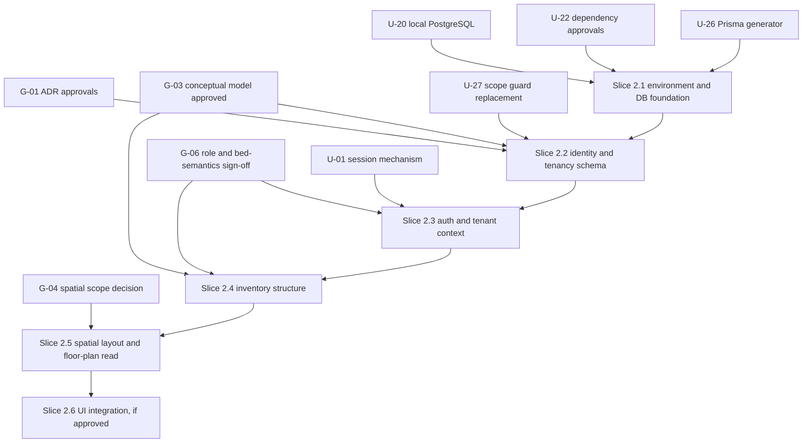

# Phase 2 — Unresolved Decisions and Gates

**Status:** Planning document. Nothing in it is approved. Prepared 2026-10-28.
**Companion documents:** [Implementation plan](PHASE_2_IMPLEMENTATION_PLAN.md) · [Data model](PHASE_2_DATA_MODEL.md) · [Tenant isolation](PHASE_2_TENANT_ISOLATION.md) · [API contract](PHASE_2_API_CONTRACT.md) · [Security review](PHASE_2_SECURITY_REVIEW.md)

> **Status update, 2026-10-29:** the owner approved or decided `U-23`, `ADR-001`, `ADR-003`, `ADR-011`, `U-20`, `U-22`, `G-02` and authorised `U-26`, as recorded in [PHASE_2_DECISION_LOG.md](PHASE_2_DECISION_LOG.md). The cards and text below are **preserved as written** and still show `PROPOSED` because they predate that decision; for those eight items **the decision log controls the status**. Approval is not verification: the verification each decision still needs is listed in the log.

This is the register every other Phase 2 document refers to. Gate identifiers (`G-xx`) and decision identifiers (`U-xx`) are defined **only here**. The other documents cite them and never restate or resolve them.

## How to read the status labels

| Label          | Meaning                                                                                         |
| -------------- | ----------------------------------------------------------------------------------------------- |
| **CONFIRMED**  | Already decided, in the repository or in an approved or accepted source. Cited with its source. |
| **PROPOSED**   | A recommendation in the Phase 2 plan, or in the requirements package, that nobody has approved. |
| **UNRESOLVED** | No decision exists. No default applies. Work that depends on it stays disabled or unstarted.    |
| **VALIDATE**   | A technical claim that must be shown by running something before anyone relies on it.           |

"Approved" means a row in `10_ARCHITECTURE_APPROVAL_REGISTER.md` §4 or a signed item in `11_OWNER_BUSINESS_RULES_SIGNOFF_CHECKLIST.md`, each in the requirements package. A recommendation in this plan is never an approval.

## Confirmed existing decisions

These are the facts the rest of the plan stands on. Each was checked against the repository or the source file on 2026-10-28.

| #    | Confirmed fact                                                                                                                                                                   | Source                                                              |
| ---- | -------------------------------------------------------------------------------------------------------------------------------------------------------------------------------- | ------------------------------------------------------------------- |
| K-1  | Phase 1 is accepted **for demonstration use**, with documented limitations. It has no backend integration.                                                                       | `docs/PHASE_1_VALIDATION.md`                                        |
| K-2  | Local history is `bf398d5` then `b2a9f0c`, both unpushed. `origin` is `github.com/AtharvaVavhal/Nook-platform.git` and `main` is ahead of it by 2.                               | `git log`, `git status -sb`                                         |
| K-3  | The toolchain is pinned: Node 24.22.1, npm 11.6.2, NestJS 12.3.2, Prisma 7.10.1, React 19.3.1, Vite 8.3.5.                                                                       | `package.json`, installed `node_modules`                            |
| K-4  | `prisma/schema.prisma` has **no models and no migrations exist**. Milestone 0 deliberately stopped there.                                                                        | `prisma/schema.prisma`, `docs/MILESTONE_0_SCOPE.md`                 |
| K-5  | A multi-tenant platform is the objective; the pilot is its first customer, not a single-tenant build. Organisation scoping is "not negotiable down to one-customer convenience". | Requirements package v0.2 `README.md`, ADR-007                      |
| K-6  | Money is integer paise (`BIGINT`, `amountMinor` string). Not used in Phase 2, which excludes financial work.                                                                     | ADR-008 (proposed); recorded here because Phase 2 must not break it |
| K-7  | An operation whose governing rule is unresolved returns `422 RULE_NOT_CONFIGURED`, names the rule, writes nothing, applies no default.                                           | `14_UNRESOLVED_ITEM_BLOCKER_CLASSIFICATION.md` §A, ADR-013          |
| K-8  | Permission checks test a **permission identifier**, never a role-name string. Deny by default.                                                                                   | `05_SECURITY_ARCHITECTURE.md` §4                                    |
| K-9  | `payment.record` ≠ `payment.confirm`, `resident.read` ≠ `document.read`, `finance.read` ≠ `data.export`. Not exercised in Phase 2 but must not be collapsed.                     | `05_SECURITY_ARCHITECTURE.md` §4.1                                  |
| K-10 | The Multer advisory is fixed in the installed tree. A fresh live `npm audit` on 2026-10-28 reported 0 vulnerabilities, and installed `multer` is 2.5.0.                          | `npm ls multer`, `npm audit`; details in the security review        |
| K-11 | Nothing in the Phase 2 scope may expose resident personal data or financial information.                                                                                         | Brief for this task; `14_…` §A                                      |

**Important:** "Confirmed" here does **not** include any ADR. Every ADR in the requirements package is still **PROPOSED**. See G-01.

## Gates — things that must be true before any Phase 2 schema, migration or backend code

A gate is not a preference. The requirements package says these precede implementation, and nothing has since changed their status.

| ID       | Gate                                                                                                                                                                                                                                    | Current state (2026-10-28)                                                                                                                                                              | Source                                                                                      |
| -------- | --------------------------------------------------------------------------------------------------------------------------------------------------------------------------------------------------------------------------------------- | --------------------------------------------------------------------------------------------------------------------------------------------------------------------------------------- | ------------------------------------------------------------------------------------------- |
| **G-01** | The architecture approval register (ADR-001 … ADR-017) is approved, amended or rejected, row by row, with a named owner and date. The package's roadmap requires **ADR-001 to ADR-011 approved** before its identity and tenancy phase. | **Not met.** Every row in §4 of the register is blank.                                                                                                                                  | `10_ARCHITECTURE_APPROVAL_REGISTER.md` §4; handbook Ch. 22 (roadmap)                        |
| **G-02** | Milestone 0 is accepted. Its exit evidence needs a verified PostgreSQL health path, a running API and CI green on a clean clone.                                                                                                        | **Not met.** `MILESTONE_0_SCOPE.md` says M0 "remains unaccepted". The Multer blocker is now cleared, but PostgreSQL runtime and hosted CI are still unverified (see U-20).              | `docs/MILESTONE_0_SCOPE.md`, `docs/MILESTONE_0_VALIDATION.md`, `docs/PHASE_1_VALIDATION.md` |
| **G-03** | The conceptual data model is approved (release gate RG-1) before it is promoted to a schema. This plan extends that model with `Floor` and spatial-layout entities that the package does not contain.                                   | **Not met.** `03_DOMAIN_AND_DATA_MODEL.md` is "Proposed conceptual model; not a finalized database schema".                                                                             | `03_…` §10; `07_30_DAY_DELIVERY_BACKLOG.md` PILOT-T02                                       |
| **G-04** | The scope question "is the 2D spatial map pilot scope?" is decided deliberately, not "by it simply appearing in a handbook".                                                                                                            | **Not met.** Recorded as Open and Critical. The spatial map is "new product direction" with "no review or approval".                                                                    | Handbook Ch. 7 and Ch. 24                                                                   |
| **G-05** | Each cross-document correction `C-01` … `C-17` is marked Accept, Amend or Reject.                                                                                                                                                       | **Not met.** The disposition table is blank. Several ADRs (for example the session design, `C-02`, and organisation context, `C-05`) were rewritten by corrections nobody has accepted. | `12_CROSS_DOCUMENT_CORRECTIONS.md` §14                                                      |
| **G-06** | Owner business-rule sign-off exists for every rule a Phase 2 feature encodes. For Phase 2 that is `BR-SEC-001 … 003` (roles) and, for bed semantics, `BR-LIF-002`, `BR-LIF-004`, `BR-LIF-006`.                                          | **Not met.** The checklist status is "Not started".                                                                                                                                     | `11_OWNER_BUSINESS_RULES_SIGNOFF_CHECKLIST.md`; `14_…` §A                                   |

**Consequence.** Planning is permitted and is what this task does. Writing the schema, creating a migration or implementing backend features is not, until G-01, G-03 and the parts of G-04 and G-06 that the chosen slice needs are recorded. The plan sequences work so that the earliest slice needs the fewest approvals.

A note on the term "Phase 2". In this repository's task history, **Phase 1** is the demonstration UI and **Phase 2** is this backend foundation. The requirements package uses `P0 … P6` and `M0` for different things. [The implementation plan](PHASE_2_IMPLEMENTATION_PLAN.md#how-this-phase-maps-to-the-requirements-package) gives the mapping so the two vocabularies are not confused.

## Unresolved decisions

Each decision names what it blocks. **Rec.** is a recommendation for the owner to accept or reject. Nothing proceeds on a recommendation alone.

### Authentication and sessions

| ID       | Decision                                                                                                                                                                                                    | Why it matters                                                                                                                                                  | Options                                                                                                                                                                                                                                      | Rec.                                                                                                                                                                          | Blocks                    |
| -------- | ----------------------------------------------------------------------------------------------------------------------------------------------------------------------------------------------------------- | --------------------------------------------------------------------------------------------------------------------------------------------------------------- | -------------------------------------------------------------------------------------------------------------------------------------------------------------------------------------------------------------------------------------------- | ----------------------------------------------------------------------------------------------------------------------------------------------------------------------------- | ------------------------- |
| **U-01** | **Session mechanism.** Your brief says "JWT authentication … planned". ADR-004 in the requirements package proposes **server-side opaque sessions, not long-lived JWTs in browser storage**. They conflict. | It decides the login endpoint, revocation, CSRF handling and the session table. Neither is approved. JWT does not provide tenant isolation under either choice. | **A.** Opaque server-side sessions in an `HttpOnly` cookie (ADR-004 as written). **B.** Short-lived JWT access token plus server-stored refresh and revocation state. B reintroduces server state, so most of A's machinery is still needed. | **A**, because it is the documented proposal and gives immediate revocation. If JWT is wanted for a reason not in the package (for example a separate mobile client), say so. | Slice 2.3                 |
| **U-02** | Session idle expiry, absolute expiry, cookie `SameSite` and name, CSRF strategy.                                                                                                                            | The package forbids inventing these or accepting a framework default.                                                                                           | Owner and security reviewer set numbers; tested.                                                                                                                                                                                             | None. A value is required before any shared environment. Local-only values must be labelled as such.                                                                          | Slice 2.3, any shared env |
| **U-03** | Password hashing algorithm and parameters; password policy.                                                                                                                                                 | Credentials are the first security asset the system holds.                                                                                                      | Argon2id (adds a native dependency); scrypt from `node:crypto` (no new dependency); bcrypt.                                                                                                                                                  | Decide at scaffold time per the package. Do not pick in code first.                                                                                                           | Slice 2.3                 |
| **U-04** | Login identifier (email, phone or username) and the account-recovery channel (`BR-SEC-006`).                                                                                                                | Shapes the `User` table, enumeration-safe responses and the recovery flow. The package says recovery stays blocked until the channel is approved.               | Email; mobile number (needs an OTP provider, not approved); owner-assisted reset with an audit event.                                                                                                                                        | Owner-assisted reset with an audit event until a channel exists. Recovery endpoint returns `RULE_NOT_CONFIGURED`.                                                             | Slice 2.3                 |
| **U-05** | Whether owner accounts require MFA, and for future platform operators.                                                                                                                                      | Affects the login flow shape and enrolment.                                                                                                                     | Required for owners; optional; deferred.                                                                                                                                                                                                     | Decide before any shared environment. Not needed to build the foundation.                                                                                                     | Shared environment        |
| **U-06** | Login and recovery rate-limit thresholds.                                                                                                                                                                   | Brute force and enumeration protection.                                                                                                                         | Per-IP, per-account, combined.                                                                                                                                                                                                               | Set numbers with the security reviewer. The throttling dependency itself is U-22.                                                                                             | Shared environment        |

### Tenancy, roles and organisations

| ID       | Decision                                                                                                                                                                                                                                                | Why it matters                                                                                                                                                                                                     | Options                                                                                                                               | Rec.                                                                                                                                                             | Blocks         |
| -------- | ------------------------------------------------------------------------------------------------------------------------------------------------------------------------------------------------------------------------------------------------------- | ------------------------------------------------------------------------------------------------------------------------------------------------------------------------------------------------------------------ | ------------------------------------------------------------------------------------------------------------------------------------- | ---------------------------------------------------------------------------------------------------------------------------------------------------------------- | -------------- |
| **U-07** | The role-to-permission baseline for Phase 2 permissions (`inventory.read/write`, `property.manage`, `member.manage`, `audit.read`, `settings.manage`); one role versus several per membership; whether property-scoped grants exist (`BR-SEC-001…003`). | The package matrix is "a proposed baseline, not an approved grant". Roles are `Owner/Partner`, `Property Manager`, `Finance Clerk/Cashier`, `Warden/Front Desk`. The pilot has one owner and 1–2 staff (`BR-011`). | Fixed bundles with one role per membership; allow several roles by explicit grant; add an additional grant table for "Scoped" access. | One role per membership plus an optional `MembershipPropertyGrant` for "Scoped" rows. Grants come from the owner-approved matrix, not from this plan.            | Slice 2.3, 2.4 |
| **U-08** | Whether to adopt PostgreSQL row-level security as defence in depth.                                                                                                                                                                                     | ADR-007 leaves it **OPEN**. It touches pool handling, transactions, migration roles and the bypass policy.                                                                                                         | Application scoping and composite FKs only; add RLS later; add RLS from the start.                                                    | Build application scoping and composite FKs first. Run a **time-boxed RLS spike** after approval and decide on evidence. Never treat a written policy as active. | Slice 2.2, 2.7 |
| **U-09** | How an organisation and its first owner are created. Platform administration is not built, and ADR-005 says accounts are owner-provisioned and invitation-only.                                                                                         | Somebody must create the first rows. The wrong mechanism is a standing backdoor.                                                                                                                                   | Controlled one-off provisioning script run by an operator, audited; a platform-admin API (deferred).                                  | Provisioning script with an audit event, gated behind the same environment guards as the seed. No self-service sign-up.                                          | Slice 2.2      |
| **U-10** | Organisation lifecycle states and what "suspended" means. The handbook lists suspension policy as Open.                                                                                                                                                 | Needed for `Organization.status`. The wrong semantics could lock a hostel out of its records.                                                                                                                      | Minimal `ACTIVE` / `DISABLED` meaning no new sessions and data retained; richer commercial states later.                              | Minimal two states. No commercial meaning is attached.                                                                                                           | Slice 2.2      |

### Inventory and spatial model

| ID       | Decision                                                                                                                                                                                                  | Why it matters                                                                                                                                                                                         | Options                                                                                                                  | Rec.                                                                                                                                | Blocks              |
| -------- | --------------------------------------------------------------------------------------------------------------------------------------------------------------------------------------------------------- | ------------------------------------------------------------------------------------------------------------------------------------------------------------------------------------------------------ | ------------------------------------------------------------------------------------------------------------------------ | ----------------------------------------------------------------------------------------------------------------------------------- | ------------------- |
| **U-11** | Include a **Building** level between Property and Floor? The package model has none. The handbook proposes it.                                                                                            | Adding it later is an additive nullable column plus a backfill, so this is low-regret either way.                                                                                                      | Omit now; add `Building` now.                                                                                            | **Omit** for now (no premature abstraction). Revisit when a property with two structures exists.                                    | Slice 2.4           |
| **U-12** | Do the spatial-layout tables (versioned `FloorLayout`, placements, zones) enter the Phase 2 schema, and is draft/publish authoring in scope? Depends on **G-04**.                                         | The plan separates identity from geometry, as the handbook does. Authoring needs an editor and publish rules that nobody approved.                                                                     | Identity tables only, geometry later; identity plus **read-only** published layout (seeded); full authoring.             | Identity plus a **read-only, seeded, single published layout version**. No authoring endpoints until G-04 is decided.               | Slice 2.5           |
| **U-13** | Bed status semantics. `BR-LIF-002/003/004` are **Unresolved**. Is the allocatable unit always a bed? Is an `OUT_OF_SERVICE` flag an approved stored concept, who sets it, and what happens to dependants? | Phase 1 shows `available`, `occupied`, `unavailable`. Only the third can be stored truthfully without residents and allocations. Inventing the other two would repeat what Phase 1 explicitly refused. | Store only `operationalStatus`; also store a manual occupancy flag (rejected here: it creates a second source of truth). | Store only `IN_SERVICE` / `OUT_OF_SERVICE` plus a reason. Return availability as **not computed**. Confirm the flag with the owner. | Slice 2.4, 2.5, 2.6 |
| **U-14** | Label uniqueness scope for rooms and beds (`BR-003`: "collect approved room/bed labels").                                                                                                                 | Drives unique indexes. A wrong scope rejects legitimate labels or allows duplicates.                                                                                                                   | Room label unique per property; or per floor. Bed label unique per room.                                                 | Room unique per property, bed unique per room, among non-archived rows. Confirm against the real property's labelling.              | Slice 2.4           |
| **U-15** | Archive versus delete for property, floor, room and bed, and what retention applies.                                                                                                                      | Once something is referenced by history, hard deletion destroys evidence.                                                                                                                              | Soft archive (`archivedAt`) with restrictive foreign keys; hard delete only for never-referenced rows.                   | Soft archive. No hard-delete endpoint.                                                                                              | Slice 2.4           |
| **U-16** | Identifier format.                                                                                                                                                                                        | IDs appear in URLs, logs and later in ledgers.                                                                                                                                                         | UUIDv4 via PostgreSQL `gen_random_uuid()`; UUIDv7 through Prisma (**VALIDATE** support in 7.10.1).                       | UUIDv4 from the database. Non-guessable, but see the isolation document: **IDs are never a security control**.                      | Slice 2.2           |
| **U-17** | Coordinate units and survey. Phase 1 uses unitless schematic coordinates ("not surveyed metres").                                                                                                         | A future 3D view needs physical scale, which nobody has measured.                                                                                                                                      | Keep schematic integers and add a `scale` record later; store metres now (needs a survey).                               | Schematic integer units with explicit documentation that they are not metres.                                                       | Slice 2.5           |
| **U-25** | The minimal set of `Property` fields (address lines, city, timezone, status).                                                                                                                             | Address data is personal-adjacent business data. The package says store only fields needed for operations.                                                                                             | Name and city only; add structured address.                                                                              | Name, code, address text, city, timezone (default `Asia/Kolkata`), status. Confirm with the owner.                                  | Slice 2.4           |

### Audit, API and platform

| ID       | Decision                                                                                                                      | Why it matters                                                                                                                       | Options                                                          | Rec.                                                                                                                                              | Blocks         |
| -------- | ----------------------------------------------------------------------------------------------------------------------------- | ------------------------------------------------------------------------------------------------------------------------------------ | ---------------------------------------------------------------- | ------------------------------------------------------------------------------------------------------------------------------------------------- | -------------- |
| **U-18** | Audit scope for inventory writes, audit retention, and the immutability mechanism. Whether CERT-In logging obligations apply. | The package lists security and money events explicitly. Routine inventory edits are not named. Retention and legal duty need advice. | Audit security events only; also all inventory writes.           | Audit all membership, session-context and inventory writes (volume is small). Retention and CERT-In applicability need professional confirmation. | Slice 2.2, 2.3 |
| **U-19** | Pagination defaults and maximum page size, rate limits, and how the API is versioned (`/api/v1`).                             | Package API decision #9 is open.                                                                                                     | Cursor pagination, 50 default and 100 maximum, as proposed here. | Accept as a starting contract and test the bounds.                                                                                                | Slice 2.4      |
| **U-24** | Whether Phase 2 wires the Phase 1 UI to the API, and how the UI shows "availability not computed".                            | Phase 1's `available` / `occupied` have no backend meaning. Wiring changes what the UI may honestly say.                             | Backend only; backend plus UI behind a data-source boundary.     | Backend first. UI wiring is its own slice with its own approval.                                                                                  | Slice 2.6      |

### Environment and dependencies

| ID       | Decision                                                                                                                                                                                                                                                                              | Why it matters                                                                                                                                            | Options                                                                                                                                                                                                                                              | Rec.                                                                                                                                                                                                                                                        | Blocks          |
| -------- | ------------------------------------------------------------------------------------------------------------------------------------------------------------------------------------------------------------------------------------------------------------------------------------- | --------------------------------------------------------------------------------------------------------------------------------------------------------- | ---------------------------------------------------------------------------------------------------------------------------------------------------------------------------------------------------------------------------------------------------- | ----------------------------------------------------------------------------------------------------------------------------------------------------------------------------------------------------------------------------------------------------------- | --------------- |
| **U-20** | Local PostgreSQL strategy. On this machine the Docker daemon is **not running**, and an **unrelated PostgreSQL 16 (Homebrew, PID 885) already listens on port 5432**. The project's `docker-compose.yml` pins `postgres:17-alpine` and publishes host port 5432, which would collide. | Phase 2 cannot claim a verified database runtime without one. Pointing the project at an unidentified existing server risks other data. Disk is at 99%.   | **A.** Start Docker, change the compose host port (for example 5433), use a dedicated throwaway volume. **B.** Create a dedicated database and role inside the existing PG 16 with the owner's explicit consent. **C.** Another disposable instance. | **A**, because it matches the pinned compose file and ADR-011's "same major version". It requires editing `docker-compose.yml` and `.env.example` (not done in this planning task) and checking disk first. Never touch the existing PG 16 without consent. | Slice 2.1       |
| **U-21** | Hosting provider, region, deployed PostgreSQL major version, backup retention, RPO and RTO (`ADR-010`, `BR-OPS-005`).                                                                                                                                                                 | Phase 2 pins a local PostgreSQL major. ADR-011 says use the same major as deployed, which is unknown.                                                     | Choose a managed PostgreSQL provider and major.                                                                                                                                                                                                      | Out of Phase 2 scope to decide. Pin 17 locally as the compose file does and record the assumption.                                                                                                                                                          | Production only |
| **U-22** | Approval for each new dependency Phase 2 would need: `@prisma/adapter-pg`, a request-validation library, rate limiting, cookie and CSRF handling, `@nestjs/testing` and an HTTP test client, a password-hashing library if U-03 chooses one.                                          | The brief says avoid unnecessary dependencies. Prisma 7 needs a driver adapter (**VALIDATE**). The registry is reachable and the lockfile is npm-managed. | Approve per package, or implement a small piece in-repo where that is honest and safe (never for crypto).                                                                                                                                            | Approve a short, named list at the start of Slice 2.1. Verify each version and run the audit again after installation.                                                                                                                                      | Slice 2.1       |
| **U-26** | Prisma generator and client configuration. `schema.prisma` uses `provider = "prisma-client-js"`. The installed Prisma 7.10.1 CLI's own templates use `prisma-client`. No client has been generated in this checkout.                                                                  | A wrong generator choice is discovered late and breaks imports across the API.                                                                            | Keep `prisma-client-js`; switch to `prisma-client` with an explicit `output`.                                                                                                                                                                        | Decide after a **disposable spike** generates a client and the API imports it under `tsx` and `tsc`. This is a validation item first and a decision second.                                                                                                 | Slice 2.1       |

### Process and provenance

| ID       | Decision                                                                                                                                                                                                                                                                                                                                                                                                                                                                                         | Why it matters                                                                                                                                                                                                                    | Options                                                                                                                                                                                                                                                                               | Rec.                                                                                                                     | Blocks    |
| -------- | ------------------------------------------------------------------------------------------------------------------------------------------------------------------------------------------------------------------------------------------------------------------------------------------------------------------------------------------------------------------------------------------------------------------------------------------------------------------------------------------------ | --------------------------------------------------------------------------------------------------------------------------------------------------------------------------------------------------------------------------------- | ------------------------------------------------------------------------------------------------------------------------------------------------------------------------------------------------------------------------------------------------------------------------------------- | ------------------------------------------------------------------------------------------------------------------------ | --------- |
| **U-23** | **Which copy of the requirements package is canonical, and which product name.** There are at least three copies. `~/Downloads/NIVASA_PACKAGE_v0.2/` (2026-10-27, 16 files) is the one the handbook cites. `~/Documents/Nook/` holds smaller, **different** earlier copies of documents 01–12 (2026-10-26). Loose copies of documents 01–14 also sit in `~/Downloads/`. The package says **Nivasa**; the product is **Nook**; the handbook lists a trademark and naming conflict as **Blocked**. | This plan treats `NIVASA_PACKAGE_v0.2` as authoritative because the handbook cites it and it is the newest. If a different copy is the approved one, parts of this plan are wrong.                                                | Confirm v0.2; or name the correct copy.                                                                                                                                                                                                                                               | Confirm v0.2 as canonical and record the name question separately from engineering.                                      | G-01      |
| **U-27** | **How the Milestone 0 scope guard is handled when Phase 2 lands.** `scripts/verify_m0_scope.py` (run as `npm run verify:m0-scope` locally and in `.github/workflows/ci.yml`) fails if `prisma/schema.prisma` contains **any** `model` or if **any** `migration.sql` exists. Phase 2's first schema slice will therefore fail the guard **by design**.                                                                                                                                            | The guard is what currently stops resident, finance and booking models from appearing without approval. Deleting or loosening it silently would remove that protection. Earlier work was told not to weaken verification scripts. | **A.** Replace it, in the same approved change as the first model, with a **Phase 2 scope guard** that allow-lists exactly the approved tables and still fails on any resident, stay, booking, payment, charge or deposit model. **B.** Edit the M0 guard in place. **C.** Remove it. | **A.** The new guard must be reviewed before the first migration and must itself be tested to fail on a forbidden model. | Slice 2.2 |

## Dependency of decisions on gates

The slices are defined in [the implementation plan](PHASE_2_IMPLEMENTATION_PLAN.md).

## Validation still required

These are claims in this register that have not been demonstrated:

1. **U-26.** That Prisma 7.10.1 supports the generator and output the project will use, and that the generated client imports cleanly under `tsx` and `tsc` in this monorepo.
2. **U-22.** That `@prisma/adapter-pg@7.10.1` is the correct driver adapter. The registry lists it with a `pg ^8.16.3` dependency, which matches the installed `pg 8.16.3`, but it has not been installed or exercised.
3. **U-16.** Whether Prisma 7.10.1 supports a UUIDv7 default.
4. **U-20.** That the pinned `postgres:17-alpine` image starts on this machine after Docker is running, and that the disk can hold the image and volume.
5. **U-23.** That `NIVASA_PACKAGE_v0.2` is the version the owner reviewed.
6. Every business-rule dependency (`BR-SEC-*`, `BR-LIF-*`, `BR-003`) is currently **unsigned**. Nothing in Phase 2 may treat them as answered.

## Revision history

| Version | Date       | Change                                                                   |
| ------- | ---------- | ------------------------------------------------------------------------ |
| 0.1     | 2026-10-28 | Initial register for the Phase 2 planning task. No decision is resolved. |
