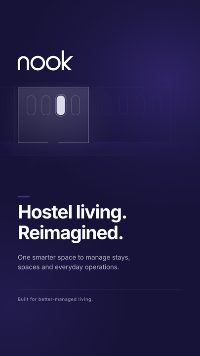

# Nook — Instagram Story, brand introduction

An art-directed 9:16 story introducing Nook as a brand. Two versions of one piece — **v2 is the
current recommendation**; v1 is kept unchanged for comparison.

|        | v1                                              | v2 (current)                                          |
| ------ | ----------------------------------------------- | ----------------------------------------------------- |
| Motif  | Abstract arcade, one bay lit                    | **Floor-plan fragment, one unit allocated**           |
| Files  | `nook-instagram-story.{png,svg}`, `preview.png` | `nook-instagram-story-v2.{png,svg}`, `preview-v2.png` |
| Build  | `make_story.py` + `render.cjs`                  | `make_story_v2.py` + `render_v2.cjs`                  |
| Checks | 11/11                                           | 11/11                                                 |



Everything below — the publication block, palette, asset handling, typography and copy discipline —
applies to both. The motif is the only thing that differs.

---

## ⚠️ Do not publish this yet

The approved brand guidelines open with this, and it has not changed:

> **Status:** working brand name. Trademark clearance, domain availability and legal ownership are
> **unverified**. Public brand launch and domain commitment are **blocked** pending review of the
> Nook / Nooks competitive conflict.

Posting this story _is_ a public brand launch. The artwork is ready; **clearance is not**. Treat
this as approved-to-review, not approved-to-post. The blocker is tracked in the handbook's decision
register as `BLOCKED — Trademark clearance and naming conflict → Legal review`.

## The launch announcement

Built from v2 with nothing redesigned. The wordmark, palette, headline, supporting copy, margins and
safe areas carry over verbatim. The plan band is compressed from 432 px to 374 px and the whole text
column shifts down, which opens space for the launch block without crowding anything.

The block is a hairline rule, a letterspaced `LAUNCHING` kicker, the date at 64 px in white, and
`Save the date.` — the second-strongest element on the canvas after the headline, and the last thing
read.

**The date is set in title case** (`4 November 2026`) rather than the all-caps form in the request.
Two caps lines stacked read as shouting; a caps kicker above a title-case date is the quieter,
more confident pattern. If you want it in caps, change the one string in `make_story_launch.py` and
re-run — no other change is needed.

### The Forge endorsement

Nook is a Forge product, so the launch story carries a Forge lockup at its foot: `A PRODUCT OF`
followed by the horizontal lockup at 40 px, set on the optical centre of the type beside it.

|           |                                                                                     |
| --------- | ----------------------------------------------------------------------------------- |
| Asset     | `FORGE-horizontal-white-on-ink.svg`, kept in `marketing/brand/forge/`               |
| Treatment | Both path groups copied **verbatim**; only that file's own background plate removed |
| Colour    | `#FFFFFF` — Forge's own approved reversed fill                                      |

**Forge's ink `#17140F` and paper `#F3EFE7` are deliberately absent.** Neither is in Nook's approved
five, and introducing a sixth and seventh brand colour to a Nook-led canvas would break the palette
discipline every other check here enforces. White is the one colour both brands already approve, and
Forge ships a white-on-ink master precisely for dark grounds. A check asserts that neither Forge ink
nor Forge paper appears anywhere in the file.

The endorsement sits roughly 1,300 px below the nook wordmark and is never combined with it, so it
does not become a descriptor inside the primary lockup (nook guideline §7.8). A check asserts the
separation.

**Limitation:** no Forge brand guidelines were supplied — only the SVG assets. Clear space, minimum
size and endorsement-lockup rules for Forge could not be verified. The lockup is placed at 40 px
with generous surrounding space and the wordmark's caps resolve cleanly at that size, but **if Forge
has a written minimum size or clear-space rule, this placement has not been checked against it.**

### What this story does and does not say

It announces a **planned launch date** and states Nook's parent brand. It carries no availability wording, no purchase or sign-up
prompt, no link, no metric, no testimonial and no partnership. Three checks in `qa.py` enforce this:
one scans for banned claim language, one asserts that any date on the canvas is exactly the approved
one, and one asserts that no availability or purchase wording accompanies the date.

4 November 2026 is a **Wednesday, seven days after this artwork was produced**. The artwork makes no
claim about readiness; see the publication block above, which has not changed.

## Concept — v2, the floor plan

**One room, drawn in plan, with a single unit allocated.**

A cropped fragment of a top-down floor plan: rooms off a corridor, each with its allocatable units
drawn against the far wall, doorways broken into the corridor-facing walls. One room is the subject
— brighter, filled, its left wall set exactly on the text column so the plan, the wordmark and the
headline all begin on the same line. One unit inside it is filled and ringed: allocated.

This is the product, not a metaphor for it. Bed-level allocation on a 2D plan is module 5 of the
handbook and the thing that distinguishes Nook from a spreadsheet. The rest of the plan recedes to
16–22% and runs off the right edge, so it reads as a fragment of a real building rather than a
complete diagram.

Hierarchy: **brand → the allocated unit → headline → supporting message → signature.**

### On guideline §7.9

§7.9 forbids "a house, bed, roof, key or location-pin **icon** alongside or instead of the
monogram". This motif is an architectural plan drawing, not a pictogram: it is orthographic, it is a
cropped fragment, it sits in its own band far from the wordmark, and it never stands in for the
mark. The units are plan-view capsules — no headboard, no pillow, no side-view silhouette.

That is a reading, not a ruling. **If brand review disagrees, v1 ships instead** — it is complete,
passing and uses no spatial motif at all. Flag it rather than let it through on assumption.

## Concept — v1, the arcade

**An arcade, and one lit bay.**

A _nook_ is a small, defined, comfortable space — the one you can call yours. The composition is a
quiet colonnade receding across the frame, with a single bay lit from within. It says _your space,
in a well-run building_ without a single cartoon house, bed, roof or location pin — all four of
which §7.9 of the guidelines explicitly forbids near the mark.

The arcade is independent geometry in the brand's monoline language. It is **not** derived from the
logo, never substitutes for it, and is masked so it dissolves at its foot rather than being cut off.
Nearly two-thirds of the canvas is empty on purpose: the restraint is what reads as premium.

Hierarchy: **brand → focal point → headline → supporting message → signature.**

## Copy

| Role       | Text                                                               |
| ---------- | ------------------------------------------------------------------ |
| Brand      | `nook` (the wordmark itself)                                       |
| Headline   | Hostel living. Reimagined.                                         |
| Supporting | One smarter space to manage stays, spaces and everyday operations. |
| Footer     | Built for better-managed living.                                   |

Nothing claims availability. There is no call to action, no download prompt, no launch date, no user
count, no rating, no testimonial and no property partnership — the product is a Milestone 0 scaffold
with no shipped functionality, and the copy is positioning, not a product claim. A check in `qa.py`
enforces this by scanning the rendered text.

## Palette

Only the five approved colours; four of them appear.

| Colour          | Hex       | Use here                                                      |
| --------------- | --------- | ------------------------------------------------------------- |
| Midnight Indigo | `#171338` | The full-bleed field                                          |
| Nook Violet     | `#7657F6` | Arcade strokes, the ambient glow, the rule above the headline |
| Soft Lavender   | `#F4F1FF` | The lit bay, supporting copy, footer, hairline                |
| Pure White      | `#FFFFFF` | Wordmark and headline                                         |
| Primary Text    | `#26233D` | Not used — it is a light-background body colour               |

No colour outside the palette is declared anywhere in the SVG.

## Brand assets used

| Asset                     | Source                                      | Treatment                                                                                                                                                                           |
| ------------------------- | ------------------------------------------- | ----------------------------------------------------------------------------------------------------------------------------------------------------------------------------------- |
| `svg/nook-logo-white.svg` | The approved master, SHA-256 `f8dbc18b1d1e` | Geometry copied **verbatim**, uniformly scaled to 300 × 108 px. Not redrawn, retyped, recoloured, re-tracked, rotated or distorted. No stroke, gradient, shadow or glow touches it. |

Placed per §5 (white wordmark on Midnight Indigo, 17.70:1) with §3 clear space of 2 × stroke weight
(23 px at this scale) verified clear on all four sides.

### One deliberate deviation from the suggested approach

The first build used `nook-logo-white-period.svg` — the `nook.` variant, which §6 approves for
campaign artwork and social posts. **It was measured and rejected.** The violet period reads
**3.76:1** on Midnight Indigo, below the 4.5:1 floor §7.4 sets, and violet-on-indigo is not a
pairing the §2 contrast table approves at all. The plain white master is 17.70:1.

If you want the period back for social, the fix belongs in the guidelines, not in this file: either
approve violet-on-indigo explicitly with a measured ratio, or specify the period variant for light
and violet grounds only.

## Typography

**Inter** — 700 for the headline (100 px, −3.5 tracking), 400 for supporting copy (35 px), 500 for
the footer (24 px, +1.6 tracking).

Inter is **not an approved brand typeface.** §8 lists the marketing and product typeface as _not yet
selected_; the logo carries no font dependency, so the choice is still open. Inter was used because
it is monoline, geometric-humanist and sits naturally beside the mark — but it is a placeholder, and
this story should be re-exported once a typeface is chosen.

The `.svg` references Inter by name rather than embedding it, so it stays editable. Open it with
Inter installed, or the renderer will substitute.

## Export

| File                              | Format         | Dimensions  |
| --------------------------------- | -------------- | ----------- |
| `nook-instagram-launch-nov-4.png` | PNG, sRGB      | 1080 × 1920 |
| `nook-instagram-launch-nov-4.svg` | SVG, live text | 1080 × 1920 |
| `preview-launch.png`              | PNG            | 405 × 720   |
| `nook-instagram-story-v2.png`     | PNG, sRGB      | 1080 × 1920 |
| `nook-instagram-story-v2.svg`     | SVG, live text | 1080 × 1920 |
| `preview-v2.png`                  | PNG            | 405 × 720   |
| `nook-instagram-story.png`        | PNG, sRGB      | 1080 × 1920 |
| `nook-instagram-story.svg`        | SVG, live text | 1080 × 1920 |
| `preview.png`                     | PNG            | 405 × 720   |

Layout: 96 px side margins; 250 px top and bottom reserved for Instagram's interface. All content
sits between y 272 and y 1626.

## Regenerating

```bash
# launch announcement (current)
python3 make_story_launch.py
node render_launch.cjs
python3 qa.py nook-instagram-launch-nov-4

# v2
python3 make_story_v2.py
node render_v2.cjs
python3 qa.py nook-instagram-story-v2

# v1 (kept for comparison)
python3 make_story.py
node render.cjs
python3 qa.py
```

Both renderers write an exact 1080 × 1920 PNG through Chromium, with Inter pulled from Google Fonts.

`make_story.py` aborts rather than guessing if the wordmark master cannot be read or does not
extract as the expected four elements.

## Quality checks

`qa.py` takes the file stem as an argument and runs against either version. **Both pass 11/11.** It verifies exact dimensions; that no content enters either safe area;
side margins; that logo clear space is unbroken; that the wordmark geometry in the SVG is byte-for-byte
the approved master; that the mark is uniformly scaled with no rotation, stroke, gradient or filter;
that only palette colours are declared; WCAG contrast for all three text levels; and that the copy
contains no availability claim, metric or testimonial.

### Defects the checks and the visual inspection caught

In the launch build, the first render put the plan band 72 px below the wordmark and left 320 px
dead at the foot — crowded at the top, empty at the bottom. The band and the whole text column were
moved down; clearance under the wordmark is now 106 px and the last line sits 48 px above the bottom
safe area.

In v2's motif, three drafts were rejected by looking at the rendered PNG:

1. **Draft 1** — 38 units across 12 rooms read as repetitive dotted texture, not a plan. The
   vertical fade was also eating the rooms' outer walls, so rooms looked like open-ended columns.
2. **Draft 2** — fewer, larger rooms, but the door-swing arcs were landing across neighbouring
   walls and reading as drawing errors. Swings removed; door gaps kept.
3. **Draft 3** — legible at last, but the motif was centred while every text element was left-aligned
   at 96 px. The subject room's left wall was moved onto the text column.

In v1:

1. The element regex matched only `<path>`, so the violet period — a `<circle>` — was silently
   dropped, producing a mark that was not the asset it claimed to be. (Moot after the switch to the
   plain white master, but the extractor now asserts its element count.)
2. Footer text at 45% lavender measured **4.11:1**, below the 4.5:1 requirement. Raised to 56%,
   now **5.68:1**.

## Scope

Nothing outside this directory was touched. No application code, schema, migration or dependency was
modified, and Phase 1 development is unaffected.
